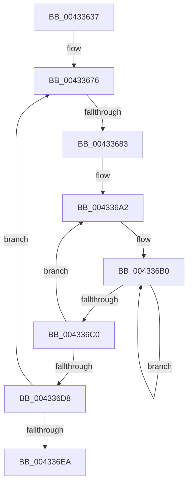

# sub_00433637

- RVA: `0x00433637`–`0x00433711` (길이 `218` bytes)
- VA: `0x0000000140433637`
- 실행 섹션: `.text`
- PDB 이름 있음: `아니요`; PDB Function 태그: `아니요`
- unwind 정보 RVA: `0x000A2570`
- 디코드: `53`개 명령, `218/218` bytes 표시
- 미해석 바이트: `0` (있으면 어셈블리에 `.byte`로 보존)

> 이 문서는 커널 이미지의 기계어와 PDB 기호를 분석해 생성했습니다. 4번과 5번은 함수 원형과 자료형을 바이너리 사용 방식에서 추정한 C 해석이며 원본 소스 복구 결과는 아닙니다.

## 1. Dependencies

- 직접 호출 지점: **0**; 고유 호출 대상: **0**
- 직접 호출자로 확인된 함수: **0**
- RIP 상대 이미지 참조: **2**

### Outgoing calls
- 직접 디코드된 call 명령이 없습니다.

### Direct callers
- 이 함수 시작 RVA로 연결되는 직접 call은 확인되지 않았습니다. 간접 호출은 완전히 역산할 수 없습니다.

### Static image references
- `0x00433676` → RVA `0x00FC5002` (`ALMOSTRO`; read)
- `0x00433692` → RVA `0x00011C60` (`.rdata`; read)

## 2. Other-region calls and transfers

- 다른 실행 섹션으로 향하는 call: **0**
- call이 아닌 외부 분기/꼬리 이동: **1**
  - `0x0043367D` → [sub_00433722](Unknown_function_00433722.md) (`tail-transfer`)

## 3. Assembly (complete function range)

```asm
00433637  48 89 5C 24 38                  mov qword ptr [rsp + 0x38], rbx
0043363C  48 89 6C 24 40                  mov qword ptr [rsp + 0x40], rbp
00433641  48 89 74 24 48                  mov qword ptr [rsp + 0x48], rsi
00433646  33 F6                           xor esi, esi
00433648  45 85 C0                        test r8d, r8d
0043364B  48 89 7C 24 10                  mov qword ptr [rsp + 0x10], rdi
00433650  8B C6                           mov eax, esi
00433652  4C 89 64 24 08                  mov qword ptr [rsp + 8], r12
00433657  0F 95 C0                        setne al
0043365A  4C 89 3C 24                     mov qword ptr [rsp], r15
0043365E  41 83 E5 01                     and r13d, 1
00433662  48 89 44 24 30                  mov qword ptr [rsp + 0x30], rax
00433667  4D 8D BE A0 03 00 00            lea r15, [r14 + 0x3a0]
0043366E  8B CE                           mov ecx, esi
00433670  8B EE                           mov ebp, esi
00433672  4F 8D 3C EF                     lea r15, [r15 + r13*8]
00433676  80 3D 85 19 B9 00 01            cmp byte ptr [rip + 0xb91985], 1
0043367D  0F 87 9F 00 00 00               ja 0x140433722
00433683  49 8B 94 EE 08 0F 00 00         mov rdx, qword ptr [r14 + rbp*8 + 0xf08]
0043368B  4C 8D 24 11                     lea r12, [rcx + rdx]
0043368F  4C 8B D6                        mov r10, rsi
00433692  48 8D 15 C7 E5 BD FF            lea rdx, [rip - 0x421a39]
00433699  4D 8B C7                        mov r8, r15
0043369C  41 BB 03 00 00 00               mov r11d, 3
004336A2  48 8B 02                        mov rax, qword ptr [rdx]
004336A5  4C 8B CE                        mov r9, rsi
004336A8  49 8B D8                        mov rbx, r8
004336AB  BF 02 00 00 00                  mov edi, 2
004336B0  48 8B 0B                        mov rcx, qword ptr [rbx]
004336B3  48 8D 5B 20                     lea rbx, [rbx + 0x20]
004336B7  4C 03 C9                        add r9, rcx
004336BA  48 83 EF 01                     sub rdi, 1
004336BE  75 F0                           jne 0x1404336b0
004336C0  49 0F AF C1                     imul rax, r9
004336C4  48 83 C2 08                     add rdx, 8
004336C8  49 81 C0 00 05 00 00            add r8, 0x500
004336CF  4C 03 D0                        add r10, rax
004336D2  49 83 EB 01                     sub r11, 1
004336D6  75 CA                           jne 0x1404336a2
004336D8  48 FF C5                        inc rbp
004336DB  4B 8D 0C 14                     lea rcx, [r12 + r10]
004336DF  49 83 C7 10                     add r15, 0x10
004336E3  48 3B 6C 24 30                  cmp rbp, qword ptr [rsp + 0x30]
004336E8  7E 8C                           jle 0x140433676
004336EA  4C 8B 3C 24                     mov r15, qword ptr [rsp]
004336EE  48 83 F9 40                     cmp rcx, 0x40
004336F2  4C 8B 64 24 08                  mov r12, qword ptr [rsp + 8]
004336F7  48 8B 7C 24 10                  mov rdi, qword ptr [rsp + 0x10]
004336FC  40 0F 96 C6                     setbe sil
00433700  48 8B 6C 24 40                  mov rbp, qword ptr [rsp + 0x40]
00433705  8B C6                           mov eax, esi
00433707  48 8B 74 24 48                  mov rsi, qword ptr [rsp + 0x48]
0043370C  48 8B 5C 24 38                  mov rbx, qword ptr [rsp + 0x38]
```

## 4. C-style interpretation (structured pseudocode)

```c
__int64 __fastcall sub_00433637(__int64 a1, __int64 a2, int a3, __int64 a4, __int64 a5, __int64 a6, __int64 a7, __int64 a8, __int64 a9)
{
    __int64 result;
    __int64 v_r10;
    __int64 v_r11;
    __int64 v_r13;
    __int64 v_r15;
    __int64 v_rbp;
    __int64 v_rdi;
    __int64 v_rsi;
    unsigned __int64 v_stack_p0;
    unsigned __int64 v_stack_p10;
    unsigned __int64 v_stack_p30;
    unsigned __int64 v_stack_p38;
    unsigned __int64 v_stack_p40;
    unsigned __int64 v_stack_p48;
    unsigned __int64 v_stack_p8;

    v_stack_p38 = v_rbx;
    v_stack_p40 = v_rbp;
    v_stack_p48 = v_rsi;
    v_rsi = 0;
    v_stack_p10 = v_rdi;
    v_stack_p8 = v_r12;
    result = (a3 != 0) ? 1 : 0;
    v_stack_p0 = v_r15;
    v_r13 = (unsigned int)((v_r13) & (1));
    v_stack_p30 = result;
loc_00433676:
loc_004336A2:
loc_004336B0:
    a4 = (0) + (*(unsigned __int64 *)(v_r14 + 928 + v_r13 * 8));
    v_rdi = (2) - (1);
    if (condition_is_not_equal) goto loc_004336B0;
    result = (*(unsigned __int64 *)(v_rip - 4332089)) * (a4);
    a2 = (v_rip - 4332089) + (8);
    a3 = (v_r14 + 928 + v_r13 * 8) + (0x500ULL);
    v_r10 = (0) + (result);
    v_r11 = (3) - (1);
    if (condition_is_not_equal) goto loc_004336A2;
    v_rbp = (0) + 1;
    v_r15 = (v_r14 + 928 + v_r13 * 8) + (16);
    if (v_rbp <= a6) goto loc_00433676;
    v_rsi = ((0 + *(unsigned __int64 *)(v_r14 + 0 * 8 + 3848) * 1 + v_r10 * 1) <= 64) ? 1 : 0;
    return (unsigned int)((unsigned int)(v_rsi));
}
```

## 5. (Beta) C Style

```c
int64_t sub_00433637(int64_t Arg1, int64_t Arg2, int32_t Arg3, int64_t Arg4, uint64_t Arg5, int64_t Arg6, int64_t Arg7, int64_t Arg8, int64_t Arg9)
{
    int64_t result;
    int64_t local_r10;
    int64_t local_r11;
    int64_t local_r13;
    int64_t local_r15;
    int64_t local_rbp;
    int64_t local_rdi;
    int64_t local_rsi;
    uint64_t v_stack_p0;
    uint64_t v_stack_p10;
    uint64_t v_stack_p30;
    uint64_t v_stack_p38;
    uint64_t v_stack_p40;
    uint64_t v_stack_p48;
    uint64_t v_stack_p8;

    v_stack_p38 = local_rbx;
    v_stack_p40 = local_rbp;
    v_stack_p48 = local_rsi;
    local_rsi = 0;
    v_stack_p10 = local_rdi;
    v_stack_p8 = local_r12;
    result = (Arg3 != 0) ? 1 : 0;
    v_stack_p0 = local_r15;
    local_r13 = (uint32_t)((local_r13) & (1));
    v_stack_p30 = result;
loc_00433676:
loc_004336A2:
loc_004336B0:
    Arg4 = (0) + (*(uint64_t *)(local_r14 + 0x3A0 + local_r13 * 8));
    local_rdi = (2) - (1);
    if (condition_is_not_equal) goto loc_004336B0;
    result = (*(uint64_t *)(v_rip - 0x421A39)) * (Arg4);
    Arg2 = (v_rip - 4332089) + (8);
    Arg3 = (local_r14 + 928 + local_r13 * 8) + (0x500ULL);
    local_r10 = (0) + (result);
    local_r11 = (3) - (1);
    if (condition_is_not_equal) goto loc_004336A2;
    local_rbp = (0) + 1;
    local_r15 = (local_r14 + 928 + local_r13 * 8) + (16);
    if (local_rbp <= Arg6) goto loc_00433676;
    local_rsi = ((0 + *(uint64_t *)(local_r14 + 0x0 * 8 + 0xF08) * 1 + local_r10 * 1) <= 64) ? 1 : 0;
    return (uint32_t)((uint32_t)(local_rsi));
}
```

## 6. Execution-region graph

[열기: 2D/3D 그래프와 함수 탐색 컨트롤 패널](../../../control-panel.html?section=text&rva=0x00433637&view=graph)

- 2D 그래프는 위에서 아래로 흐르고, 3D 그래프는 빈 공간을 드래그해 회전합니다. Shift+드래그는 이동, 휠은 확대·축소, 함수 노드 선택은 대상 보고서 이동입니다.

### Static fallback


