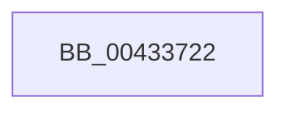

# sub_00433722

- RVA: `0x00433722`–`0x0043373A` (길이 `24` bytes)
- VA: `0x0000000140433722`
- 실행 섹션: `.text`
- PDB 이름 있음: `아니요`; PDB Function 태그: `아니요`
- unwind 정보 RVA: `0x000A25AC`
- 디코드: `4`개 명령, `24/24` bytes 표시
- 미해석 바이트: `0` (있으면 어셈블리에 `.byte`로 보존)

> 이 문서는 커널 이미지의 기계어와 PDB 기호를 분석해 생성했습니다. 4번과 5번은 함수 원형과 자료형을 바이너리 사용 방식에서 추정한 C 해석이며 원본 소스 복구 결과는 아닙니다.

## 1. Dependencies

- 직접 호출 지점: **0**; 고유 호출 대상: **0**
- 직접 호출자로 확인된 함수: **0**
- RIP 상대 이미지 참조: **0**

### Outgoing calls
- 직접 디코드된 call 명령이 없습니다.

### Direct callers
- 이 함수 시작 RVA로 연결되는 직접 call은 확인되지 않았습니다. 간접 호출은 완전히 역산할 수 없습니다.

### Static image references
- 디코드된 RIP-relative 메모리 참조가 없습니다.

## 2. Other-region calls and transfers

- 다른 실행 섹션으로 향하는 call: **0**
- call이 아닌 외부 분기/꼬리 이동: **1**
  - `0x00433735` → [sub_00433637 + 0x54](Unknown_function_00433637.md) (`tail-transfer`)

## 3. Assembly (complete function range)

```asm
00433722  4A 8D 04 6D 00 00 00 00         lea rax, [r13*2]
0043372A  48 03 C5                        add rax, rbp
0043372D  49 8B 94 C6 30 3B 00 00         mov rdx, qword ptr [r14 + rax*8 + 0x3b30]
00433735  E9 51 FF FF FF                  jmp 0x14043368b
```

## 4. C-style interpretation (structured pseudocode)

```c
__int64 __fastcall sub_00433722(void)
{
    __int64 result;

    result = (v_r13 * 2) + (v_rbp);
}
```

## 5. (Beta) C Style

```c
void sub_00433722(void)
{
    int64_t result;

    result = (local_r13 * 2) + (local_rbp);
}
```

## 6. Execution-region graph

[열기: 2D/3D 그래프와 함수 탐색 컨트롤 패널](../../../control-panel.html?section=text&rva=0x00433722&view=graph)

- 2D 그래프는 위에서 아래로 흐르고, 3D 그래프는 빈 공간을 드래그해 회전합니다. Shift+드래그는 이동, 휠은 확대·축소, 함수 노드 선택은 대상 보고서 이동입니다.

### Static fallback


