# sub_00433766

- RVA: `0x00433766`–`0x004338BE` (길이 `344` bytes)
- VA: `0x0000000140433766`
- 실행 섹션: `.text`
- PDB 이름 있음: `아니요`; PDB Function 태그: `아니요`
- unwind 정보 RVA: `0x000A25F8`
- 디코드: `79`개 명령, `344/344` bytes 표시
- 미해석 바이트: `0` (있으면 어셈블리에 `.byte`로 보존)

> 이 문서는 커널 이미지의 기계어와 PDB 기호를 분석해 생성했습니다. 4번과 5번은 함수 원형과 자료형을 바이너리 사용 방식에서 추정한 C 해석이며 원본 소스 복구 결과는 아닙니다.

## 1. Dependencies

- 직접 호출 지점: **4**; 고유 호출 대상: **3**
- 직접 호출자로 확인된 함수: **0**
- RIP 상대 이미지 참조: **4**

### Outgoing calls
- `0x004337B4` → [ExAllocatePool2](../../poolcode/B8/ExAllocatePool2_function_00B820F0.md) (function, `0x00B820F0`)
- `0x004337E6` → [ExAllocatePool2](../../poolcode/B8/ExAllocatePool2_function_00B820F0.md) (function, `0x00B820F0`)
- `0x0043382D` → [KiAcquireSpinLockInstrumented](../20/KiAcquireSpinLockInstrumented_function_002084F0.md) (function, `0x002084F0`)
- `0x00433884` → [KiLowerIrqlProcessIrqlFlags](../4F/KiLowerIrqlProcessIrqlFlags_function_004F5698.md) (function, `0x004F5698`)

### Direct callers
- 이 함수 시작 RVA로 연결되는 직접 call은 확인되지 않았습니다. 간접 호출은 완전히 역산할 수 없습니다.

### Static image references
- `0x0043378E` → RVA `0x00014730` (`.rdata`; read)
- `0x00433802` → RVA `0x00FC6D20` (`ALMOSTRO`; read)
- `0x0043380F` → RVA `0x00FC6B06` (`ALMOSTRO`; read)
- `0x0043381C` → RVA `0x00F0DE58` (`.data`; read)

## 2. Other-region calls and transfers

- 다른 실행 섹션으로 향하는 call: **2**
  - `0x004337B4` → [ExAllocatePool2](../../poolcode/B8/ExAllocatePool2_function_00B820F0.md) (`.text` → `POOLCODE`)
  - `0x004337E6` → [ExAllocatePool2](../../poolcode/B8/ExAllocatePool2_function_00B820F0.md) (`.text` → `POOLCODE`)
- call이 아닌 외부 분기/꼬리 이동: **14**
  - `0x00433778` → [sub_004338BF + 0x2A](Unknown_function_004338BF.md) (`tail-transfer`)
  - `0x00433788` → [sub_004338BF + 0x51](Unknown_function_004338BF.md) (`tail-transfer`)
  - `0x00433798` → [sub_004338BF + 0xB1](Unknown_function_004338BF.md) (`tail-transfer`)
  - `0x004337BF` → [sub_004338BF + 0xB1](Unknown_function_004338BF.md) (`tail-transfer`)
  - `0x004337CD` → [sub_004339AF + 0x72](Unknown_function_004339AF.md) (`tail-transfer`)
  - `0x00433809` → [sub_004338BF + 0xBD](Unknown_function_004338BF.md) (`tail-transfer`)
  - `0x00433816` → [sub_004338BF](Unknown_function_004338BF.md) (`tail-transfer`)
  - `0x00433824` → [sub_004338BF](Unknown_function_004338BF.md) (`tail-transfer`)
  - `0x0043383D` → [sub_004338BF + 0x8E](Unknown_function_004338BF.md) (`tail-transfer`)
  - `0x00433849` → [sub_004338BF + 0x8E](Unknown_function_004338BF.md) (`tail-transfer`)
  - `0x00433853` → [sub_004339AF + 0x20](Unknown_function_004339AF.md) (`tail-transfer`)
  - `0x00433868` → [sub_004339AF](Unknown_function_004339AF.md) (`tail-transfer`)
  - `0x00433894` → [sub_004338BF + 0x19](Unknown_function_004338BF.md) (`tail-transfer`)
  - `0x00433899` → [sub_004338BF + 0xCE](Unknown_function_004338BF.md) (`tail-transfer`)

## 3. Assembly (complete function range)

```asm
00433766  48 89 5C 24 50                  mov qword ptr [rsp + 0x50], rbx
0043376B  48 89 6C 24 60                  mov qword ptr [rsp + 0x60], rbp
00433770  4C 89 74 24 68                  mov qword ptr [rsp + 0x68], r14
00433775  45 84 C0                        test r8b, r8b
00433778  0F 85 6B 01 00 00               jne 0x1404338e9
0043377E  48 8B 99 D0 00 00 00            mov rbx, qword ptr [rcx + 0xd0]
00433785  48 85 DB                        test rbx, rbx
00433788  0F 84 82 01 00 00               je 0x140433910
0043378E  48 8D 05 9B 0F BE FF            lea rax, [rip - 0x41f065]
00433795  48 3B D8                        cmp rbx, rax
00433798  0F 84 D2 01 00 00               je 0x140433970
0043379E  4C 8B 73 10                     mov r14, qword ptr [rbx + 0x10]
004337A2  4D 85 F6                        test r14, r14
004337A5  75 2C                           jne 0x1404337d3
004337A7  41 8D 56 20                     lea edx, [r14 + 0x20]
004337AB  41 B8 49 6F 46 45               mov r8d, 0x45466f49
004337B1  8D 4A 20                        lea ecx, [rdx + 0x20]
004337B4  E8 37 E9 74 00                  call 0x140b820f0
004337B9  4C 8B F0                        mov r14, rax
004337BC  48 85 C0                        test rax, rax
004337BF  0F 84 AB 01 00 00               je 0x140433970
004337C5  33 C0                           xor eax, eax
004337C7  F0 4C 0F B1 73 10               lock cmpxchg qword ptr [rbx + 0x10], r14
004337CD  0F 85 4E 02 00 00               jne 0x140433a21
004337D3  BA 10 00 00 00                  mov edx, 0x10
004337D8  44 89 6C 24 58                  mov dword ptr [rsp + 0x58], r13d
004337DD  41 B8 49 6F 20 20               mov r8d, 0x20206f49
004337E3  8D 4A 30                        lea ecx, [rdx + 0x30]
004337E6  E8 05 E9 74 00                  call 0x140b820f0
004337EB  4C 8B E8                        mov r13, rax
004337EE  48 8D 9F B8 00 00 00            lea rbx, [rdi + 0xb8]
004337F5  44 0F 20 C5                     mov rbp, cr8
004337F9  B8 02 00 00 00                  mov eax, 2
004337FE  44 0F 22 C0                     mov cr8, rax
00433802  83 3D 17 35 B9 00 00            cmp dword ptr [rip + 0xb93517], 0
00433809  0F 85 6D 01 00 00               jne 0x14043397c
0043380F  F6 05 F0 32 B9 00 21            test byte ptr [rip + 0xb932f0], 0x21
00433816  0F 84 A3 00 00 00               je 0x1404338bf
0043381C  8B 05 36 A6 AD 00               mov eax, dword ptr [rip + 0xada636]
00433822  85 C0                           test eax, eax
00433824  0F 85 95 00 00 00               jne 0x1404338bf
0043382A  48 8B CB                        mov rcx, rbx
0043382D  E8 BE 4C DD FF                  call 0x1402084f0
00433832  49 8B 46 10                     mov rax, qword ptr [r14 + 0x10]
00433836  0F B6 7F 48                     movzx edi, byte ptr [rdi + 0x48]
0043383A  48 85 C0                        test rax, rax
0043383D  0F 84 0A 01 00 00               je 0x14043394d
00433843  48 8B C8                        mov rcx, rax
00433846  48 85 C9                        test rcx, rcx
00433849  0F 84 FE 00 00 00               je 0x14043394d
0043384F  4C 39 79 08                     cmp qword ptr [rcx + 8], r15
00433853  0F 85 76 01 00 00               jne 0x1404339cf
00433859  41 B4 01                        mov r12b, 1
0043385C  44 8B 74 24 58                  mov r14d, dword ptr [rsp + 0x58]
00433861  F6 05 9E 32 B9 00 01            test byte ptr [rip + 0xb9329e], 1
00433868  0F 85 41 01 00 00               jne 0x1404339af
0043386E  F0 48 83 23 00                  lock and qword ptr [rbx], 0
00433873  83 3D A6 34 B9 00 00            cmp dword ptr [rip + 0xb934a6], 0
0043387A  74 0D                           je 0x140433889
0043387C  44 0F 20 C1                     mov rcx, cr8
00433880  40 0F B6 D5                     movzx edx, bpl
00433884  E8 0F 1E 0C 00                  call 0x1404f5698
00433889  40 0F B6 C5                     movzx eax, bpl
0043388D  44 0F 22 C0                     mov cr8, rax
00433891  45 84 E4                        test r12b, r12b
00433894  75 42                           jne 0x1404338d8
00433896  40 84 F6                        test sil, sil
00433899  0F 85 EE 00 00 00               jne 0x14043398d
0043389F  41 8B C6                        mov eax, r14d
004338A2  48 8B 6C 24 60                  mov rbp, qword ptr [rsp + 0x60]
004338A7  48 8B 5C 24 50                  mov rbx, qword ptr [rsp + 0x50]
004338AC  4C 8B 74 24 68                  mov r14, qword ptr [rsp + 0x68]
004338B1  48 83 C4 20                     add rsp, 0x20
004338B5  41 5F                           pop r15
004338B7  41 5D                           pop r13
004338B9  41 5C                           pop r12
004338BB  5F                              pop rdi
004338BC  5E                              pop rsi
004338BD  C3                              ret
```

## 4. C-style interpretation (structured pseudocode)

```c
__int64 __fastcall sub_00433766(__int64 a1, __int64 a2, unsigned __int8 a3, __int64 a4, __int64 a5, __int64 a6, __int64 a7, __int64 a8, __int64 a9, __int64 a10, unsigned int a11, __int64 a12, __int64 a13)
{
    __int64 result;
    __int64 v_rsp;
    unsigned __int64 v_stack_p50;
    unsigned int v_stack_p58;
    unsigned __int64 v_stack_p60;
    unsigned __int64 v_stack_p68;

    v_stack_p50 = v_rbx;
    v_stack_p60 = v_rbp;
    v_stack_p68 = v_r14;
    if (*(unsigned __int64 *)(*(unsigned __int64 *)(a1 + 208) + 16) != 0) goto loc_004337D3;
    result = ExAllocatePool2(*(unsigned __int64 *)(*(unsigned __int64 *)(a1 + 208) + 16) + 32 + 32, *(unsigned __int64 *)(*(unsigned __int64 *)(a1 + 208) + 16) + 32, (unsigned int)(0x45466F49ULL), a4);
    result = 0;
loc_004337D3:
    v_stack_p58 = (unsigned int)(v_r13);
    result = ExAllocatePool2(16 + 48, 16, (unsigned int)(0x20206F49ULL), a4);
    result = KiAcquireSpinLockInstrumented(v_rdi + 184, 16, (unsigned int)(0x20206F49ULL), a4);
    result = *(unsigned __int64 *)(result + 16);
    if ((*(unsigned int *)(v_rip + 12137638)) != 0) {
        a1 = 2;
        a2 = (unsigned __int8)(v_cr8);
        result = KiLowerIrqlProcessIrqlFlags(a1, a2, (unsigned int)(0x20206F49ULL), a4);
    }
    v_rsp = (v_rsp) + (32);
    return (unsigned int)((unsigned int)((unsigned int)(a11)));
}
```

## 5. (Beta) C Style

```c
int64_t sub_00433766(void *Arg1, int64_t Arg2, uint8_t Arg3, int64_t Arg4, uint64_t Arg5, uint64_t Arg6, uint64_t Arg7, uint64_t Arg8, uint64_t Arg9, int64_t Arg10, uint32_t Arg11, int64_t Arg12, int64_t Arg13)
{
    uint8_t *arg1 = (uint8_t *)Arg1;

    int64_t result;
    int64_t local_rsp;
    uint64_t v_stack_p50;
    uint32_t v_stack_p58;
    uint64_t v_stack_p60;
    uint64_t v_stack_p68;

    v_stack_p50 = local_rbx;
    v_stack_p60 = local_rbp;
    v_stack_p68 = local_r14;
    if (*(uint64_t *)(*(uint64_t *)(arg1 + 0xD0) + 0x10) != 0) goto loc_004337D3;
    result = ExAllocatePool2(*(uint64_t *)(*(uint64_t *)(arg1 + 0xD0) + 0x10) + 32 + 32, *(uint64_t *)(*(uint64_t *)(arg1 + 0xD0) + 0x10) + 32, (uint32_t)(0x45466F49ULL), Arg4);
    result = 0;
loc_004337D3:
    v_stack_p58 = (uint32_t)(local_r13);
    result = ExAllocatePool2(16 + 48, 16, (uint32_t)(0x20206F49ULL), Arg4);
    result = KiAcquireSpinLockInstrumented(local_rdi + 184, 16, (uint32_t)(0x20206F49ULL), Arg4);
    result = *(uint64_t *)(result + 0x10);
    if ((*(uint32_t *)(v_rip + 0xB934A6)) != 0) {
        Arg1 = 2;
        Arg2 = (uint8_t)(v_cr8);
        result = KiLowerIrqlProcessIrqlFlags(Arg1, Arg2, (uint32_t)(0x20206F49ULL), Arg4);
    }
    local_rsp = (local_rsp) + (32);
    return (uint32_t)((uint32_t)((uint32_t)(Arg11)));
}
```

### 관측된 메모리 오프셋

구조체 형식이 확인되지 않은 접근은 인자 기준의 오프셋으로만 기록했습니다.

| 기준 인자 | 오프셋 표현 | 폭 (bit) | 접근 |
|---|---:|---:|---|
| `Arg1` | `+ 0xD0` | `64` | `R` |

## 6. Execution-region graph

[열기: 2D/3D 그래프와 함수 탐색 컨트롤 패널](../../../control-panel.html?section=text&rva=0x00433766&view=graph)

- 2D 그래프는 위에서 아래로 흐르고, 3D 그래프는 빈 공간을 드래그해 회전합니다. Shift+드래그는 이동, 휠은 확대·축소, 함수 노드 선택은 대상 보고서 이동입니다.

### Static fallback

```mermaid
flowchart TD
  bb_00433766[BB_00433766]
  bb_0043377E[BB_0043377E]
  bb_0043378E[BB_0043378E]
  bb_0043379E[BB_0043379E]
  bb_004337A7[BB_004337A7]
  bb_004337C5[BB_004337C5]
  bb_004337D3[BB_004337D3]
  bb_0043380F[BB_0043380F]
  bb_0043381C[BB_0043381C]
  bb_0043382A[BB_0043382A]
  bb_00433843[BB_00433843]
  bb_0043384F[BB_0043384F]
  bb_00433859[BB_00433859]
  bb_0043386E[BB_0043386E]
  bb_0043387C[BB_0043387C]
  bb_00433889[BB_00433889]
  bb_00433896[BB_00433896]
  bb_0043389F[BB_0043389F]
  bb_00433766 -->|fallthrough| bb_0043377E
  bb_0043377E -->|fallthrough| bb_0043378E
  bb_0043378E -->|fallthrough| bb_0043379E
  bb_0043379E -->|branch| bb_004337D3
  bb_0043379E -->|fallthrough| bb_004337A7
  bb_004337A7 -->|fallthrough| bb_004337C5
  bb_004337C5 -->|fallthrough| bb_004337D3
  bb_004337D3 -->|fallthrough| bb_0043380F
  bb_0043380F -->|fallthrough| bb_0043381C
  bb_0043381C -->|fallthrough| bb_0043382A
  bb_0043382A -->|fallthrough| bb_00433843
  bb_00433843 -->|fallthrough| bb_0043384F
  bb_0043384F -->|fallthrough| bb_00433859
  bb_00433859 -->|fallthrough| bb_0043386E
  bb_0043386E -->|branch| bb_00433889
  bb_0043386E -->|fallthrough| bb_0043387C
  bb_0043387C -->|flow| bb_00433889
  bb_00433889 -->|fallthrough| bb_00433896
  bb_00433896 -->|fallthrough| bb_0043389F
```


