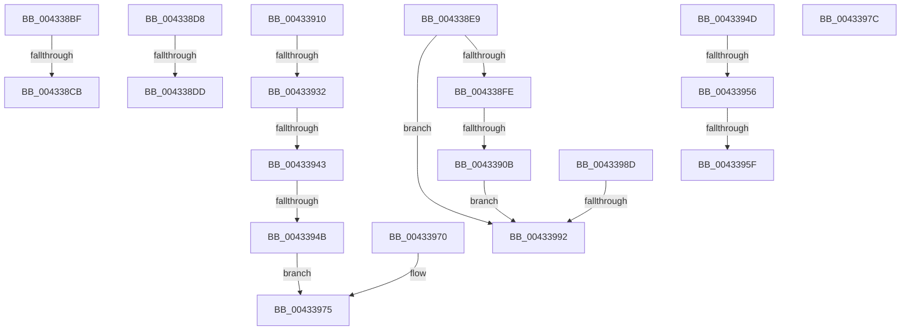

# sub_004338BF

- RVA: `0x004338BF`–`0x0043399C` (길이 `221` bytes)
- VA: `0x00000001404338BF`
- 실행 섹션: `.text`
- PDB 이름 있음: `아니요`; PDB Function 태그: `아니요`
- unwind 정보 RVA: `0x000A2628`
- 디코드: `52`개 명령, `221/221` bytes 표시
- 미해석 바이트: `0` (있으면 어셈블리에 `.byte`로 보존)

> 이 문서는 커널 이미지의 기계어와 PDB 기호를 분석해 생성했습니다. 4번과 5번은 함수 원형과 자료형을 바이너리 사용 방식에서 추정한 C 해석이며 원본 소스 복구 결과는 아닙니다.

## 1. Dependencies

- 직접 호출 지점: **4**; 고유 호출 대상: **4**
- 직접 호출자로 확인된 함수: **0**
- RIP 상대 이미지 참조: **0**

### Outgoing calls
- `0x004338CE` → [KxWaitForSpinLockAndAcquire](../20/KxWaitForSpinLockAndAcquire_function_002085C0.md) (function, `0x002085C0`)
- `0x004338E2` → [ExFreePoolWithTag](../../poolcode/B8/ExFreePoolWithTag_function_00B82870.md) (function, `0x00B82870`)
- `0x00433921` → [ExAllocatePool2](../../poolcode/B8/ExAllocatePool2_function_00B820F0.md) (function, `0x00B820F0`)
- `0x00433983` → [KiRaiseIrqlProcessIrqlFlags](../4F/KiRaiseIrqlProcessIrqlFlags_function_004F56FC.md) (function, `0x004F56FC`)

### Direct callers
- 이 함수 시작 RVA로 연결되는 직접 call은 확인되지 않았습니다. 간접 호출은 완전히 역산할 수 없습니다.

### Static image references
- 디코드된 RIP-relative 메모리 참조가 없습니다.

## 2. Other-region calls and transfers

- 다른 실행 섹션으로 향하는 call: **2**
  - `0x004338E2` → [ExFreePoolWithTag](../../poolcode/B8/ExFreePoolWithTag_function_00B82870.md) (`.text` → `POOLCODE`)
  - `0x00433921` → [ExAllocatePool2](../../poolcode/B8/ExAllocatePool2_function_00B820F0.md) (`.text` → `POOLCODE`)
- call이 아닌 외부 분기/꼬리 이동: **15**
  - `0x004338C5` → [sub_00433766 + 0xCC](Unknown_function_00433766.md) (`tail-transfer`)
  - `0x004338D3` → [sub_00433766 + 0xCC](Unknown_function_00433766.md) (`tail-transfer`)
  - `0x004338DB` → [sub_00433766 + 0x130](Unknown_function_00433766.md) (`tail-transfer`)
  - `0x004338E7` → [sub_00433766 + 0x130](Unknown_function_00433766.md) (`tail-transfer`)
  - `0x00433905` → [sub_00433766 + 0x88](Unknown_function_00433766.md) (`tail-transfer`)
  - `0x0043392C` → [sub_004339AF + 0x3F](Unknown_function_004339AF.md) (`tail-transfer`)
  - `0x0043393D` → [sub_004339AF + 0x49](Unknown_function_004339AF.md) (`tail-transfer`)
  - `0x00433945` → [sub_00433766 + 0x38](Unknown_function_00433766.md) (`tail-transfer`)
  - `0x00433950` → [sub_00433766 + 0xF6](Unknown_function_00433766.md) (`tail-transfer`)
  - `0x00433959` → [sub_004339AF + 0x34](Unknown_function_004339AF.md) (`tail-transfer`)
  - `0x0043396B` → [sub_00433766 + 0xF6](Unknown_function_00433766.md) (`tail-transfer`)
  - `0x00433977` → [sub_00433766 + 0x13C](Unknown_function_00433766.md) (`tail-transfer`)
  - `0x00433988` → [sub_00433766 + 0xA9](Unknown_function_00433766.md) (`tail-transfer`)
  - `0x00433990` → [sub_004339AF + 0x28](Unknown_function_004339AF.md) (`tail-transfer`)
  - `0x00433997` → [sub_00433766 + 0x13C](Unknown_function_00433766.md) (`tail-transfer`)

## 3. Assembly (complete function range)

```asm
004338BF  F0 48 0F BA 2B 00               lock bts qword ptr [rbx], 0
004338C5  0F 83 67 FF FF FF               jae 0x140433832
004338CB  48 8B CB                        mov rcx, rbx
004338CE  E8 ED 4C DD FF                  call 0x1402085c0
004338D3  E9 5A FF FF FF                  jmp 0x140433832
004338D8  4D 85 ED                        test r13, r13
004338DB  74 B9                           je 0x140433896
004338DD  33 D2                           xor edx, edx
004338DF  49 8B CD                        mov rcx, r13
004338E2  E8 89 EF 74 00                  call 0x140b82870
004338E7  EB AD                           jmp 0x140433896
004338E9  4C 8B B1 D0 00 00 00            mov r14, qword ptr [rcx + 0xd0]
004338F0  44 89 6C 24 58                  mov dword ptr [rsp + 0x58], r13d
004338F5  4D 85 F6                        test r14, r14
004338F8  0F 84 94 00 00 00               je 0x140433992
004338FE  4D 8B 76 10                     mov r14, qword ptr [r14 + 0x10]
00433902  4D 85 F6                        test r14, r14
00433905  0F 85 E3 FE FF FF               jne 0x1404337ee
0043390B  E9 82 00 00 00                  jmp 0x140433992
00433910  BA 60 00 00 00                  mov edx, 0x60
00433915  41 B8 49 6F 46 45               mov r8d, 0x45466f49
0043391B  41 8B ED                        mov ebp, r13d
0043391E  8D 4A E0                        lea ecx, [rdx - 0x20]
00433921  E8 CA E7 74 00                  call 0x140b820f0
00433926  48 8B D8                        mov rbx, rax
00433929  48 85 C0                        test rax, rax
0043392C  0F 84 BC 00 00 00               je 0x1404339ee
00433932  33 C0                           xor eax, eax
00433934  F0 48 0F B1 9F D0 00 00 00      lock cmpxchg qword ptr [rdi + 0xd0], rbx
0043393D  0F 85 B5 00 00 00               jne 0x1404339f8
00433943  85 ED                           test ebp, ebp
00433945  0F 89 53 FE FF FF               jns 0x14043379e
0043394B  EB 28                           jmp 0x140433975
0043394D  40 84 F6                        test sil, sil
00433950  0F 85 06 FF FF FF               jne 0x14043385c
00433956  4D 85 ED                        test r13, r13
00433959  0F 84 84 00 00 00               je 0x1404339e3
0043395F  49 89 45 00                     mov qword ptr [r13], rax
00433963  4D 89 6E 10                     mov qword ptr [r14 + 0x10], r13
00433967  4D 89 7D 08                     mov qword ptr [r13 + 8], r15
0043396B  E9 EC FE FF FF                  jmp 0x14043385c
00433970  BD 9A 00 00 C0                  mov ebp, 0xc000009a
00433975  8B C5                           mov eax, ebp
00433977  E9 26 FF FF FF                  jmp 0x1404338a2
0043397C  0F B6 D0                        movzx edx, al
0043397F  40 0F B6 CD                     movzx ecx, bpl
00433983  E8 74 1D 0C 00                  call 0x1404f56fc
00433988  E9 82 FE FF FF                  jmp 0x14043380f
0043398D  40 84 FF                        test dil, dil
00433990  75 45                           jne 0x1404339d7
00433992  B8 01 00 00 C0                  mov eax, 0xc0000001
00433997  E9 06 FF FF FF                  jmp 0x1404338a2
```

## 4. C-style interpretation (structured pseudocode)

```c
__int64 __fastcall sub_004338BF(__int64 a1, int a2)
{
    __int64 result;
    unsigned int v_stack_p58;

    result = KxWaitForSpinLockAndAcquire(v_rbx, a2, a3, a4);
}
```

## 5. (Beta) C Style

```c
int64_t sub_004338BF(int64_t Arg1, int32_t Arg2)
{
    int64_t result;
    uint32_t v_stack_p58;

    result = KxWaitForSpinLockAndAcquire(local_rbx, Arg2, a3, a4);
}
```

## 6. Execution-region graph

[열기: 2D/3D 그래프와 함수 탐색 컨트롤 패널](../../../control-panel.html?section=text&rva=0x004338BF&view=graph)

- 2D 그래프는 위에서 아래로 흐르고, 3D 그래프는 빈 공간을 드래그해 회전합니다. Shift+드래그는 이동, 휠은 확대·축소, 함수 노드 선택은 대상 보고서 이동입니다.

### Static fallback


