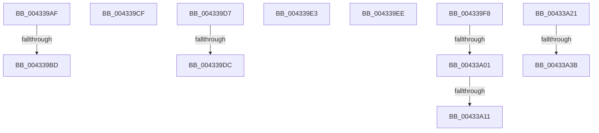

# sub_004339AF

- RVA: `0x004339AF`–`0x00433A44` (길이 `149` bytes)
- VA: `0x00000001404339AF`
- 실행 섹션: `.text`
- PDB 이름 있음: `아니요`; PDB Function 태그: `아니요`
- unwind 정보 RVA: `0x000A2658`
- 디코드: `35`개 명령, `149/149` bytes 표시
- 미해석 바이트: `0` (있으면 어셈블리에 `.byte`로 보존)

> 이 문서는 커널 이미지의 기계어와 PDB 기호를 분석해 생성했습니다. 4번과 5번은 함수 원형과 자료형을 바이너리 사용 방식에서 추정한 C 해석이며 원본 소스 복구 결과는 아닙니다.

## 1. Dependencies

- 직접 호출 지점: **3**; 고유 호출 대상: **2**
- 직접 호출자로 확인된 함수: **0**
- RIP 상대 이미지 참조: **2**

### Outgoing calls
- `0x004339C5` → [KiReleaseSpinLockInstrumented](../39/KiReleaseSpinLockInstrumented_function_00392EF0.md) (function, `0x00392EF0`)
- `0x00433A16` → [ExFreePoolWithTag](../../poolcode/B8/ExFreePoolWithTag_function_00B82870.md) (function, `0x00B82870`)
- `0x00433A26` → [ExFreePoolWithTag](../../poolcode/B8/ExFreePoolWithTag_function_00B82870.md) (function, `0x00B82870`)

### Direct callers
- 이 함수 시작 RVA로 연결되는 직접 call은 확인되지 않았습니다. 간접 호출은 완전히 역산할 수 없습니다.

### Static image references
- `0x004339AF` → RVA `0x00F0DE58` (`.data`; read)
- `0x00433A01` → RVA `0x00014730` (`.rdata`; read)

## 2. Other-region calls and transfers

- 다른 실행 섹션으로 향하는 call: **2**
  - `0x00433A16` → [ExFreePoolWithTag](../../poolcode/B8/ExFreePoolWithTag_function_00B82870.md) (`.text` → `POOLCODE`)
  - `0x00433A26` → [ExFreePoolWithTag](../../poolcode/B8/ExFreePoolWithTag_function_00B82870.md) (`.text` → `POOLCODE`)
- call이 아닌 외부 분기/꼬리 이동: **12**
  - `0x004339B7` → [sub_00433766 + 0x108](Unknown_function_00433766.md) (`tail-transfer`)
  - `0x004339CA` → [sub_00433766 + 0x10D](Unknown_function_00433766.md) (`tail-transfer`)
  - `0x004339D2` → [sub_00433766 + 0xE0](Unknown_function_00433766.md) (`tail-transfer`)
  - `0x004339DA` → [sub_004338BF + 0xD3](Unknown_function_004338BF.md) (`tail-transfer`)
  - `0x004339DE` → [sub_00433766 + 0x13C](Unknown_function_00433766.md) (`tail-transfer`)
  - `0x004339E9` → [sub_00433766 + 0xFB](Unknown_function_00433766.md) (`tail-transfer`)
  - `0x004339F3` → [sub_004338BF + 0x73](Unknown_function_004338BF.md) (`tail-transfer`)
  - `0x004339FB` → [sub_006EEAC4](../6E/Unknown_function_006EEAC4.md) (`tail-transfer`)
  - `0x00433A0B` → [sub_006EEAC4](../6E/Unknown_function_006EEAC4.md) (`tail-transfer`)
  - `0x00433A1C` → [sub_006EEAC4](../6E/Unknown_function_006EEAC4.md) (`tail-transfer`)
  - `0x00433A35` → [sub_006EEAC4 + 0xC](../6E/Unknown_function_006EEAC4.md) (`tail-transfer`)
  - `0x00433A3F` → [sub_00433766 + 0x6D](Unknown_function_00433766.md) (`tail-transfer`)

## 3. Assembly (complete function range)

```asm
004339AF  8B 05 A3 A4 AD 00               mov eax, dword ptr [rip + 0xada4a3]
004339B5  85 C0                           test eax, eax
004339B7  0F 85 B1 FE FF FF               jne 0x14043386e
004339BD  48 8B 54 24 48                  mov rdx, qword ptr [rsp + 0x48]
004339C2  48 8B CB                        mov rcx, rbx
004339C5  E8 26 F5 F5 FF                  call 0x140392ef0
004339CA  E9 A4 FE FF FF                  jmp 0x140433873
004339CF  48 8B 09                        mov rcx, qword ptr [rcx]
004339D2  E9 6F FE FF FF                  jmp 0x140433846
004339D7  45 84 E4                        test r12b, r12b
004339DA  74 B6                           je 0x140433992
004339DC  33 C0                           xor eax, eax
004339DE  E9 BF FE FF FF                  jmp 0x1404338a2
004339E3  41 BE 9A 00 00 C0               mov r14d, 0xc000009a
004339E9  E9 73 FE FF FF                  jmp 0x140433861
004339EE  BD 9A 00 00 C0                  mov ebp, 0xc000009a
004339F3  E9 3A FF FF FF                  jmp 0x140433932
004339F8  48 85 DB                        test rbx, rbx
004339FB  0F 84 C3 B0 2B 00               je 0x1406eeac4
00433A01  48 8D 05 28 0D BE FF            lea rax, [rip - 0x41f2d8]
00433A08  48 3B D8                        cmp rbx, rax
00433A0B  0F 84 B3 B0 2B 00               je 0x1406eeac4
00433A11  33 D2                           xor edx, edx
00433A13  48 8B CB                        mov rcx, rbx
00433A16  E8 55 EE 74 00                  call 0x140b82870
00433A1B  90                              nop
00433A1C  E9 A3 B0 2B 00                  jmp 0x1406eeac4
00433A21  33 D2                           xor edx, edx
00433A23  49 8B CE                        mov rcx, r14
00433A26  E8 45 EE 74 00                  call 0x140b82870
00433A2B  4C 8B B7 D0 00 00 00            mov r14, qword ptr [rdi + 0xd0]
00433A32  4D 85 F6                        test r14, r14
00433A35  0F 84 95 B0 2B 00               je 0x1406eead0
00433A3B  4D 8B 76 10                     mov r14, qword ptr [r14 + 0x10]
00433A3F  E9 8F FD FF FF                  jmp 0x1404337d3
```

## 4. C-style interpretation (structured pseudocode)

```c
__int64 __fastcall sub_004339AF(__int64 a1, __int64 a2, __int64 a3, __int64 a4, __int64 a5, __int64 a6, __int64 a7, __int64 a8, __int64 a9)
{
    __int64 result;

    result = KiReleaseSpinLockInstrumented(v_rbx, a9, a3, a4);
}
```

## 5. (Beta) C Style

```c
int64_t sub_004339AF(int64_t Arg1, int64_t Arg2, int64_t Arg3, int64_t Arg4, uint64_t Arg5, uint64_t Arg6, uint64_t Arg7, uint64_t Arg8, int64_t Arg9)
{
    int64_t result;

    result = KiReleaseSpinLockInstrumented(local_rbx, Arg9, Arg3, Arg4);
}
```

## 6. Execution-region graph

[열기: 2D/3D 그래프와 함수 탐색 컨트롤 패널](../../../control-panel.html?section=text&rva=0x004339AF&view=graph)

- 2D 그래프는 위에서 아래로 흐르고, 3D 그래프는 빈 공간을 드래그해 회전합니다. Shift+드래그는 이동, 휠은 확대·축소, 함수 노드 선택은 대상 보고서 이동입니다.

### Static fallback


