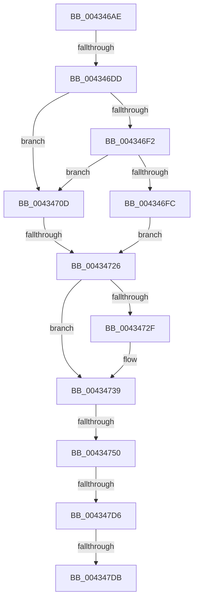

# sub_004346AE

- RVA: `0x004346AE`–`0x004347ED` (길이 `319` bytes)
- VA: `0x00000001404346AE`
- 실행 섹션: `.text`
- PDB 이름 있음: `아니요`; PDB Function 태그: `아니요`
- unwind 정보 RVA: `0x000A296C`
- 디코드: `78`개 명령, `319/319` bytes 표시
- 미해석 바이트: `0` (있으면 어셈블리에 `.byte`로 보존)

> 이 문서는 커널 이미지의 기계어와 PDB 기호를 분석해 생성했습니다. 4번과 5번은 함수 원형과 자료형을 바이너리 사용 방식에서 추정한 C 해석이며 원본 소스 복구 결과는 아닙니다.

## 1. Dependencies

- 직접 호출 지점: **1**; 고유 호출 대상: **1**
- 직접 호출자로 확인된 함수: **0**
- RIP 상대 이미지 참조: **5**

### Outgoing calls
- `0x00434701` → [ExpAcquireSpinLockSharedAtDpcLevelInstrumented](../27/ExpAcquireSpinLockSharedAtDpcLevelInstrumented_function_0027CD20.md) (function, `0x0027CD20`)

### Direct callers
- 이 함수 시작 RVA로 연결되는 직접 call은 확인되지 않았습니다. 간접 호출은 완전히 역산할 수 없습니다.

### Static image references
- `0x004346E9` → RVA `0x00FC6B06` (`ALMOSTRO`; read)
- `0x004346F2` → RVA `0x00F0DE58` (`.data`; read)
- `0x00434726` → RVA `0x00FC52E0` (`ALMOSTRO`; read)
- `0x00434760` → RVA `0x00FC8C40` (`ALMOSTRO`; read)
- `0x00434782` → RVA `0x00F231B8` (`.data`; read)

## 2. Other-region calls and transfers

- 다른 실행 섹션으로 향하는 call: **0**
- call이 아닌 외부 분기/꼬리 이동: **6**
  - `0x004346D7` → [sub_004348CE](Unknown_function_004348CE.md) (`tail-transfer`)
  - `0x00434720` → [sub_004348A7](Unknown_function_004348A7.md) (`tail-transfer`)
  - `0x0043474A` → [sub_004348F9](Unknown_function_004348F9.md) (`tail-transfer`)
  - `0x004347D0` → [sub_00434898](Unknown_function_00434898.md) (`tail-transfer`)
  - `0x004347D9` → [sub_00434839](Unknown_function_00434839.md) (`tail-transfer`)
  - `0x004347EB` → [sub_00434839](Unknown_function_00434839.md) (`tail-transfer`)

## 3. Assembly (complete function range)

```asm
004346AE  48 89 5C 24 70                  mov qword ptr [rsp + 0x70], rbx
004346B3  48 89 74 24 38                  mov qword ptr [rsp + 0x38], rsi
004346B8  49 8B F0                        mov rsi, r8
004346BB  48 89 7C 24 30                  mov qword ptr [rsp + 0x30], rdi
004346C0  48 8B B9 C0 00 00 00            mov rdi, qword ptr [rcx + 0xc0]
004346C7  4C 89 64 24 28                  mov qword ptr [rsp + 0x28], r12
004346CC  48 8B 9F 80 00 00 00            mov rbx, qword ptr [rdi + 0x80]
004346D3  66 41 3B 02                     cmp ax, word ptr [r10]
004346D7  0F 83 F1 01 00 00               jae 0x1404348ce
004346DD  49 8B 54 C2 08                  mov rdx, qword ptr [r10 + rax*8 + 8]
004346E2  48 23 DA                        and rbx, rdx
004346E5  4C 8D 7F 78                     lea r15, [rdi + 0x78]
004346E9  F6 05 16 24 B9 00 21            test byte ptr [rip + 0xb92416], 0x21
004346F0  74 1B                           je 0x14043470d
004346F2  8B 05 60 97 AD 00               mov eax, dword ptr [rip + 0xad9760]
004346F8  85 C0                           test eax, eax
004346FA  75 11                           jne 0x14043470d
004346FC  B2 FF                           mov dl, 0xff
004346FE  49 8B CF                        mov rcx, r15
00434701  E8 1A 86 E4 FF                  call 0x14027cd20
00434706  44 8B 4C 24 78                  mov r9d, dword ptr [rsp + 0x78]
0043470B  EB 19                           jmp 0x140434726
0043470D  41 0F 0D 0F                     prefetchw byte ptr [r15]
00434711  41 8B 07                        mov eax, dword ptr [r15]
00434714  0F BA F0 1F                     btr eax, 0x1f
00434718  8D 48 01                        lea ecx, [rax + 1]
0043471B  F0 41 0F B1 0F                  lock cmpxchg dword ptr [r15], ecx
00434720  0F 85 81 01 00 00               jne 0x1404348a7
00434726  83 3D B3 0B B9 00 00            cmp dword ptr [rip + 0xb90bb3], 0
0043472D  74 0A                           je 0x140434739
0043472F  48 8B 47 68                     mov rax, qword ptr [rdi + 0x68]
00434733  48 F7 D0                        not rax
00434736  48 23 D8                        and rbx, rax
00434739  48 8B 47 50                     mov rax, qword ptr [rdi + 0x50]
0043473D  48 23 C3                        and rax, rbx
00434740  48 0F 44 C3                     cmove rax, rbx
00434744  4C 8B C0                        mov r8, rax
00434747  4C 23 C6                        and r8, rsi
0043474A  0F 84 A9 01 00 00               je 0x1404348f9
00434750  41 0F B6 8D D1 00 00 00         movzx ecx, byte ptr [r13 + 0xd1]
00434758  41 0F B6 95 D0 00 00 00         movzx edx, byte ptr [r13 + 0xd0]
00434760  4C 8D 2D D9 44 B9 00            lea r13, [rip + 0xb944d9]
00434767  49 D3 C8                        ror r8, cl
0043476A  49 0F BC C0                     bsf rax, r8
0043476E  C1 E2 06                        shl edx, 6
00434771  03 C8                           add ecx, eax
00434773  C7 44 24 60 00 00 00 00         mov dword ptr [rsp + 0x60], 0
0043477B  83 E1 3F                        and ecx, 0x3f
0043477E  89 44 24 60                     mov dword ptr [rsp + 0x60], eax
00434782  48 8B 05 2F EA AE 00            mov rax, qword ptr [rip + 0xaeea2f]
00434789  03 D1                           add edx, ecx
0043478B  8B 0C 90                        mov ecx, dword ptr [rax + rdx*4]
0043478E  4D 8B 6C CD 00                  mov r13, qword ptr [r13 + rcx*8]
00434793  49 8B 5D 38                     mov rbx, qword ptr [r13 + 0x38]
00434797  41 8B D1                        mov edx, r9d
0043479A  4C 8B A4 24 80 00 00 00         mov r12, qword ptr [rsp + 0x80]
004347A2  4C 89 74 24 20                  mov qword ptr [rsp + 0x20], r14
004347A7  0F B6 1B                        movzx ebx, byte ptr [rbx]
004347AA  8B C3                           mov eax, ebx
004347AC  4C 89 6C 24 68                  mov qword ptr [rsp + 0x68], r13
004347B1  C1 E8 07                        shr eax, 7
004347B4  44 3B C8                        cmp r9d, eax
004347B7  0F 4C D0                        cmovl edx, eax
004347BA  48 63 C2                        movsxd rax, edx
004347BD  48 8B C8                        mov rcx, rax
004347C0  49 33 CD                        xor rcx, r13
004347C3  48 83 E1 FE                     and rcx, 0xfffffffffffffffe
004347C7  48 33 C8                        xor rcx, rax
004347CA  49 89 0C 24                     mov qword ptr [r12], rcx
004347CE  85 D2                           test edx, edx
004347D0  0F 84 C2 00 00 00               je 0x140434898
004347D6  83 FA 01                        cmp edx, 1
004347D9  75 5E                           jne 0x140434839
004347DB  49 8B 85 58 8E 00 00            mov rax, qword ptr [r13 + 0x8e58]
004347E2  0F B6 08                        movzx ecx, byte ptr [rax]
004347E5  4C 8D 70 08                     lea r14, [rax + 8]
004347E9  85 C9                           test ecx, ecx
004347EB  74 4C                           je 0x140434839
```

## 4. C-style interpretation (structured pseudocode)

```c
__int64 __fastcall sub_004346AE(__int64 a1, __int64 a2, __int64 a3, __int64 a4, __int64 a5, __int64 a6, __int64 a7, __int64 a8, __int64 a9, __int64 a10, __int64 a11, __int64 a12, __int64 a13, __int64 a14, unsigned int a15, __int64 a16)
{
    __int64 result;
    __int64 v_rbx;
    unsigned __int64 v_stack_p20;
    unsigned __int64 v_stack_p28;
    unsigned __int64 v_stack_p30;
    unsigned __int64 v_stack_p38;
    unsigned int v_stack_p60;
    unsigned __int64 v_stack_p68;
    unsigned __int64 v_stack_p70;

    v_stack_p70 = v_rbx;
    v_stack_p38 = v_rsi;
    v_stack_p30 = v_rdi;
    v_stack_p28 = v_r12;
    v_rbx = (*(unsigned __int64 *)(*(unsigned __int64 *)(a1 + 192) + 128)) & (*(unsigned __int64 *)(v_r10 + result * 8 + 8));
    if (((*(unsigned __int8 *)(v_rip + 12133398)) & (33)) == 0) goto loc_0043470D;
    if ((unsigned int)((unsigned int)(*(unsigned int *)(v_rip + 11376480))) != 0) goto loc_0043470D;
    result = ExpAcquireSpinLockSharedAtDpcLevelInstrumented(*(unsigned __int64 *)(a1 + 192) + 120, 255, a3, a4);
    goto loc_00434726;
loc_0043470D:
loc_00434726:
    result = (unsigned int)(*(unsigned int *)(*(unsigned __int64 *)(a1 + 192) + 120));
    if ((*(unsigned int *)(v_rip + 12127155)) != 0) {
        result = *(unsigned __int64 *)(*(unsigned __int64 *)(a1 + 192) + 104);
        result = ~(result);
        v_rbx = (v_rbx) & (result);
    }
    result = (*(unsigned __int64 *)(*(unsigned __int64 *)(a1 + 192) + 80)) & (v_rbx);
    if (condition_is_equal) { result = v_rbx; }
    a3 = (result) & (a3);
    a2 = (unsigned int)((*(unsigned __int8 *)(v_r13 + 208)) << (6));
    a1 = (unsigned int)((*(unsigned __int8 *)(v_r13 + 209)) + ((unsigned int)(result)));
    v_stack_p60 = 0;
    a1 = (unsigned int)((a1) & (63));
    v_stack_p60 = (unsigned int)(result);
    a2 = (unsigned int)((a2) + ((unsigned int)(a1)));
    v_stack_p20 = v_r14;
    v_stack_p68 = *(unsigned __int64 *)(v_rip + 12141785 + (unsigned int)(*(unsigned int *)(*(unsigned __int64 *)(v_rip + 11463215) + a2 * 4)) * 8);
    result = (unsigned int)(((unsigned int)((unsigned int)(*(unsigned __int8 *)(*(unsigned __int64 *)(*(unsigned __int64 *)(v_rip + 12141785 + (unsigned int)(*(unsigned int *)(*(unsigned __int64 *)(v_rip + 11463215) + a2 * 4)) * 8) + 56))))) >> (7));
    a2 = (unsigned int)((unsigned int)((unsigned int)(a15)));
    if (((unsigned int)((unsigned int)(a15))) < ((unsigned int)(result))) { a2 = (unsigned int)(result); }
    a1 = ((int)((unsigned int)(a2))) ^ (*(unsigned __int64 *)(v_rip + 12141785 + (unsigned int)(*(unsigned int *)(*(unsigned __int64 *)(v_rip + 11463215) + a2 * 4)) * 8));
    a1 = (a1) & (-2);
    a1 = (a1) ^ ((int)((unsigned int)(a2)));
    *(unsigned __int64 *)(a16) = a1;
}
```

## 5. (Beta) C Style

```c
int64_t sub_004346AE(void *Arg1, int64_t Arg2, int64_t Arg3, int64_t Arg4, uint64_t Arg5, uint64_t Arg6, uint64_t Arg7, uint64_t Arg8, uint64_t Arg9, uint64_t Arg10, uint64_t Arg11, uint64_t Arg12, uint64_t Arg13, uint64_t Arg14, uint32_t Arg15, void *Arg16)
{
    uint8_t *arg1 = (uint8_t *)Arg1;
    uint8_t *arg16 = (uint8_t *)Arg16;

    int64_t result;
    int64_t local_rbx;
    uint64_t v_stack_p20;
    uint64_t v_stack_p28;
    uint64_t v_stack_p30;
    uint64_t v_stack_p38;
    uint32_t v_stack_p60;
    uint64_t v_stack_p68;
    uint64_t v_stack_p70;

    v_stack_p70 = local_rbx;
    v_stack_p38 = local_rsi;
    v_stack_p30 = local_rdi;
    v_stack_p28 = local_r12;
    local_rbx = (*(uint64_t *)(*(uint64_t *)(arg1 + 0xC0) + 0x80)) & (*(uint64_t *)(local_r10 + result * 8 + 0x8));
    if (((*(uint8_t *)(v_rip + 0xB92416)) & (33)) == 0) goto loc_0043470D;
    if ((uint32_t)((uint32_t)(*(uint32_t *)(v_rip + 0xAD9760))) != 0) goto loc_0043470D;
    result = ExpAcquireSpinLockSharedAtDpcLevelInstrumented(*(uint64_t *)(arg1 + 0xC0) + 120, 255, Arg3, Arg4);
    goto loc_00434726;
loc_0043470D:
loc_00434726:
    result = (uint32_t)(*(uint32_t *)(*(uint64_t *)(arg1 + 0xC0) + 0x78));
    if ((*(uint32_t *)(v_rip + 0xB90BB3)) != 0) {
        result = *(uint64_t *)(*(uint64_t *)(arg1 + 0xC0) + 0x68);
        result = ~(result);
        local_rbx = (local_rbx) & (result);
    }
    result = (*(uint64_t *)(*(uint64_t *)(arg1 + 0xC0) + 0x50)) & (local_rbx);
    if (condition_is_equal) { result = local_rbx; }
    Arg3 = (result) & (Arg3);
    Arg2 = (uint32_t)((*(uint8_t *)(local_r13 + 0xD0)) << (6));
    Arg1 = (uint32_t)((*(uint8_t *)(local_r13 + 0xD1)) + ((uint32_t)(result)));
    v_stack_p60 = 0;
    Arg1 = (uint32_t)((Arg1) & (63));
    v_stack_p60 = (uint32_t)(result);
    Arg2 = (uint32_t)((Arg2) + ((uint32_t)(Arg1)));
    v_stack_p20 = local_r14;
    v_stack_p68 = *(uint64_t *)(v_rip + 0xB944D9 + (uint32_t)(*(uint32_t *)(*(uint64_t *)(v_rip + 0xAEEA2F) + Arg2 * 4)) * 8);
    result = (uint32_t)(((uint32_t)((uint32_t)(*(uint8_t *)(*(uint64_t *)(*(uint64_t *)(v_rip + 0xB944D9 + (uint32_t)(*(uint32_t *)(*(uint64_t *)(v_rip + 0xAEEA2F) + Arg2 * 4)) * 8) + 0x38))))) >> (7));
    Arg2 = (uint32_t)((uint32_t)((uint32_t)(Arg15)));
    if (((uint32_t)((uint32_t)(Arg15))) < ((uint32_t)(result))) { Arg2 = (uint32_t)(result); }
    Arg1 = ((int32_t)((uint32_t)(Arg2))) ^ (*(uint64_t *)(v_rip + 0xB944D9 + (uint32_t)(*(uint32_t *)(*(uint64_t *)(v_rip + 0xAEEA2F) + Arg2 * 4)) * 8));
    Arg1 = (Arg1) & (-2);
    Arg1 = (Arg1) ^ ((int32_t)((uint32_t)(Arg2)));
    *(void **)(arg16) = Arg1;
}
```

### 관측된 메모리 오프셋

구조체 형식이 확인되지 않은 접근은 인자 기준의 오프셋으로만 기록했습니다.

| 기준 인자 | 오프셋 표현 | 폭 (bit) | 접근 |
|---|---:|---:|---|
| `Arg1` | `+ 0xC0` | `64` | `R` |
| `Arg16` | `+ 0x0` | `64` | `W` |

## 6. Execution-region graph

[열기: 2D/3D 그래프와 함수 탐색 컨트롤 패널](../../../control-panel.html?section=text&rva=0x004346AE&view=graph)

- 2D 그래프는 위에서 아래로 흐르고, 3D 그래프는 빈 공간을 드래그해 회전합니다. Shift+드래그는 이동, 휠은 확대·축소, 함수 노드 선택은 대상 보고서 이동입니다.

### Static fallback


