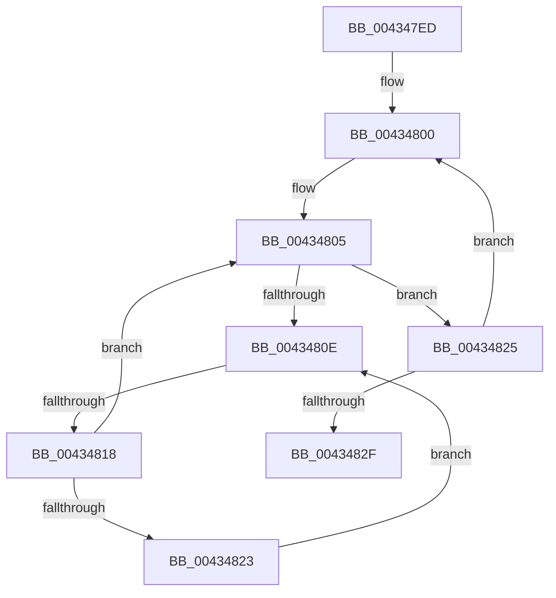

# sub_004347ED

- RVA: `0x004347ED`–`0x00434839` (길이 `76` bytes)
- VA: `0x00000001404347ED`
- 실행 섹션: `.text`
- PDB 이름 있음: `아니요`; PDB Function 태그: `아니요`
- unwind 정보 RVA: `0x000A2990`
- 디코드: `21`개 명령, `76/76` bytes 표시
- 미해석 바이트: `0` (있으면 어셈블리에 `.byte`로 보존)

> 이 문서는 커널 이미지의 기계어와 PDB 기호를 분석해 생성했습니다. 4번과 5번은 함수 원형과 자료형을 바이너리 사용 방식에서 추정한 C 해석이며 원본 소스 복구 결과는 아닙니다.

## 1. Dependencies

- 직접 호출 지점: **0**; 고유 호출 대상: **0**
- 직접 호출자로 확인된 함수: **0**
- RIP 상대 이미지 참조: **1**

### Outgoing calls
- 직접 디코드된 call 명령이 없습니다.

### Direct callers
- 이 함수 시작 RVA로 연결되는 직접 call은 확인되지 않았습니다. 간접 호출은 완전히 역산할 수 없습니다.

### Static image references
- `0x00434810` → RVA `0x00FC52AC` (`ALMOSTRO`; reference)

## 2. Other-region calls and transfers

- 다른 실행 섹션으로 향하는 call: **0**
- call이 아닌 외부 분기/꼬리 이동: **1**
  - `0x00434816` → [sub_0043487C](Unknown_function_0043487C.md) (`tail-transfer`)

## 3. Assembly (complete function range)

```asm
004347ED  48 89 6C 24 40                  mov qword ptr [rsp + 0x40], rbp
004347F2  8B E9                           mov ebp, ecx
004347F4  0F 1F 40 00                     nop dword ptr [rax]
004347F8  0F 1F 84 00 00 00 00 00         nop dword ptr [rax + rax]
00434800  49 8B 3E                        mov rdi, qword ptr [r14]
00434803  33 F6                           xor esi, esi
00434805  F0 48 0F BA 6F 30 00            lock bts qword ptr [rdi + 0x30], 0
0043480C  73 17                           jae 0x140434825
0043480E  FF C6                           inc esi
00434810  85 35 96 0A B9 00               test dword ptr [rip + 0xb90a96], esi
00434816  74 64                           je 0x14043487c
00434818  F3 90                           pause
0043481A  48 8B 47 30                     mov rax, qword ptr [rdi + 0x30]
0043481E  48 85 C0                        test rax, rax
00434821  74 E2                           je 0x140434805
00434823  EB E9                           jmp 0x14043480e
00434825  49 83 C6 08                     add r14, 8
00434829  48 83 ED 01                     sub rbp, 1
0043482D  75 D1                           jne 0x140434800
0043482F  48 8B 6C 24 40                  mov rbp, qword ptr [rsp + 0x40]
00434834  44 8B 4C 24 78                  mov r9d, dword ptr [rsp + 0x78]
```

## 4. C-style interpretation (structured pseudocode)

```c
__int64 __fastcall sub_004347ED(int a1, __int64 a2, __int64 a3, __int64 a4, __int64 a5, __int64 a6, __int64 a7, __int64 a8, __int64 a9, __int64 a10, __int64 a11, __int64 a12, __int64 a13, __int64 a14, unsigned int a15)
{
    __int64 v_r14;
    __int64 v_rbp;
    __int64 v_rsi;
    unsigned __int64 v_stack_p40;

    v_stack_p40 = v_rbp;
loc_00434800:
    v_rsi = 0;
loc_00434805:
    if (condition_is_above_or_equal) goto loc_00434825;
loc_0043480E:
    v_rsi = (unsigned int)((v_rsi) + 1);
    if (*(unsigned __int64 *)(*(unsigned __int64 *)(v_r14) + 48) == 0) goto loc_00434805;
    goto loc_0043480E;
loc_00434825:
    v_r14 = (v_r14) + (8);
    v_rbp = ((unsigned int)(a1)) - (1);
    if (condition_is_not_equal) goto loc_00434800;
    return *(unsigned __int64 *)(*(unsigned __int64 *)(v_r14) + 48);
}
```

## 5. (Beta) C Style

```c
int64_t sub_004347ED(int32_t Arg1, int64_t Arg2, int64_t Arg3, int64_t Arg4, uint64_t Arg5, uint64_t Arg6, uint64_t Arg7, int64_t Arg8, uint64_t Arg9, uint64_t Arg10, uint64_t Arg11, uint64_t Arg12, uint64_t Arg13, uint64_t Arg14, uint32_t Arg15)
{
    int64_t local_r14;
    int64_t local_rbp;
    int64_t local_rsi;
    uint64_t v_stack_p40;

    v_stack_p40 = local_rbp;
loc_00434800:
    local_rsi = 0;
loc_00434805:
    if (condition_is_above_or_equal) goto loc_00434825;
loc_0043480E:
    local_rsi = (uint32_t)((local_rsi) + 1);
    if (*(uint64_t *)(*(uint64_t *)(local_r14) + 0x30) == 0) goto loc_00434805;
    goto loc_0043480E;
loc_00434825:
    local_r14 = (local_r14) + (8);
    local_rbp = ((uint32_t)(Arg1)) - (1);
    if (condition_is_not_equal) goto loc_00434800;
    return *(uint64_t *)(*(uint64_t *)(local_r14) + 0x30);
}
```

## 6. Execution-region graph

[열기: 2D/3D 그래프와 함수 탐색 컨트롤 패널](../../../control-panel.html?section=text&rva=0x004347ED&view=graph)

- 2D 그래프는 위에서 아래로 흐르고, 3D 그래프는 빈 공간을 드래그해 회전합니다. Shift+드래그는 이동, 휠은 확대·축소, 함수 노드 선택은 대상 보고서 이동입니다.

### Static fallback


