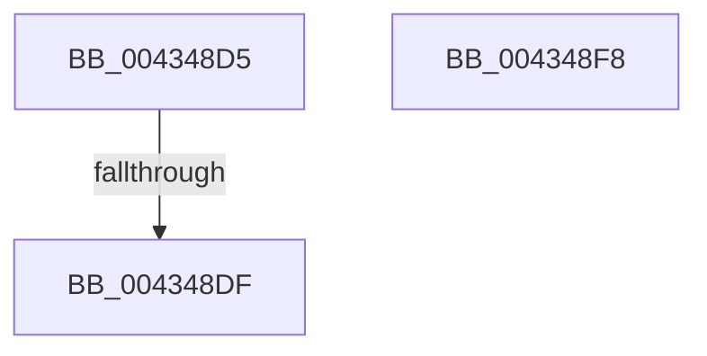

# sub_004348D5

- RVA: `0x004348D5`–`0x004348F9` (길이 `36` bytes)
- VA: `0x00000001404348D5`
- 실행 섹션: `.text`
- PDB 이름 있음: `아니요`; PDB Function 태그: `아니요`
- unwind 정보 RVA: `0x000A2A7C`
- 디코드: `12`개 명령, `36/36` bytes 표시
- 미해석 바이트: `0` (있으면 어셈블리에 `.byte`로 보존)

> 이 문서는 커널 이미지의 기계어와 PDB 기호를 분석해 생성했습니다. 4번과 5번은 함수 원형과 자료형을 바이너리 사용 방식에서 추정한 C 해석이며 원본 소스 복구 결과는 아닙니다.

## 1. Dependencies

- 직접 호출 지점: **1**; 고유 호출 대상: **1**
- 직접 호출자로 확인된 함수: **0**
- RIP 상대 이미지 참조: **1**

### Outgoing calls
- `0x004348E7` → [ExpReleaseSpinLockSharedFromDpcLevelInstrumented](../2F/ExpReleaseSpinLockSharedFromDpcLevelInstrumented_function_002F0F48.md) (function, `0x002F0F48`)

### Direct callers
- 이 함수 시작 RVA로 연결되는 직접 call은 확인되지 않았습니다. 간접 호출은 완전히 역산할 수 없습니다.

### Static image references
- `0x004348D5` → RVA `0x00F0DE58` (`.data`; read)

## 2. Other-region calls and transfers

- 다른 실행 섹션으로 향하는 call: **0**
- call이 아닌 외부 분기/꼬리 이동: **1**
  - `0x004348DD` → [sub_00434863](Unknown_function_00434863.md) (`tail-transfer`)

## 3. Assembly (complete function range)

```asm
004348D5  8B 05 7D 95 AD 00               mov eax, dword ptr [rip + 0xad957d]
004348DB  85 C0                           test eax, eax
004348DD  75 84                           jne 0x140434863
004348DF  48 8B 54 24 58                  mov rdx, qword ptr [rsp + 0x58]
004348E4  49 8B CF                        mov rcx, r15
004348E7  E8 5C C6 EB FF                  call 0x1402f0f48
004348EC  49 8B C5                        mov rax, r13
004348EF  48 83 C4 48                     add rsp, 0x48
004348F3  41 5F                           pop r15
004348F5  41 5D                           pop r13
004348F7  C3                              ret
004348F8  CC                              int3
```

## 4. C-style interpretation (structured pseudocode)

```c
__int64 __fastcall sub_004348D5(__int64 a1, __int64 a2, __int64 a3, __int64 a4, __int64 a5, __int64 a6, __int64 a7, __int64 a8, __int64 a9, __int64 a10, __int64 a11)
{
    __int64 result;
    __int64 v_rsp;

    result = ExpReleaseSpinLockSharedFromDpcLevelInstrumented(v_r15, a11, a3, a4);
    v_rsp = (v_rsp) + (72);
    return v_r13;
}
```

## 5. (Beta) C Style

```c
int64_t sub_004348D5(int64_t Arg1, int64_t Arg2, int64_t Arg3, int64_t Arg4, uint64_t Arg5, uint64_t Arg6, uint64_t Arg7, uint64_t Arg8, uint64_t Arg9, uint64_t Arg10, int64_t Arg11)
{
    int64_t result;
    int64_t local_rsp;

    result = ExpReleaseSpinLockSharedFromDpcLevelInstrumented(local_r15, Arg11, Arg3, Arg4);
    local_rsp = (local_rsp) + (72);
    return local_r13;
}
```

## 6. Execution-region graph

[열기: 2D/3D 그래프와 함수 탐색 컨트롤 패널](../../../control-panel.html?section=text&rva=0x004348D5&view=graph)

- 2D 그래프는 위에서 아래로 흐르고, 3D 그래프는 빈 공간을 드래그해 회전합니다. Shift+드래그는 이동, 휠은 확대·축소, 함수 노드 선택은 대상 보고서 이동입니다.

### Static fallback


