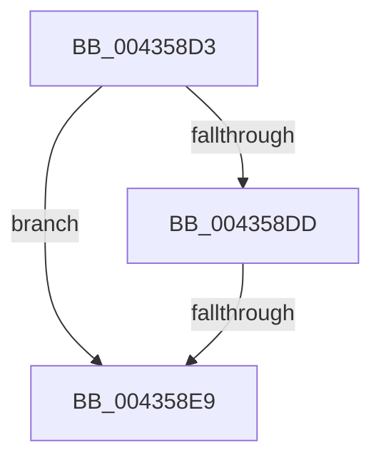

# sub_004358D3

- RVA: `0x004358D3`–`0x004358F7` (길이 `36` bytes)
- VA: `0x00000001404358D3`
- 실행 섹션: `.text`
- PDB 이름 있음: `아니요`; PDB Function 태그: `아니요`
- unwind 정보 RVA: `0x000A2C84`
- 디코드: `10`개 명령, `36/36` bytes 표시
- 미해석 바이트: `0` (있으면 어셈블리에 `.byte`로 보존)

> 이 문서는 커널 이미지의 기계어와 PDB 기호를 분석해 생성했습니다. 4번과 5번은 함수 원형과 자료형을 바이너리 사용 방식에서 추정한 C 해석이며 원본 소스 복구 결과는 아닙니다.

## 1. Dependencies

- 직접 호출 지점: **0**; 고유 호출 대상: **0**
- 직접 호출자로 확인된 함수: **0**
- RIP 상대 이미지 참조: **0**

### Outgoing calls
- 직접 디코드된 call 명령이 없습니다.

### Direct callers
- 이 함수 시작 RVA로 연결되는 직접 call은 확인되지 않았습니다. 간접 호출은 완전히 역산할 수 없습니다.

### Static image references
- 디코드된 RIP-relative 메모리 참조가 없습니다.

## 2. Other-region calls and transfers

- 다른 실행 섹션으로 향하는 call: **0**
- call이 아닌 외부 분기/꼬리 이동: **2**
  - `0x004358E7` → [sub_00435912](Unknown_function_00435912.md) (`tail-transfer`)
  - `0x004358F5` → [sub_00435958](Unknown_function_00435958.md) (`tail-transfer`)

## 3. Assembly (complete function range)

```asm
004358D3  4C 89 7C 24 58                  mov qword ptr [rsp + 0x58], r15
004358D8  48 3B DD                        cmp rbx, rbp
004358DB  74 0C                           je 0x1404358e9
004358DD  44 8B FF                        mov r15d, edi
004358E0  F0 48 0F BA 6D 18 3F            lock bts qword ptr [rbp + 0x18], 0x3f
004358E7  72 29                           jb 0x140435912
004358E9  48 8B 45 28                     mov rax, qword ptr [rbp + 0x28]
004358ED  4C 8B 7C 24 58                  mov r15, qword ptr [rsp + 0x58]
004358F2  49 85 C4                        test r12, rax
004358F5  75 61                           jne 0x140435958
```

## 4. C-style interpretation (structured pseudocode)

```c
__int64 __fastcall sub_004358D3(__int64 a1, __int64 a2, __int64 a3, __int64 a4, __int64 a5, __int64 a6, __int64 a7, __int64 a8, __int64 a9, __int64 a10, __int64 a11)
{
    unsigned __int64 v_stack_p58;

    v_stack_p58 = v_r15;
    if (v_rbx == v_rbp) goto loc_004358E9;
loc_004358E9:
}
```

## 5. (Beta) C Style

```c
int64_t sub_004358D3(int64_t Arg1, int64_t Arg2, int64_t Arg3, int64_t Arg4, uint64_t Arg5, uint64_t Arg6, uint64_t Arg7, uint64_t Arg8, uint64_t Arg9, uint64_t Arg10, int64_t Arg11)
{
    uint64_t v_stack_p58;

    v_stack_p58 = local_r15;
    if (local_rbx == local_rbp) goto loc_004358E9;
loc_004358E9:
}
```

## 6. Execution-region graph

[열기: 2D/3D 그래프와 함수 탐색 컨트롤 패널](../../../control-panel.html?section=text&rva=0x004358D3&view=graph)

- 2D 그래프는 위에서 아래로 흐르고, 3D 그래프는 빈 공간을 드래그해 회전합니다. Shift+드래그는 이동, 휠은 확대·축소, 함수 노드 선택은 대상 보고서 이동입니다.

### Static fallback


