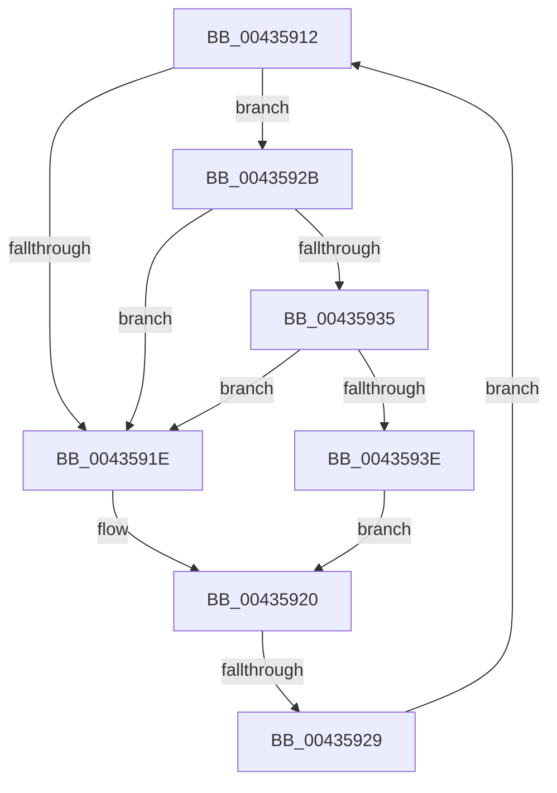

# sub_00435912

- RVA: `0x00435912`–`0x00435948` (길이 `54` bytes)
- VA: `0x0000000140435912`
- 실행 섹션: `.text`
- PDB 이름 있음: `아니요`; PDB Function 태그: `아니요`
- unwind 정보 RVA: `0x000A2CA8`
- 디코드: `17`개 명령, `54/54` bytes 표시
- 미해석 바이트: `0` (있으면 어셈블리에 `.byte`로 보존)

> 이 문서는 커널 이미지의 기계어와 PDB 기호를 분석해 생성했습니다. 4번과 5번은 함수 원형과 자료형을 바이너리 사용 방식에서 추정한 C 해석이며 원본 소스 복구 결과는 아닙니다.

## 1. Dependencies

- 직접 호출 지점: **2**; 고유 호출 대상: **2**
- 직접 호출자로 확인된 함수: **0**
- RIP 상대 이미지 참조: **2**

### Outgoing calls
- `0x00435935` → [KiCheckVpBackingLongSpinWaitHypercall](../30/KiCheckVpBackingLongSpinWaitHypercall_function_0030F490.md) (function, `0x0030F490`)
- `0x00435941` → [HvlNotifyLongSpinWait](../30/HvlNotifyLongSpinWait_function_0030F460.md) (function, `0x0030F460`)

### Direct callers
- 이 함수 시작 RVA로 연결되는 직접 call은 확인되지 않았습니다. 간접 호출은 완전히 역산할 수 없습니다.

### Static image references
- `0x00435915` → RVA `0x00FC52AC` (`ALMOSTRO`; reference)
- `0x0043592B` → RVA `0x00FC6AB8` (`ALMOSTRO`; read)

## 2. Other-region calls and transfers

- 다른 실행 섹션으로 향하는 call: **0**
- call이 아닌 외부 분기/꼬리 이동: **1**
  - `0x00435927` → [sub_004358D3 + 0xD](Unknown_function_004358D3.md) (`tail-transfer`)

## 3. Assembly (complete function range)

```asm
00435912  41 FF C7                        inc r15d
00435915  44 85 3D 90 F9 B8 00            test dword ptr [rip + 0xb8f990], r15d
0043591C  74 0D                           je 0x14043592b
0043591E  F3 90                           pause
00435920  48 8B 45 18                     mov rax, qword ptr [rbp + 0x18]
00435924  48 85 C0                        test rax, rax
00435927  79 B7                           jns 0x1404358e0
00435929  EB E7                           jmp 0x140435912
0043592B  8B 05 87 11 B9 00               mov eax, dword ptr [rip + 0xb91187]
00435931  A8 40                           test al, 0x40
00435933  74 E9                           je 0x14043591e
00435935  E8 56 9B ED FF                  call 0x14030f490
0043593A  84 C0                           test al, al
0043593C  74 E0                           je 0x14043591e
0043593E  41 8B CF                        mov ecx, r15d
00435941  E8 1A 9B ED FF                  call 0x14030f460
00435946  EB D8                           jmp 0x140435920
```

## 4. C-style interpretation (structured pseudocode)

```c
__int64 __fastcall sub_00435912(void)
{
    __int64 result;
    __int64 v_r15;

    v_r15 = (unsigned int)((v_r15) + 1);
    if (((*(unsigned int *)(v_rip + 12122512)) & ((unsigned int)(v_r15))) == 0) goto loc_0043592B;
loc_0043591E:
loc_00435920:
    goto loc_00435912;
loc_0043592B:
    if ((((unsigned __int8)((unsigned int)(*(unsigned int *)(v_rip + 12128647)))) & (64)) == 0) goto loc_0043591E;
    result = KiCheckVpBackingLongSpinWaitHypercall(a1, a2, a3, a4);
    if ((unsigned __int8)(result) == 0) goto loc_0043591E;
    result = HvlNotifyLongSpinWait((unsigned int)((unsigned int)(v_r15)), a2, a3, a4);
    goto loc_00435920;
}
```

## 5. (Beta) C Style

```c
void sub_00435912(void)
{
    int64_t result;
    int64_t local_r15;

    local_r15 = (uint32_t)((local_r15) + 1);
    if (((*(uint32_t *)(v_rip + 0xB8F990)) & ((uint32_t)(local_r15))) == 0) goto loc_0043592B;
loc_0043591E:
loc_00435920:
    goto loc_00435912;
loc_0043592B:
    if ((((uint8_t)((uint32_t)(*(uint32_t *)(v_rip + 0xB91187)))) & (64)) == 0) goto loc_0043591E;
    result = KiCheckVpBackingLongSpinWaitHypercall(a1, a2, a3, a4);
    if ((uint8_t)(result) == 0) goto loc_0043591E;
    result = HvlNotifyLongSpinWait((uint32_t)((uint32_t)(local_r15)), a2, a3, a4);
    goto loc_00435920;
}
```

## 6. Execution-region graph

[열기: 2D/3D 그래프와 함수 탐색 컨트롤 패널](../../../control-panel.html?section=text&rva=0x00435912&view=graph)

- 2D 그래프는 위에서 아래로 흐르고, 3D 그래프는 빈 공간을 드래그해 회전합니다. Shift+드래그는 이동, 휠은 확대·축소, 함수 노드 선택은 대상 보고서 이동입니다.

### Static fallback


