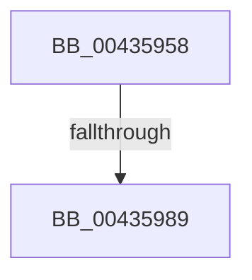

# sub_00435958

- RVA: `0x00435958`–`0x0043599E` (길이 `70` bytes)
- VA: `0x0000000140435958`
- 실행 섹션: `.text`
- PDB 이름 있음: `아니요`; PDB Function 태그: `아니요`
- unwind 정보 RVA: `0x000A2CD0`
- 디코드: `15`개 명령, `70/70` bytes 표시
- 미해석 바이트: `0` (있으면 어셈블리에 `.byte`로 보존)

> 이 문서는 커널 이미지의 기계어와 PDB 기호를 분석해 생성했습니다. 4번과 5번은 함수 원형과 자료형을 바이너리 사용 방식에서 추정한 C 해석이며 원본 소스 복구 결과는 아닙니다.

## 1. Dependencies

- 직접 호출 지점: **1**; 고유 호출 대상: **1**
- 직접 호출자로 확인된 함수: **0**
- RIP 상대 이미지 참조: **0**

### Outgoing calls
- `0x0043597C` → [MiAnyPagesRemovalPending](../47/MiAnyPagesRemovalPending_function_0047CDB8.md) (function, `0x0047CDB8`)

### Direct callers
- 이 함수 시작 RVA로 연결되는 직접 call은 확인되지 않았습니다. 간접 호출은 완전히 역산할 수 없습니다.

### Static image references
- 디코드된 RIP-relative 메모리 참조가 없습니다.

## 2. Other-region calls and transfers

- 다른 실행 섹션으로 향하는 call: **0**
- call이 아닌 외부 분기/꼬리 이동: **2**
  - `0x00435983` → [sub_006EEE2E](../6E/Unknown_function_006EEE2E.md) (`tail-transfer`)
  - `0x00435999` → [sub_004358F7](Unknown_function_004358F7.md) (`tail-transfer`)

## 3. Assembly (complete function range)

```asm
00435958  48 B8 00 00 00 00 00 DE FF FF   movabs rax, 0xffffde0000000000
00435962  48 8B CB                        mov rcx, rbx
00435965  8B D6                           mov edx, esi
00435967  48 2B C8                        sub rcx, rax
0043596A  48 B8 AB AA AA AA AA AA AA AA   movabs rax, 0xaaaaaaaaaaaaaaab
00435974  48 C1 F9 04                     sar rcx, 4
00435978  48 0F AF C8                     imul rcx, rax
0043597C  E8 37 74 04 00                  call 0x14047cdb8
00435981  85 C0                           test eax, eax
00435983  0F 84 A5 94 2B 00               je 0x1406eee2e
00435989  48 8B 43 28                     mov rax, qword ptr [rbx + 0x28]
0043598D  BF 01 00 00 00                  mov edi, 1
00435992  49 0B C4                        or rax, r12
00435995  48 89 43 28                     mov qword ptr [rbx + 0x28], rax
00435999  E9 59 FF FF FF                  jmp 0x1404358f7
```

## 4. C-style interpretation (structured pseudocode)

```c
__int64 __fastcall sub_00435958(void)
{
    __int64 result;

    a1 = (v_rbx) - (result);
    a1 = (a1) >> (4);
    a1 = (a1) * (result);
    result = MiAnyPagesRemovalPending(a1, (unsigned int)((unsigned int)(v_rsi)), a3, a4);
    result = (*(unsigned __int64 *)(v_rbx + 40)) | (v_r12);
    *(unsigned __int64 *)(v_rbx + 40) = result;
}
```

## 5. (Beta) C Style

```c
void sub_00435958(void)
{
    int64_t result;

    a1 = (local_rbx) - (result);
    a1 = (a1) >> (4);
    a1 = (a1) * (result);
    result = MiAnyPagesRemovalPending(a1, (uint32_t)((uint32_t)(local_rsi)), a3, a4);
    result = (*(uint64_t *)(local_rbx + 0x28)) | (local_r12);
    *(uint64_t *)(local_rbx + 0x28) = result;
}
```

## 6. Execution-region graph

[열기: 2D/3D 그래프와 함수 탐색 컨트롤 패널](../../../control-panel.html?section=text&rva=0x00435958&view=graph)

- 2D 그래프는 위에서 아래로 흐르고, 3D 그래프는 빈 공간을 드래그해 회전합니다. Shift+드래그는 이동, 휠은 확대·축소, 함수 노드 선택은 대상 보고서 이동입니다.

### Static fallback


