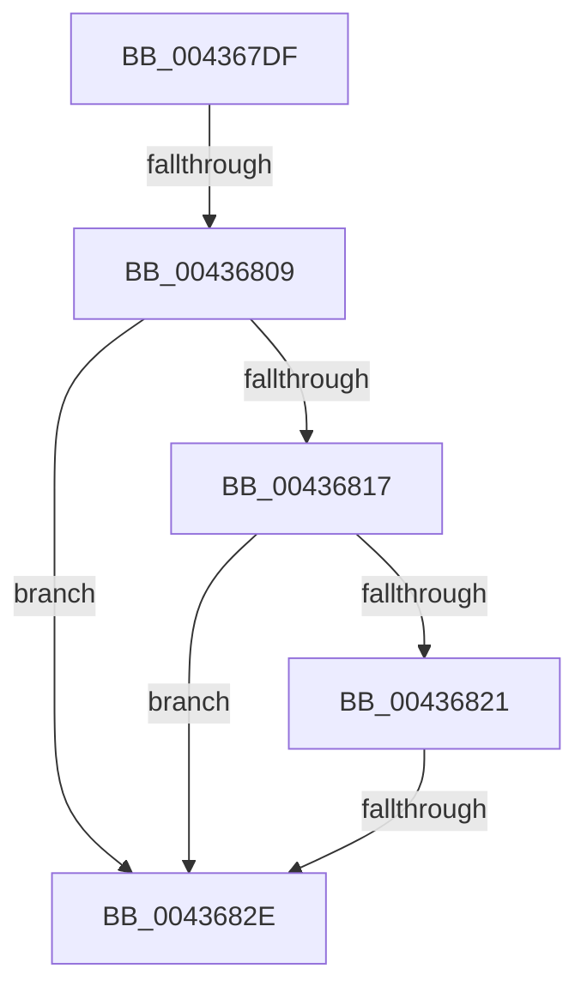

# sub_004367DF

- RVA: `0x004367DF`–`0x0043684F` (길이 `112` bytes)
- VA: `0x00000001404367DF`
- 실행 섹션: `.text`
- PDB 이름 있음: `아니요`; PDB Function 태그: `아니요`
- unwind 정보 RVA: `0x000A3028`
- 디코드: `25`개 명령, `112/112` bytes 표시
- 미해석 바이트: `0` (있으면 어셈블리에 `.byte`로 보존)

> 이 문서는 커널 이미지의 기계어와 PDB 기호를 분석해 생성했습니다. 4번과 5번은 함수 원형과 자료형을 바이너리 사용 방식에서 추정한 C 해석이며 원본 소스 복구 결과는 아닙니다.

## 1. Dependencies

- 직접 호출 지점: **0**; 고유 호출 대상: **0**
- 직접 호출자로 확인된 함수: **0**
- RIP 상대 이미지 참조: **1**

### Outgoing calls
- 직접 디코드된 call 명령이 없습니다.

### Direct callers
- 이 함수 시작 RVA로 연결되는 직접 call은 확인되지 않았습니다. 간접 호출은 완전히 역산할 수 없습니다.

### Static image references
- `0x00436834` → RVA `0x00FC8C40` (`ALMOSTRO`; read)

## 2. Other-region calls and transfers

- 다른 실행 섹션으로 향하는 call: **0**
- call이 아닌 외부 분기/꼬리 이동: **2**
  - `0x00436803` → [sub_00436919 + 0xC](Unknown_function_00436919.md) (`tail-transfer`)
  - `0x00436828` → [sub_00436919 + 0x1C](Unknown_function_00436919.md) (`tail-transfer`)

## 3. Assembly (complete function range)

```asm
004367DF  48 89 7C 24 18                  mov qword ptr [rsp + 0x18], rdi
004367E4  44 33 C0                        xor r8d, eax
004367E7  49 89 0A                        mov qword ptr [r10], rcx
004367EA  8B 44 24 30                     mov eax, dword ptr [rsp + 0x30]
004367EE  48 8B FA                        mov rdi, rdx
004367F1  49 89 52 08                     mov qword ptr [r10 + 8], rdx
004367F5  45 89 42 1C                     mov dword ptr [r10 + 0x1c], r8d
004367F9  4D 89 4A 10                     mov qword ptr [r10 + 0x10], r9
004367FD  41 89 42 18                     mov dword ptr [r10 + 0x18], eax
00436801  85 C0                           test eax, eax
00436803  0F 85 1C 01 00 00               jne 0x140436925
00436809  65 48 8B 0C 25 88 01 00 00      mov rcx, qword ptr gs:[0x188]
00436812  48 85 D2                        test rdx, rdx
00436815  74 17                           je 0x14043682e
00436817  8B 82 B8 00 00 00               mov eax, dword ptr [rdx + 0xb8]
0043681D  A8 0F                           test al, 0xf
0043681F  75 0D                           jne 0x14043682e
00436821  80 B9 4A 02 00 00 01            cmp byte ptr [rcx + 0x24a], 1
00436828  0F 84 07 01 00 00               je 0x140436935
0043682E  8B 81 4C 02 00 00               mov eax, dword ptr [rcx + 0x24c]
00436834  4C 8D 05 05 24 B9 00            lea r8, [rip + 0xb92405]
0043683B  4D 8B 04 C0                     mov r8, qword ptr [r8 + rax*8]
0043683F  41 8B 80 54 87 00 00            mov eax, dword ptr [r8 + 0x8754]
00436846  8B C8                           mov ecx, eax
00436848  48 69 D1 80 DF 00 00            imul rdx, rcx, 0xdf80
```

## 4. C-style interpretation (structured pseudocode)

```c
__int64 __fastcall sub_004367DF(__int64 a1, __int64 a2, int a3, __int64 a4, __int64 a5, unsigned int a6)
{
    unsigned __int64 v_stack_p18;

    v_stack_p18 = v_rdi;
    a3 = (unsigned int)((a3) ^ ((unsigned int)(result)));
    *(unsigned __int64 *)(v_r10) = a1;
    *(unsigned __int64 *)(v_r10 + 8) = a2;
    *(unsigned int *)(v_r10 + 28) = a3;
    *(unsigned __int64 *)(v_r10 + 16) = a4;
    *(unsigned int *)(v_r10 + 24) = (unsigned int)((unsigned int)(a6));
    if (a2 == 0) goto loc_0043682E;
    if ((((unsigned __int8)((unsigned int)(*(unsigned int *)(a2 + 184)))) & (15)) != 0) goto loc_0043682E;
loc_0043682E:
    a2 = (a2) * ((unsigned int)((unsigned int)((unsigned int)(*(unsigned int *)(*(unsigned __int64 *)(v_rip + 12133381 + (unsigned int)(*(unsigned int *)(*(unsigned __int64 *)(gs_base + (0 + 392)) + 588)) * 8) + 34644)))));
    return (unsigned int)(*(unsigned int *)(*(unsigned __int64 *)(v_rip + 12133381 + (unsigned int)(*(unsigned int *)(*(unsigned __int64 *)(gs_base + (0 + 392)) + 588)) * 8) + 34644));
}
```

## 5. (Beta) C Style

```c
int64_t sub_004367DF(int64_t Arg1, int64_t Arg2, int32_t Arg3, int64_t Arg4, uint64_t Arg5, uint32_t Arg6)
{
    uint64_t v_stack_p18;

    v_stack_p18 = local_rdi;
    Arg3 = (uint32_t)((Arg3) ^ ((uint32_t)(result)));
    *(uint64_t *)(local_r10) = Arg1;
    *(uint64_t *)(local_r10 + 0x8) = Arg2;
    *(uint32_t *)(local_r10 + 0x1C) = Arg3;
    *(uint64_t *)(local_r10 + 0x10) = Arg4;
    *(uint32_t *)(local_r10 + 0x18) = (uint32_t)((uint32_t)(Arg6));
    if (Arg2 == 0) goto loc_0043682E;
    if ((((uint8_t)((uint32_t)(*(uint32_t *)(Arg2 + 0xB8)))) & (15)) != 0) goto loc_0043682E;
loc_0043682E:
    Arg2 = (Arg2) * ((uint32_t)((uint32_t)((uint32_t)(*(uint32_t *)(*(uint64_t *)(v_rip + 0xB92405 + (uint32_t)(*(uint32_t *)(*(uint64_t *)(gs_base + (0 + 0x188)) + 0x24C)) * 8) + 0x8754)))));
    return (uint32_t)(*(uint32_t *)(*(uint64_t *)(v_rip + 0xB92405 + (uint32_t)(*(uint32_t *)(*(uint64_t *)(gs_base + (0 + 0x188)) + 0x24C)) * 8) + 0x8754));
}
```

## 6. Execution-region graph

[열기: 2D/3D 그래프와 함수 탐색 컨트롤 패널](../../../control-panel.html?section=text&rva=0x004367DF&view=graph)

- 2D 그래프는 위에서 아래로 흐르고, 3D 그래프는 빈 공간을 드래그해 회전합니다. Shift+드래그는 이동, 휠은 확대·축소, 함수 노드 선택은 대상 보고서 이동입니다.

### Static fallback


