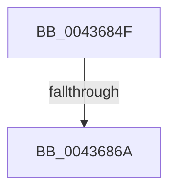

# sub_0043684F

- RVA: `0x0043684F`–`0x00436890` (길이 `65` bytes)
- VA: `0x000000014043684F`
- 실행 섹션: `.text`
- PDB 이름 있음: `아니요`; PDB Function 태그: `아니요`
- unwind 정보 RVA: `0x000A303C`
- 디코드: `16`개 명령, `65/65` bytes 표시
- 미해석 바이트: `0` (있으면 어셈블리에 `.byte`로 보존)

> 이 문서는 커널 이미지의 기계어와 PDB 기호를 분석해 생성했습니다. 4번과 5번은 함수 원형과 자료형을 바이너리 사용 방식에서 추정한 C 해석이며 원본 소스 복구 결과는 아닙니다.

## 1. Dependencies

- 직접 호출 지점: **0**; 고유 호출 대상: **0**
- 직접 호출자로 확인된 함수: **0**
- RIP 상대 이미지 참조: **1**

### Outgoing calls
- 직접 디코드된 call 명령이 없습니다.

### Direct callers
- 이 함수 시작 RVA로 연결되는 직접 call은 확인되지 않았습니다. 간접 호출은 완전히 역산할 수 없습니다.

### Static image references
- `0x00436854` → RVA `0x00E38D10` (`.data`; read)

## 2. Other-region calls and transfers

- 다른 실행 섹션으로 향하는 call: **0**
- call이 아닌 외부 분기/꼬리 이동: **2**
  - `0x00436864` → [sub_00436951](Unknown_function_00436951.md) (`tail-transfer`)
  - `0x0043688A` → [sub_00436919](Unknown_function_00436919.md) (`tail-transfer`)

## 3. Assembly (complete function range)

```asm
0043684F  48 89 74 24 10                  mov qword ptr [rsp + 0x10], rsi
00436854  48 03 15 B5 24 A0 00            add rdx, qword ptr [rip + 0xa024b5]
0043685B  8B 8A 50 3B 00 00               mov ecx, dword ptr [rdx + 0x3b50]
00436861  F6 C1 01                        test cl, 1
00436864  0F 85 E7 00 00 00               jne 0x140436951
0043686A  32 D2                           xor dl, dl
0043686C  48 8B 74 24 10                  mov rsi, qword ptr [rsp + 0x10]
00436871  83 E0 3F                        and eax, 0x3f
00436874  0D 80 03 00 00                  or eax, 0x380
00436879  83 E2 01                        and edx, 1
0043687C  03 C0                           add eax, eax
0043687E  0B C2                           or eax, edx
00436880  C1 E0 08                        shl eax, 8
00436883  41 89 42 30                     mov dword ptr [r10 + 0x30], eax
00436887  48 85 FF                        test rdi, rdi
0043688A  0F 84 89 00 00 00               je 0x140436919
```

## 4. C-style interpretation (structured pseudocode)

```c
__int64 __fastcall sub_0043684F(__int64 a1, __int64 a2)
{
    __int64 result;
    unsigned __int64 v_stack_p10;

    v_stack_p10 = v_rsi;
    a2 = (a2) + (*(unsigned __int64 *)(v_rip + 10495157));
    a2 = 0;
    result = (unsigned int)((result) & (63));
    result = (unsigned int)((result) | (896));
    a2 = (unsigned int)((a2) & (1));
    result = (unsigned int)((result) + ((unsigned int)(result)));
    result = (unsigned int)((result) | ((unsigned int)(a2)));
    result = (unsigned int)((result) << (8));
    *(unsigned int *)(v_r10 + 48) = (unsigned int)(result);
}
```

## 5. (Beta) C Style

```c
int64_t sub_0043684F(int64_t Arg1, void *Arg2)
{
    uint8_t *arg2 = (uint8_t *)Arg2;

    int64_t result;
    uint64_t v_stack_p10;

    v_stack_p10 = local_rsi;
    Arg2 = (Arg2) + (*(uint64_t *)(v_rip + 0xA024B5));
    Arg2 = 0;
    result = (uint32_t)((result) & (63));
    result = (uint32_t)((result) | (896));
    Arg2 = (uint32_t)((Arg2) & (1));
    result = (uint32_t)((result) + ((uint32_t)(result)));
    result = (uint32_t)((result) | ((uint32_t)(Arg2)));
    result = (uint32_t)((result) << (8));
    *(uint32_t *)(local_r10 + 0x30) = (uint32_t)(result);
}
```

### 관측된 메모리 오프셋

구조체 형식이 확인되지 않은 접근은 인자 기준의 오프셋으로만 기록했습니다.

| 기준 인자 | 오프셋 표현 | 폭 (bit) | 접근 |
|---|---:|---:|---|
| `Arg2` | `+ 0x3B50` | `32` | `R` |

## 6. Execution-region graph

[열기: 2D/3D 그래프와 함수 탐색 컨트롤 패널](../../../control-panel.html?section=text&rva=0x0043684F&view=graph)

- 2D 그래프는 위에서 아래로 흐르고, 3D 그래프는 빈 공간을 드래그해 회전합니다. Shift+드래그는 이동, 휠은 확대·축소, 함수 노드 선택은 대상 보고서 이동입니다.

### Static fallback


