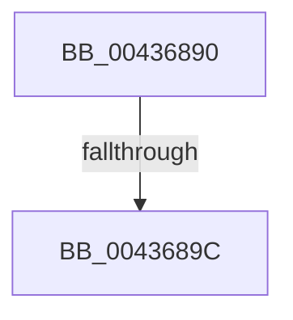

# sub_00436890

- RVA: `0x00436890`–`0x004368DC` (길이 `76` bytes)
- VA: `0x0000000140436890`
- 실행 섹션: `.text`
- PDB 이름 있음: `아니요`; PDB Function 태그: `아니요`
- unwind 정보 RVA: `0x000A3050`
- 디코드: `20`개 명령, `76/76` bytes 표시
- 미해석 바이트: `0` (있으면 어셈블리에 `.byte`로 보존)

> 이 문서는 커널 이미지의 기계어와 PDB 기호를 분석해 생성했습니다. 4번과 5번은 함수 원형과 자료형을 바이너리 사용 방식에서 추정한 C 해석이며 원본 소스 복구 결과는 아닙니다.

## 1. Dependencies

- 직접 호출 지점: **0**; 고유 호출 대상: **0**
- 직접 호출자로 확인된 함수: **0**
- RIP 상대 이미지 참조: **0**

### Outgoing calls
- 직접 디코드된 call 명령이 없습니다.

### Direct callers
- 이 함수 시작 RVA로 연결되는 직접 call은 확인되지 않았습니다. 간접 호출은 완전히 역산할 수 없습니다.

### Static image references
- 디코드된 RIP-relative 메모리 참조가 없습니다.

## 2. Other-region calls and transfers

- 다른 실행 섹션으로 향하는 call: **0**
- call이 아닌 외부 분기/꼬리 이동: **2**
  - `0x0043689A` → [sub_00436919](Unknown_function_00436919.md) (`tail-transfer`)
  - `0x004368DA` → [sub_004368DC + 0x7](Unknown_function_004368DC.md) (`tail-transfer`)

## 3. Assembly (complete function range)

```asm
00436890  8B 87 B8 00 00 00               mov eax, dword ptr [rdi + 0xb8]
00436896  24 0F                           and al, 0xf
00436898  3C 01                           cmp al, 1
0043689A  73 7D                           jae 0x140436919
0043689C  49 89 7A 28                     mov qword ptr [r10 + 0x28], rdi
004368A0  41 8B 42 30                     mov eax, dword ptr [r10 + 0x30]
004368A4  48 8B 7C 24 18                  mov rdi, qword ptr [rsp + 0x18]
004368A9  41 C1 E3 12                     shl r11d, 0x12
004368AD  44 33 D8                        xor r11d, eax
004368B0  41 81 E3 00 00 0C 00            and r11d, 0xc0000
004368B7  44 33 D8                        xor r11d, eax
004368BA  8B 44 24 40                     mov eax, dword ptr [rsp + 0x40]
004368BE  83 C8 08                        or eax, 8
004368C1  45 89 5A 30                     mov dword ptr [r10 + 0x30], r11d
004368C5  41 89 42 20                     mov dword ptr [r10 + 0x20], eax
004368C9  48 8B 44 24 48                  mov rax, qword ptr [rsp + 0x48]
004368CE  49 89 42 38                     mov qword ptr [r10 + 0x38], rax
004368D2  48 8B 44 24 60                  mov rax, qword ptr [rsp + 0x60]
004368D7  48 85 C0                        test rax, rax
004368DA  74 07                           je 0x1404368e3
```

## 4. C-style interpretation (structured pseudocode)

```c
__int64 __fastcall sub_00436890(__int64 a1, __int64 a2, __int64 a3, __int64 a4, __int64 a5, __int64 a6, __int64 a7, unsigned int a8, __int64 a9, __int64 a10, __int64 a11, __int64 a12)
{
    __int64 result;
    __int64 v_r11;
    unsigned __int64 v_stack_p18;

    result = (unsigned __int8)(((unsigned int)(*(unsigned int *)(v_rdi + 184))) & (15));
    *(unsigned __int64 *)(v_r10 + 40) = v_rdi;
    v_r11 = (unsigned int)((v_r11) << (18));
    v_r11 = (unsigned int)((v_r11) ^ ((unsigned int)((unsigned int)(*(unsigned int *)(v_r10 + 48)))));
    v_r11 = (unsigned int)((v_r11) & (0xC0000ULL));
    v_r11 = (unsigned int)((v_r11) ^ ((unsigned int)((unsigned int)(*(unsigned int *)(v_r10 + 48)))));
    result = (unsigned int)(((unsigned int)(a8)) | (8));
    *(unsigned int *)(v_r10 + 48) = (unsigned int)(v_r11);
    *(unsigned int *)(v_r10 + 32) = (unsigned int)(result);
    *(unsigned __int64 *)(v_r10 + 56) = a9;
}
```

## 5. (Beta) C Style

```c
int64_t sub_00436890(int64_t Arg1, int64_t Arg2, int64_t Arg3, int64_t Arg4, uint64_t Arg5, uint64_t Arg6, uint64_t Arg7, uint32_t Arg8, int64_t Arg9, uint64_t Arg10, uint64_t Arg11, int64_t Arg12)
{
    int64_t result;
    int64_t local_r11;
    uint64_t v_stack_p18;

    result = (uint8_t)(((uint32_t)(*(uint32_t *)(local_rdi + 0xB8))) & (15));
    *(uint64_t *)(local_r10 + 0x28) = local_rdi;
    local_r11 = (uint32_t)((local_r11) << (18));
    local_r11 = (uint32_t)((local_r11) ^ ((uint32_t)((uint32_t)(*(uint32_t *)(local_r10 + 0x30)))));
    local_r11 = (uint32_t)((local_r11) & (0xC0000ULL));
    local_r11 = (uint32_t)((local_r11) ^ ((uint32_t)((uint32_t)(*(uint32_t *)(local_r10 + 0x30)))));
    result = (uint32_t)(((uint32_t)(Arg8)) | (8));
    *(uint32_t *)(local_r10 + 0x30) = (uint32_t)(local_r11);
    *(uint32_t *)(local_r10 + 0x20) = (uint32_t)(result);
    *(uint64_t *)(local_r10 + 0x38) = Arg9;
}
```

## 6. Execution-region graph

[열기: 2D/3D 그래프와 함수 탐색 컨트롤 패널](../../../control-panel.html?section=text&rva=0x00436890&view=graph)

- 2D 그래프는 위에서 아래로 흐르고, 3D 그래프는 빈 공간을 드래그해 회전합니다. Shift+드래그는 이동, 휠은 확대·축소, 함수 노드 선택은 대상 보고서 이동입니다.

### Static fallback


