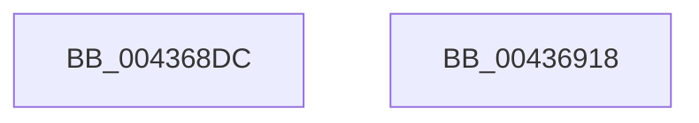

# sub_004368DC

- RVA: `0x004368DC`–`0x00436919` (길이 `61` bytes)
- VA: `0x00000001404368DC`
- 실행 섹션: `.text`
- PDB 이름 있음: `아니요`; PDB Function 태그: `아니요`
- unwind 정보 RVA: `0x000A3060`
- 디코드: `18`개 명령, `61/61` bytes 표시
- 미해석 바이트: `0` (있으면 어셈블리에 `.byte`로 보존)

> 이 문서는 커널 이미지의 기계어와 PDB 기호를 분석해 생성했습니다. 4번과 5번은 함수 원형과 자료형을 바이너리 사용 방식에서 추정한 C 해석이며 원본 소스 복구 결과는 아닙니다.

## 1. Dependencies

- 직접 호출 지점: **0**; 고유 호출 대상: **0**
- 직접 호출자로 확인된 함수: **0**
- RIP 상대 이미지 참조: **0**

### Outgoing calls
- 직접 디코드된 call 명령이 없습니다.

### Direct callers
- 이 함수 시작 RVA로 연결되는 직접 call은 확인되지 않았습니다. 간접 호출은 완전히 역산할 수 없습니다.

### Static image references
- 디코드된 RIP-relative 메모리 참조가 없습니다.

## 2. Other-region calls and transfers

- 다른 실행 섹션으로 향하는 call: **0**
- 별도 외부 분기/꼬리 이동을 확인하지 못했습니다.

## 3. Assembly (complete function range)

```asm
004368DC  48 C7 00 00 00 00 00            mov qword ptr [rax], 0
004368E3  49 89 42 48                     mov qword ptr [r10 + 0x48], rax
004368E7  0F 57 C0                        xorps xmm0, xmm0
004368EA  48 8B 44 24 50                  mov rax, qword ptr [rsp + 0x50]
004368EF  49 89 42 40                     mov qword ptr [r10 + 0x40], rax
004368F3  41 8B 42 1C                     mov eax, dword ptr [r10 + 0x1c]
004368F7  33 D8                           xor ebx, eax
004368F9  83 E3 0F                        and ebx, 0xf
004368FC  33 D8                           xor ebx, eax
004368FE  48 8B 44 24 68                  mov rax, qword ptr [rsp + 0x68]
00436903  49 89 42 50                     mov qword ptr [r10 + 0x50], rax
00436907  33 C0                           xor eax, eax
00436909  41 89 5A 1C                     mov dword ptr [r10 + 0x1c], ebx
0043690D  41 0F 11 42 58                  movups xmmword ptr [r10 + 0x58], xmm0
00436912  49 89 42 68                     mov qword ptr [r10 + 0x68], rax
00436916  5B                              pop rbx
00436917  C3                              ret
00436918  CC                              int3
```

## 4. C-style interpretation (structured pseudocode)

```c
__int64 __fastcall sub_004368DC(__int64 a1, __int64 a2, __int64 a3, __int64 a4, __int64 a5, __int64 a6, __int64 a7, __int64 a8, __int64 a9, __int64 a10, __int64 a11, __int64 a12, __int64 a13)
{
    __int64 result;
    __int64 v_rbx;

    *(unsigned __int64 *)(result) = 0;
    *(unsigned __int64 *)(v_r10 + 72) = result;
    *(unsigned __int64 *)(v_r10 + 64) = a10;
    v_rbx = (unsigned int)((v_rbx) ^ ((unsigned int)((unsigned int)(*(unsigned int *)(v_r10 + 28)))));
    v_rbx = (unsigned int)((v_rbx) & (15));
    v_rbx = (unsigned int)((v_rbx) ^ ((unsigned int)((unsigned int)(*(unsigned int *)(v_r10 + 28)))));
    *(unsigned __int64 *)(v_r10 + 80) = a13;
    result = 0;
    *(unsigned int *)(v_r10 + 28) = (unsigned int)(v_rbx);
    *(unsigned __int64 *)(v_r10 + 88) = v_xmm0;
    *(unsigned __int64 *)(v_r10 + 104) = 0;
    return result;
}
```

## 5. (Beta) C Style

```c
int64_t sub_004368DC(int64_t Arg1, int64_t Arg2, int64_t Arg3, int64_t Arg4, uint64_t Arg5, uint64_t Arg6, uint64_t Arg7, uint64_t Arg8, uint64_t Arg9, int64_t Arg10, uint64_t Arg11, uint64_t Arg12, int64_t Arg13)
{
    int64_t result;
    int64_t local_rbx;

    *(uint64_t *)(result) = 0;
    *(uint64_t *)(local_r10 + 0x48) = result;
    *(uint64_t *)(local_r10 + 0x40) = Arg10;
    local_rbx = (uint32_t)((local_rbx) ^ ((uint32_t)((uint32_t)(*(uint32_t *)(local_r10 + 0x1C)))));
    local_rbx = (uint32_t)((local_rbx) & (15));
    local_rbx = (uint32_t)((local_rbx) ^ ((uint32_t)((uint32_t)(*(uint32_t *)(local_r10 + 0x1C)))));
    *(uint64_t *)(local_r10 + 0x50) = Arg13;
    result = 0;
    *(uint32_t *)(local_r10 + 0x1C) = (uint32_t)(local_rbx);
    *(uint64_t *)(local_r10 + 0x58) = v_xmm0;
    *(uint64_t *)(local_r10 + 0x68) = 0;
    return result;
}
```

## 6. Execution-region graph

[열기: 2D/3D 그래프와 함수 탐색 컨트롤 패널](../../../control-panel.html?section=text&rva=0x004368DC&view=graph)

- 2D 그래프는 위에서 아래로 흐르고, 3D 그래프는 빈 공간을 드래그해 회전합니다. Shift+드래그는 이동, 휠은 확대·축소, 함수 노드 선택은 대상 보고서 이동입니다.

### Static fallback


