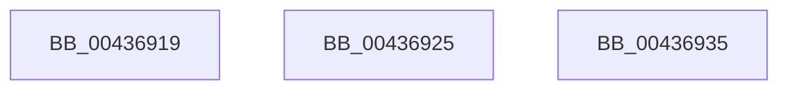

# sub_00436919

- RVA: `0x00436919`–`0x00436951` (길이 `56` bytes)
- VA: `0x0000000140436919`
- 실행 섹션: `.text`
- PDB 이름 있음: `아니요`; PDB Function 태그: `아니요`
- unwind 정보 RVA: `0x000A3074`
- 디코드: `9`개 명령, `56/56` bytes 표시
- 미해석 바이트: `0` (있으면 어셈블리에 `.byte`로 보존)

> 이 문서는 커널 이미지의 기계어와 PDB 기호를 분석해 생성했습니다. 4번과 5번은 함수 원형과 자료형을 바이너리 사용 방식에서 추정한 C 해석이며 원본 소스 복구 결과는 아닙니다.

## 1. Dependencies

- 직접 호출 지점: **0**; 고유 호출 대상: **0**
- 직접 호출자로 확인된 함수: **0**
- RIP 상대 이미지 참조: **0**

### Outgoing calls
- 직접 디코드된 call 명령이 없습니다.

### Direct callers
- 이 함수 시작 RVA로 연결되는 직접 call은 확인되지 않았습니다. 간접 호출은 완전히 역산할 수 없습니다.

### Static image references
- 디코드된 RIP-relative 메모리 참조가 없습니다.

## 2. Other-region calls and transfers

- 다른 실행 섹션으로 향하는 call: **0**
- call이 아닌 외부 분기/꼬리 이동: **3**
  - `0x00436920` → [sub_00436890 + 0xC](Unknown_function_00436890.md) (`tail-transfer`)
  - `0x00436930` → [sub_004367DF + 0x67](Unknown_function_004367DF.md) (`tail-transfer`)
  - `0x0043694C` → [sub_004367DF + 0x67](Unknown_function_004367DF.md) (`tail-transfer`)

## 3. Assembly (complete function range)

```asm
00436919  49 8D B8 50 87 00 00            lea rdi, [r8 + 0x8750]
00436920  E9 77 FF FF FF                  jmp 0x14043689c
00436925  65 4C 8B 04 25 20 00 00 00      mov r8, qword ptr gs:[0x20]
0043692E  FF C8                           dec eax
00436930  E9 11 FF FF FF                  jmp 0x140436846
00436935  48 8B 81 B8 00 00 00            mov rax, qword ptr [rcx + 0xb8]
0043693C  65 4C 8B 04 25 20 00 00 00      mov r8, qword ptr gs:[0x20]
00436945  0F B7 80 04 01 00 00            movzx eax, word ptr [rax + 0x104]
0043694C  E9 F5 FE FF FF                  jmp 0x140436846
```

## 4. C-style interpretation (structured pseudocode)

```c
__int64 __fastcall sub_00436919(__int64 a1, __int64 a2, __int64 a3)
{
}
```

## 5. (Beta) C Style

```c
int64_t sub_00436919(int64_t Arg1, int64_t Arg2, void *Arg3)
{
    uint8_t *arg3 = (uint8_t *)Arg3;

}
```

### 관측된 메모리 오프셋

구조체 형식이 확인되지 않은 접근은 인자 기준의 오프셋으로만 기록했습니다.

| 기준 인자 | 오프셋 표현 | 폭 (bit) | 접근 |
|---|---:|---:|---|
| `Arg3` | `+ 0x8750` | `64` | `R` |

## 6. Execution-region graph

[열기: 2D/3D 그래프와 함수 탐색 컨트롤 패널](../../../control-panel.html?section=text&rva=0x00436919&view=graph)

- 2D 그래프는 위에서 아래로 흐르고, 3D 그래프는 빈 공간을 드래그해 회전합니다. Shift+드래그는 이동, 휠은 확대·축소, 함수 노드 선택은 대상 보고서 이동입니다.

### Static fallback


