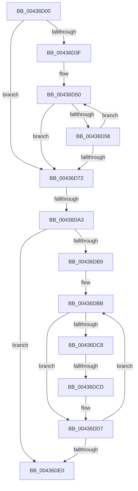

# sub_00436D00

- RVA: `0x00436D00`–`0x00436E05` (길이 `261` bytes)
- VA: `0x0000000140436D00`
- 실행 섹션: `.text`
- PDB 이름 있음: `아니요`; PDB Function 태그: `아니요`
- unwind 정보 RVA: `0x000A30E8`
- 디코드: `63`개 명령, `261/261` bytes 표시
- 미해석 바이트: `0` (있으면 어셈블리에 `.byte`로 보존)

> 이 문서는 커널 이미지의 기계어와 PDB 기호를 분석해 생성했습니다. 4번과 5번은 함수 원형과 자료형을 바이너리 사용 방식에서 추정한 C 해석이며 원본 소스 복구 결과는 아닙니다.

## 1. Dependencies

- 직접 호출 지점: **1**; 고유 호출 대상: **1**
- 직접 호출자로 확인된 함수: **0**
- RIP 상대 이미지 참조: **2**

### Outgoing calls
- `0x00436D25` → [memset](../6C/memset_function_006C6C40.md) (function, `0x006C6C40`)

### Direct callers
- 이 함수 시작 RVA로 연결되는 직접 call은 확인되지 않았습니다. 간접 호출은 완전히 역산할 수 없습니다.

### Static image references
- `0x00436DA3` → RVA `0x00000000` (`image boundary/outside`; read)
- `0x00436DCD` → RVA `0x00010880` (`.rdata`; read)

## 2. Other-region calls and transfers

- 다른 실행 섹션으로 향하는 call: **0**
- call이 아닌 외부 분기/꼬리 이동: **3**
  - `0x00436D9D` → [sub_00436E2A](Unknown_function_00436E2A.md) (`tail-transfer`)
  - `0x00436DCB` → [sub_00436E2A + 0x1E](Unknown_function_00436E2A.md) (`tail-transfer`)
  - `0x00436E03` → [sub_00436E60](Unknown_function_00436E60.md) (`tail-transfer`)

## 3. Assembly (complete function range)

```asm
00436D00  49 89 73 18                     mov qword ptr [r11 + 0x18], rsi
00436D04  4C 8B EA                        mov r13, rdx
00436D07  49 89 7B E0                     mov qword ptr [r11 - 0x20], rdi
00436D0B  33 D2                           xor edx, edx
00436D0D  4D 89 63 D8                     mov qword ptr [r11 - 0x28], r12
00436D11  45 8B E0                        mov r12d, r8d
00436D14  8B E9                           mov ebp, ecx
00436D16  41 B8 C8 00 00 00               mov r8d, 0xc8
00436D1C  48 8D 4C 24 40                  lea rcx, [rsp + 0x40]
00436D21  4D 89 73 D0                     mov qword ptr [r11 - 0x30], r14
00436D25  E8 16 FF 28 00                  call 0x1406c6c40
00436D2A  48 BA 00 00 00 00 80 F6 FF FF   movabs rdx, 0xfffff68000000000
00436D34  49 8B DD                        mov rbx, r13
00436D37  48 8B C2                        mov rax, rdx
00436D3A  4C 3B E8                        cmp r13, rax
00436D3D  72 33                           jb 0x140436d72
00436D3F  48 B9 FF FF FF FF FF F6 FF FF   movabs rcx, 0xfffff6ffffffffff
00436D49  0F 1F 80 00 00 00 00            nop dword ptr [rax]
00436D50  48 8B C1                        mov rax, rcx
00436D53  48 3B D8                        cmp rbx, rax
00436D56  77 1A                           ja 0x140436d72
00436D58  48 C1 E3 19                     shl rbx, 0x19
00436D5C  48 8B C2                        mov rax, rdx
00436D5F  48 C1 E0 19                     shl rax, 0x19
00436D63  48 2B D8                        sub rbx, rax
00436D66  48 C1 FB 10                     sar rbx, 0x10
00436D6A  48 8B C2                        mov rax, rdx
00436D6D  48 3B D8                        cmp rbx, rax
00436D70  73 DE                           jae 0x140436d50
00436D72  48 8B FB                        mov rdi, rbx
00436D75  4C 89 BC 24 20 01 00 00         mov qword ptr [rsp + 0x120], r15
00436D7D  48 C1 EF 09                     shr rdi, 9
00436D81  49 B8 F8 FF FF FF 7F 00 00 00   movabs r8, 0x7ffffffff8
00436D8B  49 23 F8                        and rdi, r8
00436D8E  48 8B C2                        mov rax, rdx
00436D91  48 03 F8                        add rdi, rax
00436D94  41 BF 02 00 00 00               mov r15d, 2
00436D9A  83 FD 01                        cmp ebp, 1
00436D9D  0F 86 87 00 00 00               jbe 0x140436e2a
00436DA3  48 8D 0D 56 92 BC FF            lea rcx, [rip - 0x436daa]
00436DAA  33 F6                           xor esi, esi
00436DAC  4C 8B B4 E9 A8 45 01 00         mov r14, qword ptr [rcx + rbp*8 + 0x145a8]
00436DB4  4D 85 F6                        test r14, r14
00436DB7  74 27                           je 0x140436de0
00436DB9  8B C6                           mov eax, esi
00436DBB  48 8D 0C C7                     lea rcx, [rdi + rax*8]
00436DBF  48 8B 04 C7                     mov rax, qword ptr [rdi + rax*8]
00436DC3  48 85 C0                        test rax, rax
00436DC6  74 0F                           je 0x140436dd7
00436DC8  83 FD 01                        cmp ebp, 1
00436DCB  76 7B                           jbe 0x140436e48
00436DCD  48 8B 05 AC 9A BD FF            mov rax, qword ptr [rip - 0x426554]
00436DD4  48 89 01                        mov qword ptr [rcx], rax
00436DD7  FF C6                           inc esi
00436DD9  8B C6                           mov eax, esi
00436DDB  49 3B C6                        cmp rax, r14
00436DDE  72 DB                           jb 0x140436dbb
00436DE0  4C 8B B4 24 28 01 00 00         mov r14, qword ptr [rsp + 0x128]
00436DE8  45 85 E4                        test r12d, r12d
00436DEB  4C 8B A4 24 30 01 00 00         mov r12, qword ptr [rsp + 0x130]
00436DF3  48 8B BC 24 38 01 00 00         mov rdi, qword ptr [rsp + 0x138]
00436DFB  48 8B B4 24 70 01 00 00         mov rsi, qword ptr [rsp + 0x170]
00436E03  75 5B                           jne 0x140436e60
```

## 4. C-style interpretation (structured pseudocode)

```c
__int64 __fastcall sub_00436D00(int a1, __int64 a2, int a3, __int64 a4, __int64 a5, __int64 a6, __int64 a7, __int64 a8, __int64 a9, __int64 a10, __int64 a11, __int64 a12, __int64 a13, __int64 a14, __int64 a15, __int64 a16, __int64 a17, __int64 a18, __int64 a19, __int64 a20, __int64 a21, __int64 a22, __int64 a23, __int64 a24, __int64 a25, __int64 a26, __int64 a27, __int64 a28, __int64 a29, __int64 a30, __int64 a31, __int64 a32, __int64 a33, __int64 a34, __int64 a35, __int64 a36, __int64 a37, __int64 a38, __int64 a39, __int64 a40, __int64 a41, __int64 a42, __int64 a43, __int64 a44, __int64 a45, __int64 a46)
{
    __int64 result;
    __int64 v_rbx;
    __int64 v_rdi;
    __int64 v_rsi;
    unsigned __int64 v_stack_p120;

    *(unsigned __int64 *)(v_r11 + 24) = v_rsi;
    *(unsigned __int64 *)(v_r11 - 32) = v_rdi;
    a2 = 0;
    *(unsigned __int64 *)(v_r11 - 40) = v_r12;
    *(unsigned __int64 *)(v_r11 - 48) = v_r14;
    result = memset(a8, a2, 200, a4);
    if (0 < 0) goto loc_00436D72;
loc_00436D50:
    if (0 > a8) goto loc_00436D72;
    v_rbx = (0) << (25);
    result = (0) << (25);
    v_rbx = (v_rbx) - (result);
    v_rbx = (v_rbx) >> (16);
    if (v_rbx >= 0) goto loc_00436D50;
loc_00436D72:
    v_stack_p120 = v_r15;
    v_rdi = (v_rbx) >> (9);
    v_rdi = (v_rdi) & (200);
    v_rdi = (v_rdi) + (0);
    v_rsi = 0;
    if (*(unsigned __int64 *)(v_rip - 4418986 + (unsigned int)(a1) * 8 + 83368) == 0) goto loc_00436DE0;
loc_00436DBB:
    if (*(unsigned __int64 *)(v_rdi + 0 * 8) == 0) goto loc_00436DD7;
    *(unsigned __int64 *)(v_rdi + 0 * 8) = *(unsigned __int64 *)(v_rip - 4351316);
loc_00436DD7:
    v_rsi = (unsigned int)((v_rsi) + 1);
    if (((unsigned int)((unsigned int)(v_rsi))) < (*(unsigned __int64 *)(v_rip - 4418986 + (unsigned int)(a1) * 8 + 83368))) goto loc_00436DBB;
loc_00436DE0:
}
```

## 5. (Beta) C Style

```c
int64_t sub_00436D00(int32_t Arg1, int64_t Arg2, int32_t Arg3, int64_t Arg4, uint64_t Arg5, uint64_t Arg6, uint64_t Arg7, int64_t Arg8, uint64_t Arg9, uint64_t Arg10, uint64_t Arg11, uint64_t Arg12, uint64_t Arg13, uint64_t Arg14, uint64_t Arg15, uint64_t Arg16, uint64_t Arg17, uint64_t Arg18, uint64_t Arg19, uint64_t Arg20, uint64_t Arg21, uint64_t Arg22, uint64_t Arg23, uint64_t Arg24, uint64_t Arg25, uint64_t Arg26, uint64_t Arg27, uint64_t Arg28, uint64_t Arg29, uint64_t Arg30, uint64_t Arg31, uint64_t Arg32, uint64_t Arg33, uint64_t Arg34, uint64_t Arg35, uint64_t Arg36, int64_t Arg37, int64_t Arg38, int64_t Arg39, uint64_t Arg40, uint64_t Arg41, uint64_t Arg42, uint64_t Arg43, uint64_t Arg44, uint64_t Arg45, int64_t Arg46)
{
    int64_t result;
    int64_t local_rbx;
    int64_t local_rdi;
    int64_t local_rsi;
    uint64_t v_stack_p120;

    *(uint64_t *)(local_r11 + 0x18) = local_rsi;
    *(uint64_t *)(local_r11 - 0x20) = local_rdi;
    Arg2 = 0;
    *(uint64_t *)(local_r11 - 0x28) = local_r12;
    *(uint64_t *)(local_r11 - 0x30) = local_r14;
    result = memset(Arg8, Arg2, 200, Arg4);
    if (0 < 0) goto loc_00436D72;
loc_00436D50:
    if (0 > Arg8) goto loc_00436D72;
    local_rbx = (0) << (25);
    result = (0) << (25);
    local_rbx = (local_rbx) - (result);
    local_rbx = (local_rbx) >> (16);
    if (local_rbx >= 0) goto loc_00436D50;
loc_00436D72:
    v_stack_p120 = local_r15;
    local_rdi = (local_rbx) >> (9);
    local_rdi = (local_rdi) & (200);
    local_rdi = (local_rdi) + (0);
    local_rsi = 0;
    if (*(uint64_t *)(v_rip - 0x436DAA + (uint32_t)(Arg1) * 8 + 0x145A8) == 0) goto loc_00436DE0;
loc_00436DBB:
    if (*(uint64_t *)(local_rdi + 0x0 * 8) == 0) goto loc_00436DD7;
    *(uint64_t *)(local_rdi + 0x0 * 8) = *(uint64_t *)(v_rip - 0x426554);
loc_00436DD7:
    local_rsi = (uint32_t)((local_rsi) + 1);
    if (((uint32_t)((uint32_t)(local_rsi))) < (*(uint64_t *)(v_rip - 0x436DAA + (uint32_t)(Arg1) * 8 + 0x145A8))) goto loc_00436DBB;
loc_00436DE0:
}
```

## 6. Execution-region graph

[열기: 2D/3D 그래프와 함수 탐색 컨트롤 패널](../../../control-panel.html?section=text&rva=0x00436D00&view=graph)

- 2D 그래프는 위에서 아래로 흐르고, 3D 그래프는 빈 공간을 드래그해 회전합니다. Shift+드래그는 이동, 휠은 확대·축소, 함수 노드 선택은 대상 보고서 이동입니다.

### Static fallback


