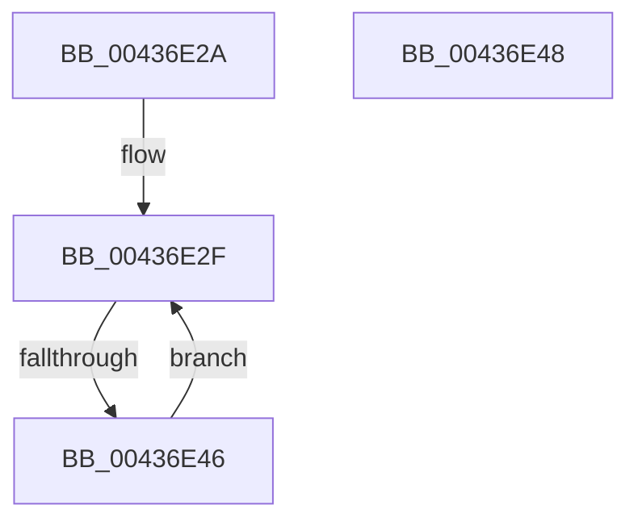

# sub_00436E2A

- RVA: `0x00436E2A`–`0x00436E60` (길이 `54` bytes)
- VA: `0x0000000140436E2A`
- 실행 섹션: `.text`
- PDB 이름 있음: `아니요`; PDB Function 태그: `아니요`
- unwind 정보 RVA: `0x000A3124`
- 디코드: `15`개 명령, `54/54` bytes 표시
- 미해석 바이트: `0` (있으면 어셈블리에 `.byte`로 보존)

> 이 문서는 커널 이미지의 기계어와 PDB 기호를 분석해 생성했습니다. 4번과 5번은 함수 원형과 자료형을 바이너리 사용 방식에서 추정한 C 해석이며 원본 소스 복구 결과는 아닙니다.

## 1. Dependencies

- 직접 호출 지점: **1**; 고유 호출 대상: **1**
- 직접 호출자로 확인된 함수: **0**
- RIP 상대 이미지 참조: **1**

### Outgoing calls
- `0x00436E56` → [MiRewritePteWithLockBit](../32/MiRewritePteWithLockBit_function_00322FEC.md) (function, `0x00322FEC`)

### Direct callers
- 이 함수 시작 RVA로 연결되는 직접 call은 확인되지 않았습니다. 간접 호출은 완전히 역산할 수 없습니다.

### Static image references
- `0x00436E48` → RVA `0x00010880` (`.rdata`; read)

## 2. Other-region calls and transfers

- 다른 실행 섹션으로 향하는 call: **0**
- call이 아닌 외부 분기/꼬리 이동: **2**
  - `0x00436E40` → [sub_00436D00 + 0xA3](Unknown_function_00436D00.md) (`tail-transfer`)
  - `0x00436E5B` → [sub_00436D00 + 0xD7](Unknown_function_00436D00.md) (`tail-transfer`)

## 3. Assembly (complete function range)

```asm
00436E2A  41 8B CF                        mov ecx, r15d
00436E2D  2B CD                           sub ecx, ebp
00436E2F  48 C1 EF 09                     shr rdi, 9
00436E33  49 23 F8                        and rdi, r8
00436E36  48 8B C2                        mov rax, rdx
00436E39  48 03 F8                        add rdi, rax
00436E3C  48 83 E9 01                     sub rcx, 1
00436E40  0F 84 5D FF FF FF               je 0x140436da3
00436E46  EB E7                           jmp 0x140436e2f
00436E48  4C 8B 0D 31 9A BD FF            mov r9, qword ptr [rip - 0x4265cf]
00436E4F  4C 8B C1                        mov r8, rcx
00436E52  33 C9                           xor ecx, ecx
00436E54  33 D2                           xor edx, edx
00436E56  E8 91 C1 EE FF                  call 0x140322fec
00436E5B  E9 77 FF FF FF                  jmp 0x140436dd7
```

## 4. C-style interpretation (structured pseudocode)

```c
__int64 __fastcall sub_00436E2A(__int64 a1, __int64 a2, __int64 a3)
{
    __int64 v_rdi;

    a1 = (unsigned int)(((unsigned int)((unsigned int)(v_r15))) - ((unsigned int)(v_rbp)));
loc_00436E2F:
    v_rdi = (v_rdi) >> (9);
    v_rdi = (v_rdi) & (a3);
    v_rdi = (v_rdi) + (a2);
    a1 = (a1) - (1);
    goto loc_00436E2F;
}
```

## 5. (Beta) C Style

```c
int64_t sub_00436E2A(int64_t Arg1, int64_t Arg2, int64_t Arg3)
{
    int64_t local_rdi;

    Arg1 = (uint32_t)(((uint32_t)((uint32_t)(local_r15))) - ((uint32_t)(local_rbp)));
loc_00436E2F:
    local_rdi = (local_rdi) >> (9);
    local_rdi = (local_rdi) & (Arg3);
    local_rdi = (local_rdi) + (Arg2);
    Arg1 = (Arg1) - (1);
    goto loc_00436E2F;
}
```

## 6. Execution-region graph

[열기: 2D/3D 그래프와 함수 탐색 컨트롤 패널](../../../control-panel.html?section=text&rva=0x00436E2A&view=graph)

- 2D 그래프는 위에서 아래로 흐르고, 3D 그래프는 빈 공간을 드래그해 회전합니다. Shift+드래그는 이동, 휠은 확대·축소, 함수 노드 선택은 대상 보고서 이동입니다.

### Static fallback


