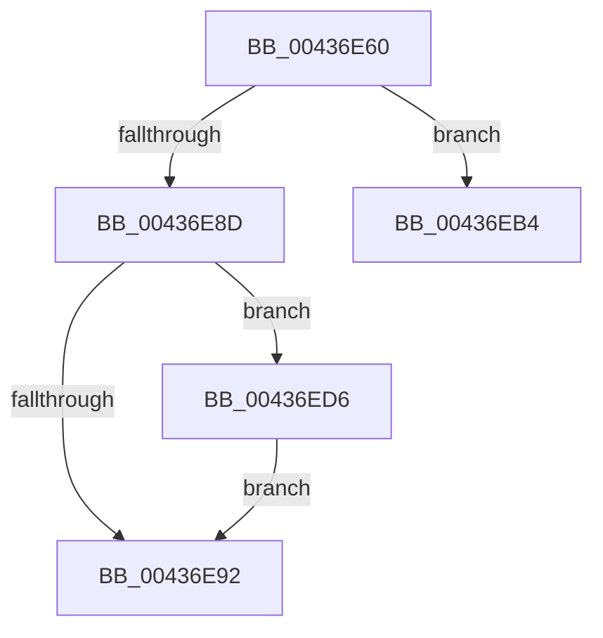

# sub_00436E60

- RVA: `0x00436E60`–`0x00436EE7` (길이 `135` bytes)
- VA: `0x0000000140436E60`
- 실행 섹션: `.text`
- PDB 이름 있음: `아니요`; PDB Function 태그: `아니요`
- unwind 정보 RVA: `0x000A3148`
- 디코드: `32`개 명령, `135/135` bytes 표시
- 미해석 바이트: `0` (있으면 어셈블리에 `.byte`로 보존)

> 이 문서는 커널 이미지의 기계어와 PDB 기호를 분석해 생성했습니다. 4번과 5번은 함수 원형과 자료형을 바이너리 사용 방식에서 추정한 C 해석이며 원본 소스 복구 결과는 아닙니다.

## 1. Dependencies

- 직접 호출 지점: **6**; 고유 호출 대상: **5**
- 직접 호출자로 확인된 함수: **0**
- RIP 상대 이미지 참조: **1**

### Outgoing calls
- `0x00436E63` → [MiVaToFlushVm](../31/MiVaToFlushVm_function_0031AD84.md) (function, `0x0031AD84`)
- `0x00436E83` → [MiInitializeTbFlushList](../29/MiInitializeTbFlushList_function_00294F00.md) (function, `0x00294F00`)
- `0x00436EA0` → [MiInsertTbFlushEntry](../29/MiInsertTbFlushEntry_function_00293670.md) (function, `0x00293670`)
- `0x00436EAA` → [MiFlushTbList](../31/MiFlushTbList_function_00311FC0.md) (function, `0x00311FC0`)
- `0x00436EC2` → [MiInsertLargeTbFlushEntry](../37/MiInsertLargeTbFlushEntry_function_0037827C.md) (function, `0x0037827C`)
- `0x00436ECC` → [MiFlushTbList](../31/MiFlushTbList_function_00311FC0.md) (function, `0x00311FC0`)

### Direct callers
- 이 함수 시작 RVA로 연결되는 직접 call은 확인되지 않았습니다. 간접 호출은 완전히 역산할 수 없습니다.

### Static image references
- `0x00436ED6` → RVA `0x00000000` (`image boundary/outside`; read)

## 2. Other-region calls and transfers

- 다른 실행 섹션으로 향하는 call: **0**
- call이 아닌 외부 분기/꼬리 이동: **2**
  - `0x00436EAF` → [sub_00436E05](Unknown_function_00436E05.md) (`tail-transfer`)
  - `0x00436ED1` → [sub_00436E05](Unknown_function_00436E05.md) (`tail-transfer`)

## 3. Assembly (complete function range)

```asm
00436E60  48 8B CB                        mov rcx, rbx
00436E63  E8 1C 3F EE FF                  call 0x14031ad84
00436E68  41 BB 01 00 00 00               mov r11d, 1
00436E6E  48 8D 4C 24 40                  lea rcx, [rsp + 0x40]
00436E73  48 8B D0                        mov rdx, rax
00436E76  44 89 5C 24 20                  mov dword ptr [rsp + 0x20], r11d
00436E7B  45 8D 4B 07                     lea r9d, [r11 + 7]
00436E7F  45 8D 43 13                     lea r8d, [r11 + 0x13]
00436E83  E8 78 E0 E5 FF                  call 0x140294f00
00436E88  41 3B EB                        cmp ebp, r11d
00436E8B  76 27                           jbe 0x140436eb4
00436E8D  83 FD 03                        cmp ebp, 3
00436E90  75 44                           jne 0x140436ed6
00436E92  45 33 C9                        xor r9d, r9d
00436E95  48 8D 4C 24 40                  lea rcx, [rsp + 0x40]
00436E9A  4D 8B C3                        mov r8, r11
00436E9D  48 8B D3                        mov rdx, rbx
00436EA0  E8 CB C7 E5 FF                  call 0x140293670
00436EA5  48 8D 4C 24 40                  lea rcx, [rsp + 0x40]
00436EAA  E8 11 B1 ED FF                  call 0x140311fc0
00436EAF  E9 51 FF FF FF                  jmp 0x140436e05
00436EB4  44 2B FD                        sub r15d, ebp
00436EB7  48 8D 4C 24 40                  lea rcx, [rsp + 0x40]
00436EBC  41 8B D7                        mov edx, r15d
00436EBF  4D 8B C5                        mov r8, r13
00436EC2  E8 B5 13 F4 FF                  call 0x14037827c
00436EC7  48 8D 4C 24 40                  lea rcx, [rsp + 0x40]
00436ECC  E8 EF B0 ED FF                  call 0x140311fc0
00436ED1  E9 2F FF FF FF                  jmp 0x140436e05
00436ED6  48 8D 05 23 91 BC FF            lea rax, [rip - 0x436edd]
00436EDD  4C 8B 9C E8 60 1C 01 00         mov r11, qword ptr [rax + rbp*8 + 0x11c60]
00436EE5  EB AB                           jmp 0x140436e92
```

## 4. C-style interpretation (structured pseudocode)

```c
__int64 __fastcall sub_00436E60(__int64 a1, __int64 a2, __int64 a3, __int64 a4, __int64 a5, __int64 a6, __int64 a7, __int64 a8)
{
    __int64 result;
    __int64 v_r15;
    unsigned int v_stack_p20;

    result = MiVaToFlushVm(v_rbx, a2, a3, a4);
    v_stack_p20 = 1;
    result = MiInitializeTbFlushList(a8, result, 1 + 19, 1 + 7);
    if (((unsigned int)(v_rbp)) <= 1) goto loc_00436EB4;
    if (((unsigned int)(v_rbp)) != 3) goto loc_00436ED6;
loc_00436E92:
    a4 = 0;
    result = MiInsertTbFlushEntry(a8, v_rbx, 1, a4);
    result = MiFlushTbList(a8, v_rbx, 1, a4);
loc_00436EB4:
    v_r15 = (unsigned int)((v_r15) - ((unsigned int)(v_rbp)));
    result = MiInsertLargeTbFlushEntry(a8, (unsigned int)((unsigned int)(v_r15)), v_r13, a4);
    result = MiFlushTbList(a8, (unsigned int)((unsigned int)(v_r15)), v_r13, a4);
loc_00436ED6:
    goto loc_00436E92;
}
```

## 5. (Beta) C Style

```c
int64_t sub_00436E60(int64_t Arg1, int64_t Arg2, int64_t Arg3, int64_t Arg4, uint64_t Arg5, uint64_t Arg6, uint64_t Arg7, int64_t Arg8)
{
    int64_t result;
    int64_t local_r15;
    uint32_t v_stack_p20;

    result = MiVaToFlushVm(local_rbx, Arg2, Arg3, Arg4);
    v_stack_p20 = 1;
    result = MiInitializeTbFlushList(Arg8, result, 1 + 19, 1 + 7);
    if (((uint32_t)(local_rbp)) <= 1) goto loc_00436EB4;
    if (((uint32_t)(local_rbp)) != 3) goto loc_00436ED6;
loc_00436E92:
    Arg4 = 0;
    result = MiInsertTbFlushEntry(Arg8, local_rbx, 1, Arg4);
    result = MiFlushTbList(Arg8, local_rbx, 1, Arg4);
loc_00436EB4:
    local_r15 = (uint32_t)((local_r15) - ((uint32_t)(local_rbp)));
    result = MiInsertLargeTbFlushEntry(Arg8, (uint32_t)((uint32_t)(local_r15)), local_r13, Arg4);
    result = MiFlushTbList(Arg8, (uint32_t)((uint32_t)(local_r15)), local_r13, Arg4);
loc_00436ED6:
    goto loc_00436E92;
}
```

## 6. Execution-region graph

[열기: 2D/3D 그래프와 함수 탐색 컨트롤 패널](../../../control-panel.html?section=text&rva=0x00436E60&view=graph)

- 2D 그래프는 위에서 아래로 흐르고, 3D 그래프는 빈 공간을 드래그해 회전합니다. Shift+드래그는 이동, 휠은 확대·축소, 함수 노드 선택은 대상 보고서 이동입니다.

### Static fallback


