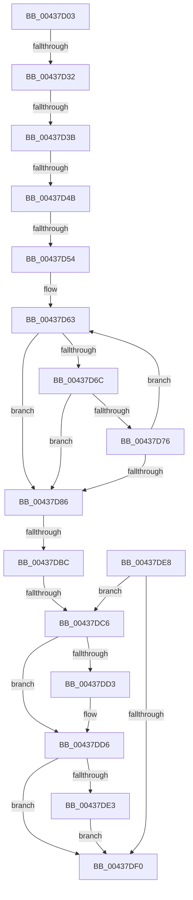

# sub_00437D03

- RVA: `0x00437D03`–`0x00437E04` (길이 `257` bytes)
- VA: `0x0000000140437D03`
- 실행 섹션: `.text`
- PDB 이름 있음: `아니요`; PDB Function 태그: `아니요`
- unwind 정보 RVA: `0x000A3324`
- 디코드: `64`개 명령, `257/257` bytes 표시
- 미해석 바이트: `0` (있으면 어셈블리에 `.byte`로 보존)

> 이 문서는 커널 이미지의 기계어와 PDB 기호를 분석해 생성했습니다. 4번과 5번은 함수 원형과 자료형을 바이너리 사용 방식에서 추정한 C 해석이며 원본 소스 복구 결과는 아닙니다.

## 1. Dependencies

- 직접 호출 지점: **0**; 고유 호출 대상: **0**
- 직접 호출자로 확인된 함수: **0**
- RIP 상대 이미지 참조: **0**

### Outgoing calls
- 직접 디코드된 call 명령이 없습니다.

### Direct callers
- 이 함수 시작 RVA로 연결되는 직접 call은 확인되지 않았습니다. 간접 호출은 완전히 역산할 수 없습니다.

### Static image references
- 디코드된 RIP-relative 메모리 참조가 없습니다.

## 2. Other-region calls and transfers

- 다른 실행 섹션으로 향하는 call: **0**
- call이 아닌 외부 분기/꼬리 이동: **6**
  - `0x00437D2C` → [sub_00437E4E](Unknown_function_00437E4E.md) (`tail-transfer`)
  - `0x00437D35` → [sub_00437E4E + 0x46](Unknown_function_00437E4E.md) (`tail-transfer`)
  - `0x00437D45` → [sub_00437ECD](Unknown_function_00437ECD.md) (`tail-transfer`)
  - `0x00437D4E` → [sub_00437ECD + 0xE](Unknown_function_00437ECD.md) (`tail-transfer`)
  - `0x00437DBA` → [sub_00437E13](Unknown_function_00437E13.md) (`tail-transfer`)
  - `0x00437DC0` → [sub_00437E4E + 0x9](Unknown_function_00437E4E.md) (`tail-transfer`)

## 3. Assembly (complete function range)

```asm
00437D03  48 89 6C 24 70                  mov qword ptr [rsp + 0x70], rbp
00437D08  49 8B EF                        mov rbp, r15
00437D0B  48 89 BC 24 80 00 00 00         mov qword ptr [rsp + 0x80], rdi
00437D13  49 8B FE                        mov rdi, r14
00437D16  48 89 74 24 78                  mov qword ptr [rsp + 0x78], rsi
00437D1B  4C 89 7C 24 30                  mov qword ptr [rsp + 0x30], r15
00437D20  4C 89 74 24 38                  mov qword ptr [rsp + 0x38], r14
00437D25  49 81 F9 FF FF FF 7F            cmp r9, 0x7fffffff
00437D2C  0F 83 1C 01 00 00               jae 0x140437e4e
00437D32  45 85 C0                        test r8d, r8d
00437D35  0F 85 59 01 00 00               jne 0x140437e94
00437D3B  41 8B F5                        mov esi, r13d
00437D3E  41 F7 C4 00 E0 FF FF            test r12d, 0xffffe000
00437D45  0F 85 82 01 00 00               jne 0x140437ecd
00437D4B  4D 85 F6                        test r14, r14
00437D4E  0F 84 87 01 00 00               je 0x140437edb
00437D54  4D 2B CE                        sub r9, r14
00437D57  49 8B C6                        mov rax, r14
00437D5A  4D 2B D7                        sub r10, r15
00437D5D  49 8B D7                        mov rdx, r15
00437D60  4D 8B C5                        mov r8, r13
00437D63  49 8D 0C 01                     lea rcx, [r9 + rax]
00437D67  48 85 C9                        test rcx, rcx
00437D6A  74 1A                           je 0x140437d86
00437D6C  41 0F B7 0C 12                  movzx ecx, word ptr [r10 + rdx]
00437D71  66 85 C9                        test cx, cx
00437D74  74 10                           je 0x140437d86
00437D76  66 89 0A                        mov word ptr [rdx], cx
00437D79  49 FF C0                        inc r8
00437D7C  48 83 C2 02                     add rdx, 2
00437D80  48 83 E8 01                     sub rax, 1
00437D84  75 DD                           jne 0x140437d63
00437D86  48 85 C0                        test rax, rax
00437D89  48 8D 4A FE                     lea rcx, [rdx - 2]
00437D8D  BE 05 00 00 80                  mov esi, 0x80000005
00437D92  48 0F 45 CA                     cmovne rcx, rdx
00437D96  41 0F 45 F5                     cmovne esi, r13d
00437D9A  66 44 89 29                     mov word ptr [rcx], r13w
00437D9E  49 8D 48 FF                     lea rcx, [r8 - 1]
00437DA2  49 0F 45 C8                     cmovne rcx, r8
00437DA6  48 2B F9                        sub rdi, rcx
00437DA9  48 89 7C 24 38                  mov qword ptr [rsp + 0x38], rdi
00437DAE  49 8D 2C 4F                     lea rbp, [r15 + rcx*2]
00437DB2  48 89 6C 24 30                  mov qword ptr [rsp + 0x30], rbp
00437DB7  48 85 C0                        test rax, rax
00437DBA  75 57                           jne 0x140437e13
00437DBC  8B DE                           mov ebx, esi
00437DBE  85 F6                           test esi, esi
00437DC0  0F 88 91 00 00 00               js 0x140437e57
00437DC6  48 8B 84 24 90 00 00 00         mov rax, qword ptr [rsp + 0x90]
00437DCE  48 85 C0                        test rax, rax
00437DD1  74 03                           je 0x140437dd6
00437DD3  48 89 28                        mov qword ptr [rax], rbp
00437DD6  48 8B 84 24 98 00 00 00         mov rax, qword ptr [rsp + 0x98]
00437DDE  48 85 C0                        test rax, rax
00437DE1  74 0D                           je 0x140437df0
00437DE3  48 89 38                        mov qword ptr [rax], rdi
00437DE6  EB 08                           jmp 0x140437df0
00437DE8  81 FB 05 00 00 80               cmp ebx, 0x80000005
00437DEE  74 D6                           je 0x140437dc6
00437DF0  48 8B 74 24 78                  mov rsi, qword ptr [rsp + 0x78]
00437DF5  8B C3                           mov eax, ebx
00437DF7  48 8B 6C 24 70                  mov rbp, qword ptr [rsp + 0x70]
00437DFC  48 8B BC 24 80 00 00 00         mov rdi, qword ptr [rsp + 0x80]
```

## 4. C-style interpretation (structured pseudocode)

```c
__int64 __fastcall sub_00437D03(__int64 a1, __int64 a2, int a3, __int64 a4, __int64 a5, __int64 a6, __int64 a7, __int64 a8, __int64 a9, __int64 a10, __int64 a11, __int64 a12, __int64 a13, __int64 a14, __int64 a15, __int64 a16, __int64 a17, __int64 a18, __int64 a19)
{
    __int64 result;
    __int64 v_r10;
    __int64 v_rdi;
    __int64 v_rsi;
    unsigned __int64 v_stack_p30;
    unsigned __int64 v_stack_p38;
    unsigned __int64 v_stack_p70;
    unsigned __int64 v_stack_p78;
    unsigned __int64 v_stack_p80;

    v_stack_p70 = v_rbp;
    v_stack_p80 = v_rdi;
    v_stack_p78 = v_rsi;
    v_stack_p30 = v_r15;
    v_stack_p38 = v_r14;
    a4 = (a4) - (v_r14);
    v_r10 = (v_r10) - (v_r15);
loc_00437D63:
    if (a4 + v_r14 * 1 == 0) goto loc_00437D86;
    if ((unsigned __int16)(*(unsigned __int16 *)(v_r10 + v_r15 * 1)) == 0) goto loc_00437D86;
    *(unsigned __int16 *)(v_r15) = (unsigned __int16)(*(unsigned __int16 *)(v_r10 + v_r15 * 1));
    a3 = (v_r13) + 1;
    a2 = (v_r15) + (2);
    result = (v_r14) - (1);
    if (condition_is_not_equal) goto loc_00437D63;
loc_00437D86:
    a1 = a2 - 2;
    if (result != 0) { a1 = a2; }
    v_rsi = (unsigned int)(0x80000005ULL);
    if (result != 0) { v_rsi = (unsigned int)(v_r13); }
    *(unsigned __int16 *)(a1) = (unsigned __int16)(v_r13);
    a1 = a3 - 1;
    if (result != 0) { a1 = a3; }
    v_rdi = (v_r14) - (a1);
    v_stack_p38 = v_rdi;
    v_stack_p30 = v_r15 + a1 * 2;
loc_00437DC6:
    if (a18 != 0) {
        *(unsigned __int64 *)(a18) = v_r15 + a1 * 2;
    }
    if (a19 == 0) goto loc_00437DF0;
    *(unsigned __int64 *)(a19) = v_rdi;
    goto loc_00437DF0;
loc_00437DF0:
    return (unsigned int)((unsigned int)((unsigned int)((unsigned int)(v_rsi))));
}
```

## 5. (Beta) C Style

```c
int64_t sub_00437D03(int64_t Arg1, int64_t Arg2, int32_t Arg3, int64_t Arg4, uint64_t Arg5, uint64_t Arg6, uint64_t Arg7, uint64_t Arg8, uint64_t Arg9, uint64_t Arg10, uint64_t Arg11, uint64_t Arg12, uint64_t Arg13, int64_t Arg14, int64_t Arg15, int64_t Arg16, uint64_t Arg17, int64_t Arg18, int64_t Arg19)
{
    int64_t result;
    int64_t local_r10;
    int64_t local_rdi;
    int64_t local_rsi;
    uint64_t v_stack_p30;
    uint64_t v_stack_p38;
    uint64_t v_stack_p70;
    uint64_t v_stack_p78;
    uint64_t v_stack_p80;

    v_stack_p70 = local_rbp;
    v_stack_p80 = local_rdi;
    v_stack_p78 = local_rsi;
    v_stack_p30 = local_r15;
    v_stack_p38 = local_r14;
    Arg4 = (Arg4) - (local_r14);
    local_r10 = (local_r10) - (local_r15);
loc_00437D63:
    if (Arg4 + local_r14 * 1 == 0) goto loc_00437D86;
    if ((uint16_t)(*(uint16_t *)(local_r10 + local_r15 * 1)) == 0) goto loc_00437D86;
    *(uint16_t *)(local_r15) = (uint16_t)(*(uint16_t *)(local_r10 + local_r15 * 1));
    Arg3 = (local_r13) + 1;
    Arg2 = (local_r15) + (2);
    result = (local_r14) - (1);
    if (condition_is_not_equal) goto loc_00437D63;
loc_00437D86:
    Arg1 = Arg2 - 2;
    if (result != 0) { Arg1 = Arg2; }
    local_rsi = (uint32_t)(0x80000005ULL);
    if (result != 0) { local_rsi = (uint32_t)(local_r13); }
    *(uint16_t *)(Arg1) = (uint16_t)(local_r13);
    Arg1 = Arg3 - 1;
    if (result != 0) { Arg1 = Arg3; }
    local_rdi = (local_r14) - (Arg1);
    v_stack_p38 = local_rdi;
    v_stack_p30 = local_r15 + Arg1 * 2;
loc_00437DC6:
    if (Arg18 != 0) {
        *(uint64_t *)(Arg18) = local_r15 + Arg1 * 2;
    }
    if (Arg19 == 0) goto loc_00437DF0;
    *(uint64_t *)(Arg19) = local_rdi;
    goto loc_00437DF0;
loc_00437DF0:
    return (uint32_t)((uint32_t)((uint32_t)((uint32_t)(local_rsi))));
}
```

## 6. Execution-region graph

[열기: 2D/3D 그래프와 함수 탐색 컨트롤 패널](../../../control-panel.html?section=text&rva=0x00437D03&view=graph)

- 2D 그래프는 위에서 아래로 흐르고, 3D 그래프는 빈 공간을 드래그해 회전합니다. Shift+드래그는 이동, 휠은 확대·축소, 함수 노드 선택은 대상 보고서 이동입니다.

### Static fallback


