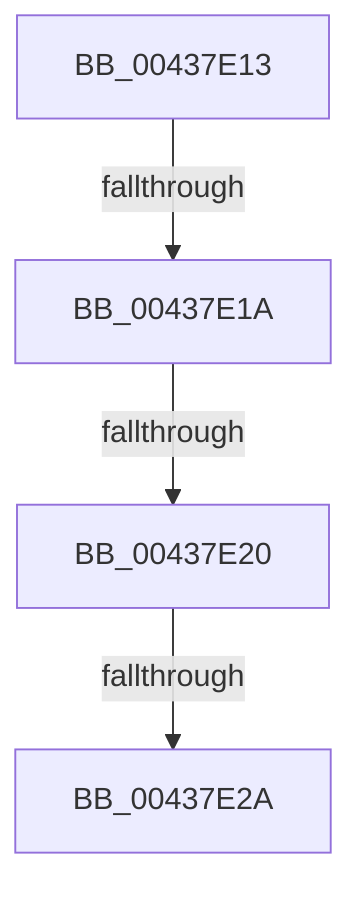

# sub_00437E13

- RVA: `0x00437E13`–`0x00437E40` (길이 `45` bytes)
- VA: `0x0000000140437E13`
- 실행 섹션: `.text`
- PDB 이름 있음: `아니요`; PDB Function 태그: `아니요`
- unwind 정보 RVA: `0x000A3354`
- 디코드: `12`개 명령, `45/45` bytes 표시
- 미해석 바이트: `0` (있으면 어셈블리에 `.byte`로 보존)

> 이 문서는 커널 이미지의 기계어와 PDB 기호를 분석해 생성했습니다. 4번과 5번은 함수 원형과 자료형을 바이너리 사용 방식에서 추정한 C 해석이며 원본 소스 복구 결과는 아닙니다.

## 1. Dependencies

- 직접 호출 지점: **1**; 고유 호출 대상: **1**
- 직접 호출자로 확인된 함수: **0**
- RIP 상대 이미지 참조: **0**

### Outgoing calls
- `0x00437E36` → [memset](../6C/memset_function_006C6C40.md) (function, `0x006C6C40`)

### Direct callers
- 이 함수 시작 RVA로 연결되는 직접 call은 확인되지 않았습니다. 간접 호출은 완전히 역산할 수 없습니다.

### Static image references
- 디코드된 RIP-relative 메모리 참조가 없습니다.

## 2. Other-region calls and transfers

- 다른 실행 섹션으로 향하는 call: **0**
- call이 아닌 외부 분기/꼬리 이동: **4**
  - `0x00437E18` → [sub_00437D03 + 0xB9](Unknown_function_00437D03.md) (`tail-transfer`)
  - `0x00437E1E` → [sub_00437D03 + 0xB9](Unknown_function_00437D03.md) (`tail-transfer`)
  - `0x00437E28` → [sub_00437D03 + 0xB9](Unknown_function_00437D03.md) (`tail-transfer`)
  - `0x00437E3B` → [sub_00437D03 + 0xB9](Unknown_function_00437D03.md) (`tail-transfer`)

## 3. Assembly (complete function range)

```asm
00437E13  41 0F BA E4 09                  bt r12d, 9
00437E18  73 A2                           jae 0x140437dbc
00437E1A  48 83 FF 01                     cmp rdi, 1
00437E1E  76 9C                           jbe 0x140437dbc
00437E20  4C 8D 04 3F                     lea r8, [rdi + rdi]
00437E24  49 83 F8 02                     cmp r8, 2
00437E28  76 92                           jbe 0x140437dbc
00437E2A  49 83 C0 FE                     add r8, -2
00437E2E  41 0F B6 D4                     movzx edx, r12b
00437E32  48 8D 4D 02                     lea rcx, [rbp + 2]
00437E36  E8 05 EE 28 00                  call 0x1406c6c40
00437E3B  E9 7C FF FF FF                  jmp 0x140437dbc
```

## 4. C-style interpretation (structured pseudocode)

```c
__int64 __fastcall sub_00437E13(void)
{
    __int64 result;

    a3 = (v_rdi + v_rdi * 1) + (-2);
    result = memset(v_rbp + 2, (unsigned __int8)(v_r12), a3, a4);
}
```

## 5. (Beta) C Style

```c
void sub_00437E13(void)
{
    int64_t result;

    a3 = (local_rdi + local_rdi * 1) + (-2);
    result = memset(local_rbp + 2, (uint8_t)(local_r12), a3, a4);
}
```

## 6. Execution-region graph

[열기: 2D/3D 그래프와 함수 탐색 컨트롤 패널](../../../control-panel.html?section=text&rva=0x00437E13&view=graph)

- 2D 그래프는 위에서 아래로 흐르고, 3D 그래프는 빈 공간을 드래그해 회전합니다. Shift+드래그는 이동, 휠은 확대·축소, 함수 노드 선택은 대상 보고서 이동입니다.

### Static fallback


