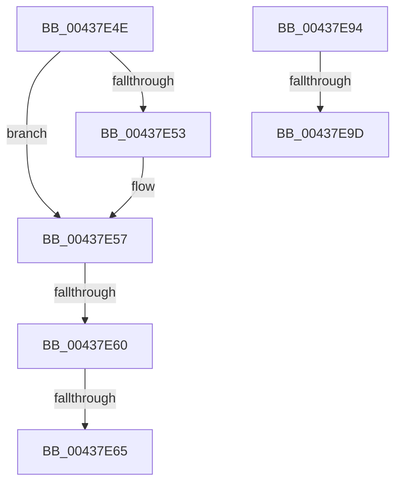

# sub_00437E4E

- RVA: `0x00437E4E`–`0x00437EAC` (길이 `94` bytes)
- VA: `0x0000000140437E4E`
- 실행 섹션: `.text`
- PDB 이름 있음: `아니요`; PDB Function 태그: `아니요`
- unwind 정보 RVA: `0x000A3380`
- 디코드: `22`개 명령, `94/94` bytes 표시
- 미해석 바이트: `0` (있으면 어셈블리에 `.byte`로 보존)

> 이 문서는 커널 이미지의 기계어와 PDB 기호를 분석해 생성했습니다. 4번과 5번은 함수 원형과 자료형을 바이너리 사용 방식에서 추정한 C 해석이며 원본 소스 복구 결과는 아닙니다.

## 1. Dependencies

- 직접 호출 지점: **1**; 고유 호출 대상: **1**
- 직접 호출자로 확인된 함수: **0**
- RIP 상대 이미지 참조: **1**

### Outgoing calls
- `0x00437E80` → [RtlStringExHandleOtherFlagsW](../41/RtlStringExHandleOtherFlagsW_function_0041E3F0.md) (function, `0x0041E3F0`)

### Direct callers
- 이 함수 시작 RVA로 연결되는 직접 call은 확인되지 않았습니다. 간접 호출은 완전히 역산할 수 없습니다.

### Static image references
- `0x00437E9D` → RVA `0x006C8EC0` (` ?? ::FNODOBFM::`string'`; read)

## 2. Other-region calls and transfers

- 다른 실행 섹션으로 향하는 call: **0**
- call이 아닌 외부 분기/꼬리 이동: **5**
  - `0x00437E5E` → [sub_00437D03 + 0xE5](Unknown_function_00437D03.md) (`tail-transfer`)
  - `0x00437E63` → [sub_00437D03 + 0xE5](Unknown_function_00437D03.md) (`tail-transfer`)
  - `0x00437E8F` → [sub_00437D03 + 0xE5](Unknown_function_00437D03.md) (`tail-transfer`)
  - `0x00437E97` → [sub_00437D03 + 0x38](Unknown_function_00437D03.md) (`tail-transfer`)
  - `0x00437EA7` → [sub_00437D03 + 0x38](Unknown_function_00437D03.md) (`tail-transfer`)

## 3. Assembly (complete function range)

```asm
00437E4E  4D 85 F6                        test r14, r14
00437E51  74 04                           je 0x140437e57
00437E53  66 44 89 29                     mov word ptr [rcx], r13w
00437E57  41 F7 C4 00 1C 00 00            test r12d, 0x1c00
00437E5E  74 88                           je 0x140437de8
00437E60  4D 85 F6                        test r14, r14
00437E63  74 83                           je 0x140437de8
00437E65  48 8D 44 24 38                  lea rax, [rsp + 0x38]
00437E6A  44 89 64 24 28                  mov dword ptr [rsp + 0x28], r12d
00437E6F  4B 8D 14 36                     lea rdx, [r14 + r14]
00437E73  48 89 44 24 20                  mov qword ptr [rsp + 0x20], rax
00437E78  4C 8D 4C 24 30                  lea r9, [rsp + 0x30]
00437E7D  49 8B CF                        mov rcx, r15
00437E80  E8 6B 65 FE FF                  call 0x14041e3f0
00437E85  48 8B 6C 24 30                  mov rbp, qword ptr [rsp + 0x30]
00437E8A  48 8B 7C 24 38                  mov rdi, qword ptr [rsp + 0x38]
00437E8F  E9 54 FF FF FF                  jmp 0x140437de8
00437E94  4D 85 D2                        test r10, r10
00437E97  0F 85 9E FE FF FF               jne 0x140437d3b
00437E9D  4C 8D 15 1C 10 29 00            lea r10, [rip + 0x29101c]
00437EA4  4D 8B CD                        mov r9, r13
00437EA7  E9 8F FE FF FF                  jmp 0x140437d3b
```

## 4. C-style interpretation (structured pseudocode)

```c
__int64 __fastcall sub_00437E4E(__int64 a1, __int64 a2, __int64 a3, __int64 a4, __int64 a5, __int64 a6, __int64 a7)
{
    __int64 result;
    unsigned __int64 v_stack_p20;
    unsigned int v_stack_p28;

    if (v_r14 != 0) {
        *(unsigned __int16 *)(a1) = (unsigned __int16)(v_r13);
    }
    v_stack_p28 = (unsigned int)(v_r12);
    v_stack_p20 = a7;
    result = RtlStringExHandleOtherFlagsW(v_r15, v_r14 + v_r14 * 1, a3, a6);
}
```

## 5. (Beta) C Style

```c
int64_t sub_00437E4E(void *Arg1, int64_t Arg2, int64_t Arg3, int64_t Arg4, uint64_t Arg5, int64_t Arg6, int64_t Arg7)
{
    uint8_t *arg1 = (uint8_t *)Arg1;

    int64_t result;
    uint64_t v_stack_p20;
    uint32_t v_stack_p28;

    if (local_r14 != 0) {
        *(uint16_t *)(arg1) = (uint16_t)(local_r13);
    }
    v_stack_p28 = (uint32_t)(local_r12);
    v_stack_p20 = Arg7;
    result = RtlStringExHandleOtherFlagsW(local_r15, local_r14 + local_r14 * 1, Arg3, Arg6);
}
```

### 관측된 메모리 오프셋

구조체 형식이 확인되지 않은 접근은 인자 기준의 오프셋으로만 기록했습니다.

| 기준 인자 | 오프셋 표현 | 폭 (bit) | 접근 |
|---|---:|---:|---|
| `Arg1` | `+ 0x0` | `16` | `W` |

## 6. Execution-region graph

[열기: 2D/3D 그래프와 함수 탐색 컨트롤 패널](../../../control-panel.html?section=text&rva=0x00437E4E&view=graph)

- 2D 그래프는 위에서 아래로 흐르고, 3D 그래프는 빈 공간을 드래그해 회전합니다. Shift+드래그는 이동, 휠은 확대·축소, 함수 노드 선택은 대상 보고서 이동입니다.

### Static fallback


