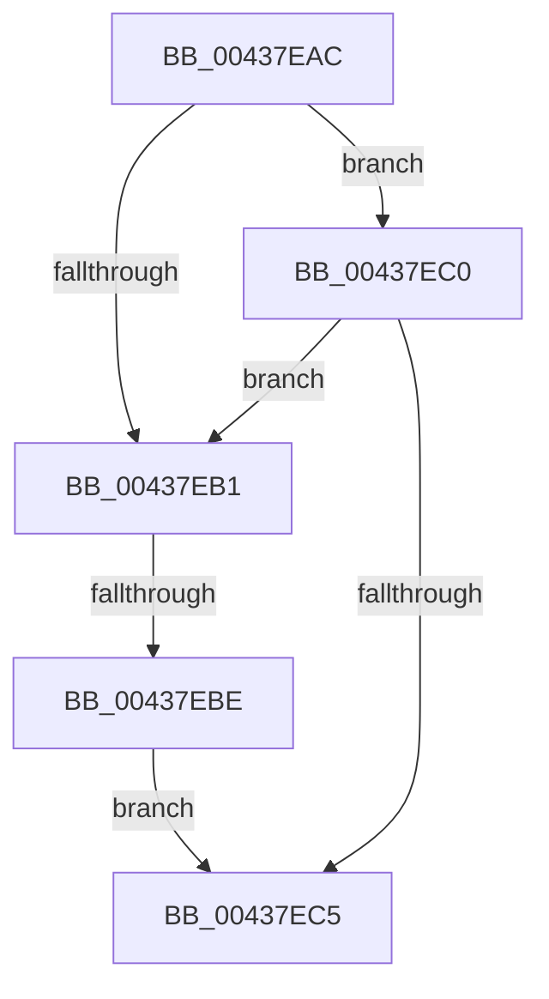

# sub_00437EAC

- RVA: `0x00437EAC`–`0x00437ECD` (길이 `33` bytes)
- VA: `0x0000000140437EAC`
- 실행 섹션: `.text`
- PDB 이름 있음: `아니요`; PDB Function 태그: `아니요`
- unwind 정보 RVA: `0x000A339C`
- 디코드: `9`개 명령, `33/33` bytes 표시
- 미해석 바이트: `0` (있으면 어셈블리에 `.byte`로 보존)

> 이 문서는 커널 이미지의 기계어와 PDB 기호를 분석해 생성했습니다. 4번과 5번은 함수 원형과 자료형을 바이너리 사용 방식에서 추정한 C 해석이며 원본 소스 복구 결과는 아닙니다.

## 1. Dependencies

- 직접 호출 지점: **0**; 고유 호출 대상: **0**
- 직접 호출자로 확인된 함수: **0**
- RIP 상대 이미지 참조: **0**

### Outgoing calls
- 직접 디코드된 call 명령이 없습니다.

### Direct callers
- 이 함수 시작 RVA로 연결되는 직접 call은 확인되지 않았습니다. 간접 호출은 완전히 역산할 수 없습니다.

### Static image references
- 디코드된 RIP-relative 메모리 참조가 없습니다.

## 2. Other-region calls and transfers

- 다른 실행 섹션으로 향하는 call: **0**
- call이 아닌 외부 분기/꼬리 이동: **2**
  - `0x00437EB8` → [RtlStringCchCopyNExW + 0x4A](RtlStringCchCopyNExW_function_00437CB0.md) (`tail-transfer`)
  - `0x00437EC8` → [RtlStringCchCopyNExW + 0x4A](RtlStringCchCopyNExW_function_00437CB0.md) (`tail-transfer`)

## 3. Assembly (complete function range)

```asm
00437EAC  4D 85 FF                        test r15, r15
00437EAF  74 0F                           je 0x140437ec0
00437EB1  49 81 FE FF FF FF 7F            cmp r14, 0x7fffffff
00437EB8  0F 86 3C FE FF FF               jbe 0x140437cfa
00437EBE  EB 05                           jmp 0x140437ec5
00437EC0  4D 85 F6                        test r14, r14
00437EC3  74 EC                           je 0x140437eb1
00437EC5  44 8B DB                        mov r11d, ebx
00437EC8  E9 2D FE FF FF                  jmp 0x140437cfa
```

## 4. C-style interpretation (structured pseudocode)

```c
void __fastcall sub_00437EAC(void)
{
    if (v_r15 == 0) goto loc_00437EC0;
loc_00437EB1:
    goto loc_00437EC5;
loc_00437EC0:
    if (v_r14 == 0) goto loc_00437EB1;
loc_00437EC5:
}
```

## 5. (Beta) C Style

```c
void sub_00437EAC(void)
{
    if (local_r15 == 0) goto loc_00437EC0;
loc_00437EB1:
    goto loc_00437EC5;
loc_00437EC0:
    if (local_r14 == 0) goto loc_00437EB1;
loc_00437EC5:
}
```

## 6. Execution-region graph

[열기: 2D/3D 그래프와 함수 탐색 컨트롤 패널](../../../control-panel.html?section=text&rva=0x00437EAC&view=graph)

- 2D 그래프는 위에서 아래로 흐르고, 3D 그래프는 빈 공간을 드래그해 회전합니다. Shift+드래그는 이동, 휠은 확대·축소, 함수 노드 선택은 대상 보고서 이동입니다.

### Static fallback


