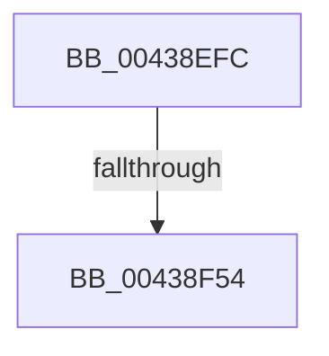

# sub_00438EFC

- RVA: `0x00438EFC`–`0x00438F5D` (길이 `97` bytes)
- VA: `0x0000000140438EFC`
- 실행 섹션: `.text`
- PDB 이름 있음: `아니요`; PDB Function 태그: `아니요`
- unwind 정보 RVA: `0x000A37C8`
- 디코드: `21`개 명령, `97/97` bytes 표시
- 미해석 바이트: `0` (있으면 어셈블리에 `.byte`로 보존)

> 이 문서는 커널 이미지의 기계어와 PDB 기호를 분석해 생성했습니다. 4번과 5번은 함수 원형과 자료형을 바이너리 사용 방식에서 추정한 C 해석이며 원본 소스 복구 결과는 아닙니다.

## 1. Dependencies

- 직접 호출 지점: **0**; 고유 호출 대상: **0**
- 직접 호출자로 확인된 함수: **0**
- RIP 상대 이미지 참조: **1**

### Outgoing calls
- 직접 디코드된 call 명령이 없습니다.

### Direct callers
- 이 함수 시작 RVA로 연결되는 직접 call은 확인되지 않았습니다. 간접 호출은 완전히 역산할 수 없습니다.

### Static image references
- `0x00438F48` → RVA `0x00FC6D20` (`ALMOSTRO`; read)

## 2. Other-region calls and transfers

- 다른 실행 섹션으로 향하는 call: **0**
- call이 아닌 외부 분기/꼬리 이동: **2**
  - `0x00438F4E` → [sub_004390F5](Unknown_function_004390F5.md) (`tail-transfer`)
  - `0x00438F57` → [sub_00439072](Unknown_function_00439072.md) (`tail-transfer`)

## 3. Assembly (complete function range)

```asm
00438EFC  48 89 6C 24 48                  mov qword ptr [rsp + 0x48], rbp
00438F01  81 E2 FF 0F 00 00               and edx, 0xfff
00438F07  48 89 74 24 40                  mov qword ptr [rsp + 0x40], rsi
00438F0C  48 8D 71 30                     lea rsi, [rcx + 0x30]
00438F10  8B 49 28                        mov ecx, dword ptr [rcx + 0x28]
00438F13  48 81 C1 FF 0F 00 00            add rcx, 0xfff
00438F1A  4C 89 64 24 30                  mov qword ptr [rsp + 0x30], r12
00438F1F  48 03 CA                        add rcx, rdx
00438F22  4C 89 6C 24 28                  mov qword ptr [rsp + 0x28], r13
00438F27  48 C1 E9 0C                     shr rcx, 0xc
00438F2B  45 33 E4                        xor r12d, r12d
00438F2E  4C 89 7C 24 20                  mov qword ptr [rsp + 0x20], r15
00438F33  41 8B EC                        mov ebp, r12d
00438F36  4C 8D 3C CE                     lea r15, [rsi + rcx*8]
00438F3A  45 0F 20 C6                     mov r14, cr8
00438F3E  41 BD 02 00 00 00               mov r13d, 2
00438F44  45 0F 22 C5                     mov cr8, r13
00438F48  39 2D D2 DD B8 00               cmp dword ptr [rip + 0xb8ddd2], ebp
00438F4E  0F 85 A1 01 00 00               jne 0x1404390f5
00438F54  49 3B F7                        cmp rsi, r15
00438F57  0F 83 15 01 00 00               jae 0x140439072
```

## 4. C-style interpretation (structured pseudocode)

```c
void __fastcall sub_00438EFC(__int64 a1, int a2)
{
    __int64 v_r12;
    unsigned __int64 v_stack_p20;
    unsigned __int64 v_stack_p28;
    unsigned __int64 v_stack_p30;
    unsigned __int64 v_stack_p40;
    unsigned __int64 v_stack_p48;

    v_stack_p48 = v_rbp;
    a2 = (unsigned int)((a2) & (0xFFFULL));
    v_stack_p40 = v_rsi;
    a1 = ((unsigned int)(*(unsigned int *)(a1 + 40))) + (0xFFFULL);
    v_stack_p30 = v_r12;
    a1 = (a1) + (a2);
    v_stack_p28 = v_r13;
    a1 = (a1) >> (12);
    v_r12 = 0;
    v_stack_p20 = v_r15;
}
```

## 5. (Beta) C Style

```c
void sub_00438EFC(void *Arg1, int32_t Arg2)
{
    uint8_t *arg1 = (uint8_t *)Arg1;

    int64_t local_r12;
    uint64_t v_stack_p20;
    uint64_t v_stack_p28;
    uint64_t v_stack_p30;
    uint64_t v_stack_p40;
    uint64_t v_stack_p48;

    v_stack_p48 = local_rbp;
    Arg2 = (uint32_t)((Arg2) & (0xFFFULL));
    v_stack_p40 = local_rsi;
    Arg1 = ((uint32_t)(*(uint32_t *)(arg1 + 0x28))) + (0xFFFULL);
    v_stack_p30 = local_r12;
    Arg1 = (Arg1) + (Arg2);
    v_stack_p28 = local_r13;
    Arg1 = (Arg1) >> (12);
    local_r12 = 0;
    v_stack_p20 = local_r15;
}
```

### 관측된 메모리 오프셋

구조체 형식이 확인되지 않은 접근은 인자 기준의 오프셋으로만 기록했습니다.

| 기준 인자 | 오프셋 표현 | 폭 (bit) | 접근 |
|---|---:|---:|---|
| `Arg1` | `+ 0x0 + rcx*8` | `64` | `R` |
| `Arg1` | `+ 0x28` | `32` | `R` |
| `Arg1` | `+ 0x30` | `64` | `R` |

## 6. Execution-region graph

[열기: 2D/3D 그래프와 함수 탐색 컨트롤 패널](../../../control-panel.html?section=text&rva=0x00438EFC&view=graph)

- 2D 그래프는 위에서 아래로 흐르고, 3D 그래프는 빈 공간을 드래그해 회전합니다. Shift+드래그는 이동, 휠은 확대·축소, 함수 노드 선택은 대상 보고서 이동입니다.

### Static fallback


