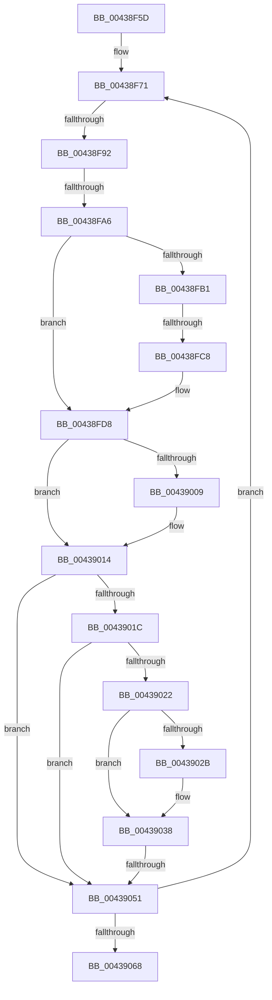

# sub_00438F5D

- RVA: `0x00438F5D`–`0x00439072` (길이 `277` bytes)
- VA: `0x0000000140438F5D`
- 실행 섹션: `.text`
- PDB 이름 있음: `아니요`; PDB Function 태그: `아니요`
- unwind 정보 RVA: `0x000A37EC`
- 디코드: `62`개 명령, `277/277` bytes 표시
- 미해석 바이트: `0` (있으면 어셈블리에 `.byte`로 보존)

> 이 문서는 커널 이미지의 기계어와 PDB 기호를 분석해 생성했습니다. 4번과 5번은 함수 원형과 자료형을 바이너리 사용 방식에서 추정한 C 해석이며 원본 소스 복구 결과는 아닙니다.

## 1. Dependencies

- 직접 호출 지점: **2**; 고유 호출 대상: **2**
- 직접 호출자로 확인된 함수: **0**
- RIP 상대 이미지 참조: **2**

### Outgoing calls
- `0x0043900F` → [MiReleasePageFileInfo](../28/MiReleasePageFileInfo_function_00283FD0.md) (function, `0x00283FD0`)
- `0x00439033` → [KiLowerIrqlProcessIrqlFlags](../4F/KiLowerIrqlProcessIrqlFlags_function_004F5698.md) (function, `0x004F5698`)

### Direct callers
- 이 함수 시작 RVA로 연결되는 직접 call은 확인되지 않았습니다. 간접 호출은 완전히 역산할 수 없습니다.

### Static image references
- `0x00438FE6` → RVA `0x00E30088` (`.data`; read)
- `0x00439022` → RVA `0x00FC6D20` (`ALMOSTRO`; read)

## 2. Other-region calls and transfers

- 다른 실행 섹션으로 향하는 call: **0**
- call이 아닌 외부 분기/꼬리 이동: **4**
  - `0x00438F8C` → [sub_004390B1](Unknown_function_004390B1.md) (`tail-transfer`)
  - `0x00438FA0` → [sub_004390B1 + 0x29](Unknown_function_004390B1.md) (`tail-transfer`)
  - `0x00438FC2` → [sub_00439107 + 0x1C](Unknown_function_00439107.md) (`tail-transfer`)
  - `0x0043904F` → [sub_004390B1 + 0x1B](Unknown_function_004390B1.md) (`tail-transfer`)

## 3. Assembly (complete function range)

```asm
00438F5D  48 89 5C 24 70                  mov qword ptr [rsp + 0x70], rbx
00438F62  48 89 7C 24 38                  mov qword ptr [rsp + 0x38], rdi
00438F67  48 B9 00 00 00 00 00 DE FF FF   movabs rcx, 0xffffde0000000000
00438F71  48 8B 06                        mov rax, qword ptr [rsi]
00438F74  48 8D 1C 40                     lea rbx, [rax + rax*2]
00438F78  48 C1 E3 04                     shl rbx, 4
00438F7C  48 8B C1                        mov rax, rcx
00438F7F  48 03 D8                        add rbx, rax
00438F82  41 8B FC                        mov edi, r12d
00438F85  F0 48 0F BA 6B 18 3F            lock bts qword ptr [rbx + 0x18], 0x3f
00438F8C  0F 82 1F 01 00 00               jb 0x1404390b1
00438F92  48 8B 43 10                     mov rax, qword ptr [rbx + 0x10]
00438F96  48 89 44 24 68                  mov qword ptr [rsp + 0x68], rax
00438F9B  C0 E8 02                        shr al, 2
00438F9E  A8 01                           test al, 1
00438FA0  0F 85 34 01 00 00               jne 0x1404390da
00438FA6  4C 89 64 24 68                  mov qword ptr [rsp + 0x68], r12
00438FAB  F6 43 22 10                     test byte ptr [rbx + 0x22], 0x10
00438FAF  75 27                           jne 0x140438fd8
00438FB1  44 8B 5B 20                     mov r11d, dword ptr [rbx + 0x20]
00438FB5  44 89 5C 24 60                  mov dword ptr [rsp + 0x60], r11d
00438FBA  41 C1 EB 10                     shr r11d, 0x10
00438FBE  41 F6 C3 08                     test r11b, 8
00438FC2  0F 85 5B 01 00 00               jne 0x140439123
00438FC8  41 80 CB 10                     or r11b, 0x10
00438FCC  44 88 5C 24 62                  mov byte ptr [rsp + 0x62], r11b
00438FD1  8B 44 24 60                     mov eax, dword ptr [rsp + 0x60]
00438FD5  89 43 20                        mov dword ptr [rbx + 0x20], eax
00438FD8  48 8B 43 28                     mov rax, qword ptr [rbx + 0x28]
00438FDC  49 BA FF FF FF FF FF FF FF 7F   movabs r10, 0x7fffffffffffffff
00438FE6  48 8B 0D 9B 70 9F 00            mov rcx, qword ptr [rip + 0x9f709b]
00438FED  48 C1 E8 2B                     shr rax, 0x2b
00438FF1  25 FF 03 00 00                  and eax, 0x3ff
00438FF6  48 8B 0C C1                     mov rcx, qword ptr [rcx + rax*8]
00438FFA  F0 4C 21 53 18                  lock and qword ptr [rbx + 0x18], r10
00438FFF  48 8B 54 24 68                  mov rdx, qword ptr [rsp + 0x68]
00439004  48 85 D2                        test rdx, rdx
00439007  74 0B                           je 0x140439014
00439009  41 B8 01 00 00 00               mov r8d, 1
0043900F  E8 BC AF E4 FF                  call 0x140283fd0
00439014  48 FF C5                        inc rbp
00439017  45 3A F5                        cmp r14b, r13b
0043901A  74 35                           je 0x140439051
0043901C  40 F6 C5 0F                     test bpl, 0xf
00439020  75 2F                           jne 0x140439051
00439022  44 39 25 F7 DC B8 00            cmp dword ptr [rip + 0xb8dcf7], r12d
00439029  74 0D                           je 0x140439038
0043902B  44 0F 20 C1                     mov rcx, cr8
0043902F  41 0F B6 D6                     movzx edx, r14b
00439033  E8 60 C6 0B 00                  call 0x1404f5698
00439038  41 0F B6 C6                     movzx eax, r14b
0043903C  44 0F 22 C0                     mov cr8, rax
00439040  44 0F 20 C1                     mov rcx, cr8
00439044  45 0F 22 C5                     mov cr8, r13
00439048  44 39 25 D1 DC B8 00            cmp dword ptr [rip + 0xb8dcd1], r12d
0043904F  75 7B                           jne 0x1404390cc
00439051  48 83 C6 08                     add rsi, 8
00439055  48 B9 00 00 00 00 00 DE FF FF   movabs rcx, 0xffffde0000000000
0043905F  49 3B F7                        cmp rsi, r15
00439062  0F 82 09 FF FF FF               jb 0x140438f71
00439068  48 8B 7C 24 38                  mov rdi, qword ptr [rsp + 0x38]
0043906D  48 8B 5C 24 70                  mov rbx, qword ptr [rsp + 0x70]
```

## 4. C-style interpretation (structured pseudocode)

```c
__int64 __fastcall sub_00438F5D(__int64 a1, __int64 a2, __int64 a3, __int64 a4, __int64 a5, __int64 a6, __int64 a7, __int64 a8, __int64 a9, __int64 a10, __int64 a11, unsigned int a12, __int64 a13, __int64 a14)
{
    __int64 result;
    __int64 v_r11;
    __int64 v_rbp;
    __int64 v_rbx;
    __int64 v_rsi;
    unsigned __int64 v_stack_p38;
    unsigned int v_stack_p60;
    unsigned __int8 v_stack_p62;
    unsigned __int64 v_stack_p68;
    unsigned __int64 v_stack_p70;

    v_stack_p70 = v_rbx;
    v_stack_p38 = v_rdi;
loc_00438F71:
    v_rbx = (*(unsigned __int64 *)(v_rsi) + *(unsigned __int64 *)(v_rsi) * 2) << (4);
    v_rbx = (v_rbx) + (a1);
    v_stack_p68 = *(unsigned __int64 *)(v_rbx + 16);
    result = (unsigned __int8)((*(unsigned __int64 *)(v_rbx + 16)) >> (2));
    v_stack_p68 = v_r12;
    if (((*(unsigned __int8 *)(v_rbx + 34)) & (16)) != 0) goto loc_00438FD8;
    v_stack_p60 = (unsigned int)((unsigned int)(*(unsigned int *)(v_rbx + 32)));
    v_r11 = (unsigned int)(((unsigned int)(*(unsigned int *)(v_rbx + 32))) >> (16));
    v_r11 = (unsigned __int8)((v_r11) | (16));
    v_stack_p62 = (unsigned __int8)(v_r11);
    *(unsigned int *)(v_rbx + 32) = (unsigned int)((unsigned int)(a12));
loc_00438FD8:
    result = (*(unsigned __int64 *)(v_rbx + 40)) >> (43);
    result = (unsigned int)((result) & (0x3FFULL));
    if (a13 != 0) {
        a3 = 1;
        result = MiReleasePageFileInfo(*(unsigned __int64 *)(*(unsigned __int64 *)(v_rip + 10449051) + result * 8), a13, a3, a4);
    }
    v_rbp = (v_rbp) + 1;
    if (((unsigned __int8)(v_r14)) == ((unsigned __int8)(v_r13))) goto loc_00439051;
    if ((((unsigned __int8)(v_rbp)) & (15)) != 0) goto loc_00439051;
    if ((*(unsigned int *)(v_rip + 12115191)) != ((unsigned int)(v_r12))) {
        a1 = v_cr8;
        a2 = (unsigned __int8)(v_r14);
        result = KiLowerIrqlProcessIrqlFlags(a1, a2, a3, a4);
    }
loc_00439051:
    v_rsi = (v_rsi) + (8);
    if (v_rsi < v_r15) goto loc_00438F71;
    return (unsigned __int8)(v_r14);
}
```

## 5. (Beta) C Style

```c
int64_t sub_00438F5D(int64_t Arg1, int64_t Arg2, int64_t Arg3, int64_t Arg4, uint64_t Arg5, uint64_t Arg6, int64_t Arg7, uint64_t Arg8, uint64_t Arg9, uint64_t Arg10, uint64_t Arg11, uint32_t Arg12, int64_t Arg13, int64_t Arg14)
{
    int64_t result;
    int64_t local_r11;
    int64_t local_rbp;
    int64_t local_rbx;
    int64_t local_rsi;
    uint64_t v_stack_p38;
    uint32_t v_stack_p60;
    uint8_t v_stack_p62;
    uint64_t v_stack_p68;
    uint64_t v_stack_p70;

    v_stack_p70 = local_rbx;
    v_stack_p38 = local_rdi;
loc_00438F71:
    local_rbx = (*(uint64_t *)(local_rsi) + *(uint64_t *)(local_rsi) * 2) << (4);
    local_rbx = (local_rbx) + (Arg1);
    v_stack_p68 = *(uint64_t *)(local_rbx + 0x10);
    result = (uint8_t)((*(uint64_t *)(local_rbx + 0x10)) >> (2));
    v_stack_p68 = local_r12;
    if (((*(uint8_t *)(local_rbx + 0x22)) & (16)) != 0) goto loc_00438FD8;
    v_stack_p60 = (uint32_t)((uint32_t)(*(uint32_t *)(local_rbx + 0x20)));
    local_r11 = (uint32_t)(((uint32_t)(*(uint32_t *)(local_rbx + 0x20))) >> (16));
    local_r11 = (uint8_t)((local_r11) | (16));
    v_stack_p62 = (uint8_t)(local_r11);
    *(uint32_t *)(local_rbx + 0x20) = (uint32_t)((uint32_t)(Arg12));
loc_00438FD8:
    result = (*(uint64_t *)(local_rbx + 0x28)) >> (43);
    result = (uint32_t)((result) & (0x3FFULL));
    if (Arg13 != 0) {
        Arg3 = 1;
        result = MiReleasePageFileInfo(*(uint64_t *)(*(uint64_t *)(v_rip + 0x9F709B) + result * 8), Arg13, Arg3, Arg4);
    }
    local_rbp = (local_rbp) + 1;
    if (((uint8_t)(local_r14)) == ((uint8_t)(local_r13))) goto loc_00439051;
    if ((((uint8_t)(local_rbp)) & (15)) != 0) goto loc_00439051;
    if ((*(uint32_t *)(v_rip + 0xB8DCF7)) != ((uint32_t)(local_r12))) {
        Arg1 = v_cr8;
        Arg2 = (uint8_t)(local_r14);
        result = KiLowerIrqlProcessIrqlFlags(Arg1, Arg2, Arg3, Arg4);
    }
loc_00439051:
    local_rsi = (local_rsi) + (8);
    if (local_rsi < local_r15) goto loc_00438F71;
    return (uint8_t)(local_r14);
}
```

## 6. Execution-region graph

[열기: 2D/3D 그래프와 함수 탐색 컨트롤 패널](../../../control-panel.html?section=text&rva=0x00438F5D&view=graph)

- 2D 그래프는 위에서 아래로 흐르고, 3D 그래프는 빈 공간을 드래그해 회전합니다. Shift+드래그는 이동, 휠은 확대·축소, 함수 노드 선택은 대상 보고서 이동입니다.

### Static fallback


