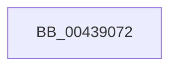

# sub_00439072

- RVA: `0x00439072`–`0x00439094` (길이 `34` bytes)
- VA: `0x0000000140439072`
- 실행 섹션: `.text`
- PDB 이름 있음: `아니요`; PDB Function 태그: `아니요`
- unwind 정보 RVA: `0x000A3804`
- 디코드: `7`개 명령, `34/34` bytes 표시
- 미해석 바이트: `0` (있으면 어셈블리에 `.byte`로 보존)

> 이 문서는 커널 이미지의 기계어와 PDB 기호를 분석해 생성했습니다. 4번과 5번은 함수 원형과 자료형을 바이너리 사용 방식에서 추정한 C 해석이며 원본 소스 복구 결과는 아닙니다.

## 1. Dependencies

- 직접 호출 지점: **0**; 고유 호출 대상: **0**
- 직접 호출자로 확인된 함수: **0**
- RIP 상대 이미지 참조: **1**

### Outgoing calls
- 직접 디코드된 call 명령이 없습니다.

### Direct callers
- 이 함수 시작 RVA로 연결되는 직접 call은 확인되지 않았습니다. 간접 호출은 완전히 역산할 수 없습니다.

### Static image references
- `0x00439072` → RVA `0x00FC6D20` (`ALMOSTRO`; read)

## 2. Other-region calls and transfers

- 다른 실행 섹션으로 향하는 call: **0**
- call이 아닌 외부 분기/꼬리 이동: **1**
  - `0x00439092` → [sub_00439094 + 0xD](Unknown_function_00439094.md) (`tail-transfer`)

## 3. Assembly (complete function range)

```asm
00439072  83 3D A7 DC B8 00 00            cmp dword ptr [rip + 0xb8dca7], 0
00439079  4C 8B 7C 24 20                  mov r15, qword ptr [rsp + 0x20]
0043907E  4C 8B 6C 24 28                  mov r13, qword ptr [rsp + 0x28]
00439083  4C 8B 64 24 30                  mov r12, qword ptr [rsp + 0x30]
00439088  48 8B 74 24 40                  mov rsi, qword ptr [rsp + 0x40]
0043908D  48 8B 6C 24 48                  mov rbp, qword ptr [rsp + 0x48]
00439092  74 0D                           je 0x1404390a1
```

## 4. C-style interpretation (structured pseudocode)

```c
void __fastcall sub_00439072(__int64 a1, __int64 a2, __int64 a3, __int64 a4, __int64 a5, __int64 a6, __int64 a7, __int64 a8, __int64 a9)
{
    unsigned __int64 v_stack_p20;
}
```

## 5. (Beta) C Style

```c
void sub_00439072(int64_t Arg1, int64_t Arg2, int64_t Arg3, int64_t Arg4, int64_t Arg5, int64_t Arg6, uint64_t Arg7, int64_t Arg8, int64_t Arg9)
{
    uint64_t v_stack_p20;
}
```

## 6. Execution-region graph

[열기: 2D/3D 그래프와 함수 탐색 컨트롤 패널](../../../control-panel.html?section=text&rva=0x00439072&view=graph)

- 2D 그래프는 위에서 아래로 흐르고, 3D 그래프는 빈 공간을 드래그해 회전합니다. Shift+드래그는 이동, 휠은 확대·축소, 함수 노드 선택은 대상 보고서 이동입니다.

### Static fallback


