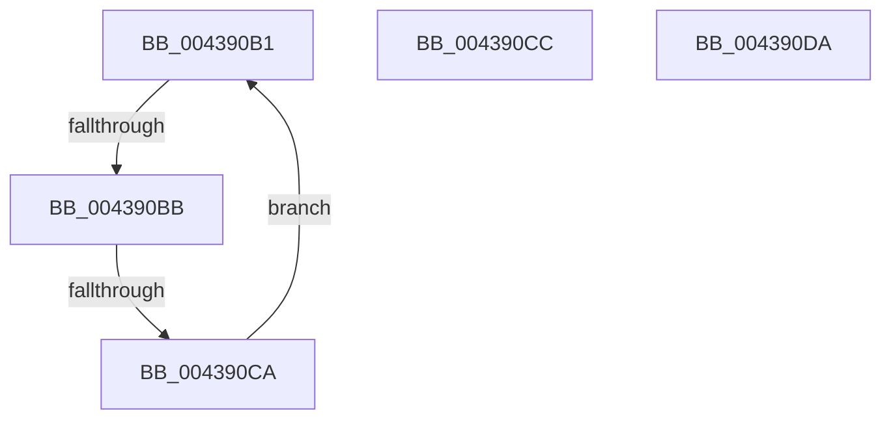

# sub_004390B1

- RVA: `0x004390B1`–`0x004390F5` (길이 `68` bytes)
- VA: `0x00000001404390B1`
- 실행 섹션: `.text`
- PDB 이름 있음: `아니요`; PDB Function 태그: `아니요`
- unwind 정보 RVA: `0x000A3828`
- 디코드: `17`개 명령, `68/68` bytes 표시
- 미해석 바이트: `0` (있으면 어셈블리에 `.byte`로 보존)

> 이 문서는 커널 이미지의 기계어와 PDB 기호를 분석해 생성했습니다. 4번과 5번은 함수 원형과 자료형을 바이너리 사용 방식에서 추정한 C 해석이며 원본 소스 복구 결과는 아닙니다.

## 1. Dependencies

- 직접 호출 지점: **2**; 고유 호출 대상: **2**
- 직접 호출자로 확인된 함수: **0**
- RIP 상대 이미지 참조: **1**

### Outgoing calls
- `0x004390D0` → [KiRaiseIrqlProcessIrqlFlags](../4F/KiRaiseIrqlProcessIrqlFlags_function_004F56FC.md) (function, `0x004F56FC`)
- `0x004390EB` → [MiClearPageFileReservation](../32/MiClearPageFileReservation_function_0032B68C.md) (function, `0x0032B68C`)

### Direct callers
- 이 함수 시작 RVA로 연결되는 직접 call은 확인되지 않았습니다. 간접 호출은 완전히 역산할 수 없습니다.

### Static image references
- `0x004390B3` → RVA `0x00FC52AC` (`ALMOSTRO`; reference)

## 2. Other-region calls and transfers

- 다른 실행 섹션으로 향하는 call: **0**
- call이 아닌 외부 분기/꼬리 이동: **4**
  - `0x004390B9` → [sub_00439107](Unknown_function_00439107.md) (`tail-transfer`)
  - `0x004390C4` → [sub_00438F5D + 0x28](Unknown_function_00438F5D.md) (`tail-transfer`)
  - `0x004390D5` → [sub_00438F5D + 0xF4](Unknown_function_00438F5D.md) (`tail-transfer`)
  - `0x004390F0` → [sub_00438F5D + 0x4E](Unknown_function_00438F5D.md) (`tail-transfer`)

## 3. Assembly (complete function range)

```asm
004390B1  FF C7                           inc edi
004390B3  85 3D F3 C1 B8 00               test dword ptr [rip + 0xb8c1f3], edi
004390B9  74 4C                           je 0x140439107
004390BB  F3 90                           pause
004390BD  48 8B 43 18                     mov rax, qword ptr [rbx + 0x18]
004390C1  48 85 C0                        test rax, rax
004390C4  0F 89 BB FE FF FF               jns 0x140438f85
004390CA  EB E5                           jmp 0x1404390b1
004390CC  41 0F B6 D5                     movzx edx, r13b
004390D0  E8 27 C6 0B 00                  call 0x1404f56fc
004390D5  E9 77 FF FF FF                  jmp 0x140439051
004390DA  48 8B 43 10                     mov rax, qword ptr [rbx + 0x10]
004390DE  48 8D 4C 24 68                  lea rcx, [rsp + 0x68]
004390E3  48 83 E0 FB                     and rax, 0xfffffffffffffffb
004390E7  48 89 43 10                     mov qword ptr [rbx + 0x10], rax
004390EB  E8 9C 25 EF FF                  call 0x14032b68c
004390F0  E9 B6 FE FF FF                  jmp 0x140438fab
```

## 4. C-style interpretation (structured pseudocode)

```c
__int64 __fastcall sub_004390B1(void)
{
    __int64 v_rdi;
    unsigned __int64 v_stack_p68;

    v_rdi = (unsigned int)((v_rdi) + 1);
    goto loc_004390B1;
}
```

## 5. (Beta) C Style

```c
void sub_004390B1(void)
{
    int64_t local_rdi;
    uint64_t v_stack_p68;

    local_rdi = (uint32_t)((local_rdi) + 1);
    goto loc_004390B1;
}
```

## 6. Execution-region graph

[열기: 2D/3D 그래프와 함수 탐색 컨트롤 패널](../../../control-panel.html?section=text&rva=0x004390B1&view=graph)

- 2D 그래프는 위에서 아래로 흐르고, 3D 그래프는 빈 공간을 드래그해 회전합니다. Shift+드래그는 이동, 휠은 확대·축소, 함수 노드 선택은 대상 보고서 이동입니다.

### Static fallback


