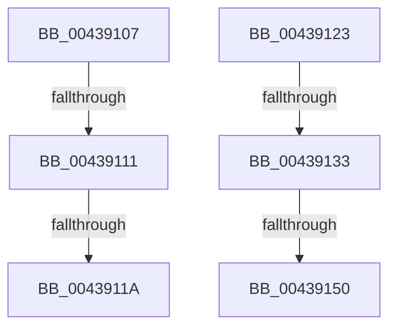

# sub_00439107

- RVA: `0x00439107`–`0x00439161` (길이 `90` bytes)
- VA: `0x0000000140439107`
- 실행 섹션: `.text`
- PDB 이름 있음: `아니요`; PDB Function 태그: `아니요`
- unwind 정보 RVA: `0x000A3878`
- 디코드: `26`개 명령, `90/90` bytes 표시
- 미해석 바이트: `0` (있으면 어셈블리에 `.byte`로 보존)

> 이 문서는 커널 이미지의 기계어와 PDB 기호를 분석해 생성했습니다. 4번과 5번은 함수 원형과 자료형을 바이너리 사용 방식에서 추정한 C 해석이며 원본 소스 복구 결과는 아닙니다.

## 1. Dependencies

- 직접 호출 지점: **3**; 고유 호출 대상: **3**
- 직접 호출자로 확인된 함수: **0**
- RIP 상대 이미지 참조: **1**

### Outgoing calls
- `0x00439111` → [KiCheckVpBackingLongSpinWaitHypercall](../30/KiCheckVpBackingLongSpinWaitHypercall_function_0030F490.md) (function, `0x0030F490`)
- `0x0043911C` → [HvlNotifyLongSpinWait](../30/HvlNotifyLongSpinWait_function_0030F460.md) (function, `0x0030F460`)
- `0x00439126` → [MiCanPfnOriginalPteBeLost](../37/MiCanPfnOriginalPteBeLost_function_00373D3C.md) (function, `0x00373D3C`)

### Direct callers
- 이 함수 시작 RVA로 연결되는 직접 call은 확인되지 않았습니다. 간접 호출은 완전히 역산할 수 없습니다.

### Static image references
- `0x00439107` → RVA `0x00FC6AB8` (`ALMOSTRO`; read)

## 2. Other-region calls and transfers

- 다른 실행 섹션으로 향하는 call: **0**
- call이 아닌 외부 분기/꼬리 이동: **6**
  - `0x0043910F` → [sub_004390B1 + 0xA](Unknown_function_004390B1.md) (`tail-transfer`)
  - `0x00439118` → [sub_004390B1 + 0xA](Unknown_function_004390B1.md) (`tail-transfer`)
  - `0x00439121` → [sub_004390B1 + 0xC](Unknown_function_004390B1.md) (`tail-transfer`)
  - `0x0043912D` → [sub_00438F5D + 0x6B](Unknown_function_00438F5D.md) (`tail-transfer`)
  - `0x0043914A` → [sub_00438F5D + 0x6B](Unknown_function_00438F5D.md) (`tail-transfer`)
  - `0x0043915C` → [sub_00438F5D + 0x6B](Unknown_function_00438F5D.md) (`tail-transfer`)

## 3. Assembly (complete function range)

```asm
00439107  8B 05 AB D9 B8 00               mov eax, dword ptr [rip + 0xb8d9ab]
0043910D  A8 40                           test al, 0x40
0043910F  74 AA                           je 0x1404390bb
00439111  E8 7A 63 ED FF                  call 0x14030f490
00439116  84 C0                           test al, al
00439118  74 A1                           je 0x1404390bb
0043911A  8B CF                           mov ecx, edi
0043911C  E8 3F 63 ED FF                  call 0x14030f460
00439121  EB 9A                           jmp 0x1404390bd
00439123  48 8B CB                        mov rcx, rbx
00439126  E8 11 AC F3 FF                  call 0x140373d3c
0043912B  85 C0                           test eax, eax
0043912D  0F 84 95 FE FF FF               je 0x140438fc8
00439133  48 8B 43 10                     mov rax, qword ptr [rbx + 0x10]
00439137  0F B6 4B 22                     movzx ecx, byte ptr [rbx + 0x22]
0043913B  C0 E9 04                        shr cl, 4
0043913E  A8 04                           test al, 4
00439140  F6 D1                           not cl
00439142  0F 95 C0                        setne al
00439145  22 C8                           and cl, al
00439147  F6 C1 01                        test cl, 1
0043914A  0F 84 78 FE FF FF               je 0x140438fc8
00439150  48 8B 43 10                     mov rax, qword ptr [rbx + 0x10]
00439154  48 83 E0 FB                     and rax, 0xfffffffffffffffb
00439158  48 89 43 10                     mov qword ptr [rbx + 0x10], rax
0043915C  E9 67 FE FF FF                  jmp 0x140438fc8
```

## 4. C-style interpretation (structured pseudocode)

```c
__int64 __fastcall sub_00439107(void)
{
    __int64 result;

    result = KiCheckVpBackingLongSpinWaitHypercall(a1, a2, a3, a4);
    result = HvlNotifyLongSpinWait((unsigned int)((unsigned int)(v_rdi)), a2, a3, a4);
}
```

## 5. (Beta) C Style

```c
void sub_00439107(void)
{
    int64_t result;

    result = KiCheckVpBackingLongSpinWaitHypercall(a1, a2, a3, a4);
    result = HvlNotifyLongSpinWait((uint32_t)((uint32_t)(local_rdi)), a2, a3, a4);
}
```

## 6. Execution-region graph

[열기: 2D/3D 그래프와 함수 탐색 컨트롤 패널](../../../control-panel.html?section=text&rva=0x00439107&view=graph)

- 2D 그래프는 위에서 아래로 흐르고, 3D 그래프는 빈 공간을 드래그해 회전합니다. Shift+드래그는 이동, 휠은 확대·축소, 함수 노드 선택은 대상 보고서 이동입니다.

### Static fallback


