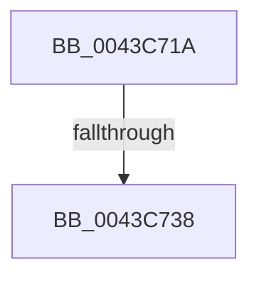

# sub_0043C71A

- RVA: `0x0043C71A`–`0x0043C740` (길이 `38` bytes)
- VA: `0x000000014043C71A`
- 실행 섹션: `.text`
- PDB 이름 있음: `아니요`; PDB Function 태그: `아니요`
- unwind 정보 RVA: `0x000A4564`
- 디코드: `8`개 명령, `38/38` bytes 표시
- 미해석 바이트: `0` (있으면 어셈블리에 `.byte`로 보존)

> 이 문서는 커널 이미지의 기계어와 PDB 기호를 분석해 생성했습니다. 4번과 5번은 함수 원형과 자료형을 바이너리 사용 방식에서 추정한 C 해석이며 원본 소스 복구 결과는 아닙니다.

## 1. Dependencies

- 직접 호출 지점: **1**; 고유 호출 대상: **1**
- 직접 호출자로 확인된 함수: **0**
- RIP 상대 이미지 참조: **0**

### Outgoing calls
- `0x0043C71F` → [KeDisableInterrupts](../21/KeDisableInterrupts_function_00217BE0.md) (function, `0x00217BE0`)

### Direct callers
- 이 함수 시작 RVA로 연결되는 직접 call은 확인되지 않았습니다. 간접 호출은 완전히 역산할 수 없습니다.

### Static image references
- 디코드된 RIP-relative 메모리 참조가 없습니다.

## 2. Other-region calls and transfers

- 다른 실행 섹션으로 향하는 call: **0**
- call이 아닌 외부 분기/꼬리 이동: **1**
  - `0x0043C732` → [sub_0043C88C](Unknown_function_0043C88C.md) (`tail-transfer`)

## 3. Assembly (complete function range)

```asm
0043C71A  48 89 7C 24 38                  mov qword ptr [rsp + 0x38], rdi
0043C71F  E8 BC B4 DD FF                  call 0x140217be0
0043C724  48 8B BB F8 38 00 00            mov rdi, qword ptr [rbx + 0x38f8]
0043C72B  44 0F B6 C0                     movzx r8d, al
0043C72F  48 85 FF                        test rdi, rdi
0043C732  0F 84 54 01 00 00               je 0x14043c88c
0043C738  48 83 7F F8 00                  cmp qword ptr [rdi - 8], 0
0043C73D  48 8B 07                        mov rax, qword ptr [rdi]
```

## 4. C-style interpretation (structured pseudocode)

```c
__int64 __fastcall sub_0043C71A(void)
{
    __int64 result;
    unsigned __int64 v_stack_p38;

    v_stack_p38 = v_rdi;
    result = KeDisableInterrupts(a1, a2, a3, a4);
    return *(unsigned __int64 *)(*(unsigned __int64 *)(v_rbx + 14584));
}
```

## 5. (Beta) C Style

```c
void sub_0043C71A(void)
{
    int64_t result;
    uint64_t v_stack_p38;

    v_stack_p38 = local_rdi;
    result = KeDisableInterrupts(a1, a2, a3, a4);
    return *(uint64_t *)(*(uint64_t *)(local_rbx + 0x38F8));
}
```

## 6. Execution-region graph

[열기: 2D/3D 그래프와 함수 탐색 컨트롤 패널](../../../control-panel.html?section=text&rva=0x0043C71A&view=graph)

- 2D 그래프는 위에서 아래로 흐르고, 3D 그래프는 빈 공간을 드래그해 회전합니다. Shift+드래그는 이동, 휠은 확대·축소, 함수 노드 선택은 대상 보고서 이동입니다.

### Static fallback


