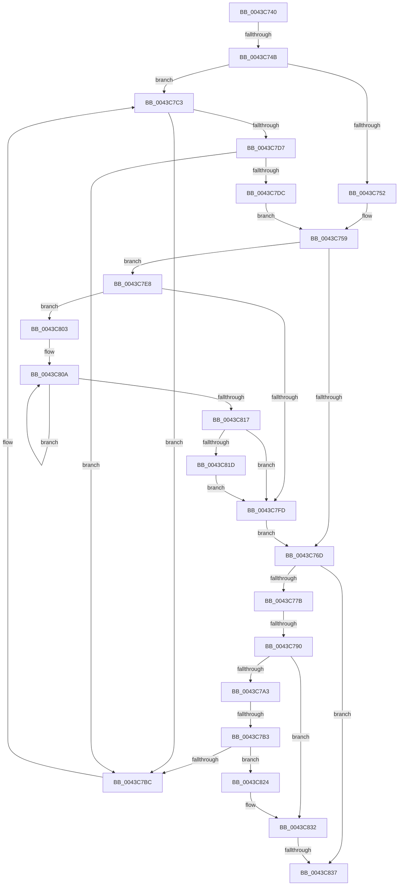

# sub_0043C740

- RVA: `0x0043C740`–`0x0043C83C` (길이 `252` bytes)
- VA: `0x000000014043C740`
- 실행 섹션: `.text`
- PDB 이름 있음: `아니요`; PDB Function 태그: `아니요`
- unwind 정보 RVA: `0x000A4578`
- 디코드: `65`개 명령, `252/252` bytes 표시
- 미해석 바이트: `0` (있으면 어셈블리에 `.byte`로 보존)

> 이 문서는 커널 이미지의 기계어와 PDB 기호를 분석해 생성했습니다. 4번과 5번은 함수 원형과 자료형을 바이너리 사용 방식에서 추정한 C 해석이며 원본 소스 복구 결과는 아닙니다.

## 1. Dependencies

- 직접 호출 지점: **2**; 고유 호출 대상: **2**
- 직접 호출자로 확인된 함수: **0**
- RIP 상대 이미지 참조: **0**

### Outgoing calls
- `0x0043C790` → [KeDisableInterrupts](../21/KeDisableInterrupts_function_00217BE0.md) (function, `0x00217BE0`)
- `0x0043C81D` → [KiRemoveSystemWorkPriorityKick](../26/KiRemoveSystemWorkPriorityKick_function_002631D0.md) (function, `0x002631D0`)

### Direct callers
- 이 함수 시작 RVA로 연결되는 직접 call은 확인되지 않았습니다. 간접 호출은 완전히 역산할 수 없습니다.

### Static image references
- 디코드된 RIP-relative 메모리 참조가 없습니다.

## 2. Other-region calls and transfers

- 다른 실행 섹션으로 향하는 call: **0**
- call이 아닌 외부 분기/꼬리 이동: **4**
  - `0x0043C745` → [sub_0043C8B6](Unknown_function_0043C8B6.md) (`tail-transfer`)
  - `0x0043C78A` → [sub_0043C8B6 + 0x28](Unknown_function_0043C8B6.md) (`tail-transfer`)
  - `0x0043C7AD` → [sub_0043C8B6 + 0x15](Unknown_function_0043C8B6.md) (`tail-transfer`)
  - `0x0043C835` → [sub_0043C846](Unknown_function_0043C846.md) (`tail-transfer`)

## 3. Assembly (complete function range)

```asm
0043C740  48 89 74 24 30                  mov qword ptr [rsp + 0x30], rsi
0043C745  0F 85 6B 01 00 00               jne 0x14043c8b6
0043C74B  33 D2                           xor edx, edx
0043C74D  48 3B C7                        cmp rax, rdi
0043C750  75 71                           jne 0x14043c7c3
0043C752  48 89 93 F8 38 00 00            mov qword ptr [rbx + 0x38f8], rdx
0043C759  48 8B 47 30                     mov rax, qword ptr [rdi + 0x30]
0043C75D  48 89 17                        mov qword ptr [rdi], rdx
0043C760  48 8B 40 38                     mov rax, qword ptr [rax + 0x38]
0043C764  48 89 47 10                     mov qword ptr [rdi + 0x10], rax
0043C768  45 84 C0                        test r8b, r8b
0043C76B  75 7B                           jne 0x14043c7e8
0043C76D  4C 8B 47 10                     mov r8, qword ptr [rdi + 0x10]
0043C771  4C 3B 47 18                     cmp r8, qword ptr [rdi + 0x18]
0043C775  0F 84 BC 00 00 00               je 0x14043c837
0043C77B  48 8B 47 28                     mov rax, qword ptr [rdi + 0x28]
0043C77F  48 8B 57 20                     mov rdx, qword ptr [rdi + 0x20]
0043C783  48 8B 08                        mov rcx, qword ptr [rax]
0043C786  48 85 4A 28                     test qword ptr [rdx + 0x28], rcx
0043C78A  0F 84 4E 01 00 00               je 0x14043c8de
0043C790  E8 4B B4 DD FF                  call 0x140217be0
0043C795  48 83 3F 00                     cmp qword ptr [rdi], 0
0043C799  44 0F B6 C0                     movzx r8d, al
0043C79D  0F 85 8F 00 00 00               jne 0x14043c832
0043C7A3  48 8B 8B F8 38 00 00            mov rcx, qword ptr [rbx + 0x38f8]
0043C7AA  48 85 C9                        test rcx, rcx
0043C7AD  0F 84 18 01 00 00               je 0x14043c8cb
0043C7B3  48 8B 41 08                     mov rax, qword ptr [rcx + 8]
0043C7B7  48 39 08                        cmp qword ptr [rax], rcx
0043C7BA  74 68                           je 0x14043c824
0043C7BC  B9 03 00 00 00                  mov ecx, 3
0043C7C1  CD 29                           int 0x29
0043C7C3  48 89 83 F8 38 00 00            mov qword ptr [rbx + 0x38f8], rax
0043C7CA  48 8B 0F                        mov rcx, qword ptr [rdi]
0043C7CD  48 8B 47 08                     mov rax, qword ptr [rdi + 8]
0043C7D1  48 39 79 08                     cmp qword ptr [rcx + 8], rdi
0043C7D5  75 E5                           jne 0x14043c7bc
0043C7D7  48 39 38                        cmp qword ptr [rax], rdi
0043C7DA  75 E0                           jne 0x14043c7bc
0043C7DC  48 89 08                        mov qword ptr [rax], rcx
0043C7DF  48 89 41 08                     mov qword ptr [rcx + 8], rax
0043C7E3  E9 71 FF FF FF                  jmp 0x14043c759
0043C7E8  65 48 8B 0C 25 20 00 00 00      mov rcx, qword ptr gs:[0x20]
0043C7F1  4C 8B 81 B8 8E 00 00            mov r8, qword ptr [rcx + 0x8eb8]
0043C7F8  4D 85 C0                        test r8, r8
0043C7FB  75 06                           jne 0x14043c803
0043C7FD  FB                              sti
0043C7FE  E9 6A FF FF FF                  jmp 0x14043c76d
0043C803  41 0F 0D 08                     prefetchw byte ptr [r8]
0043C807  41 8B 00                        mov eax, dword ptr [r8]
0043C80A  8B D0                           mov edx, eax
0043C80C  0F BA F2 15                     btr edx, 0x15
0043C810  F0 41 0F B1 10                  lock cmpxchg dword ptr [r8], edx
0043C815  75 F3                           jne 0x14043c80a
0043C817  0F BA E0 15                     bt eax, 0x15
0043C81B  73 E0                           jae 0x14043c7fd
0043C81D  E8 AE 69 E2 FF                  call 0x1402631d0
0043C822  EB D9                           jmp 0x14043c7fd
0043C824  48 89 0F                        mov qword ptr [rdi], rcx
0043C827  48 89 47 08                     mov qword ptr [rdi + 8], rax
0043C82B  48 89 38                        mov qword ptr [rax], rdi
0043C82E  48 89 79 08                     mov qword ptr [rcx + 8], rdi
0043C832  45 84 C0                        test r8b, r8b
0043C835  75 0F                           jne 0x14043c846
0043C837  48 8B 74 24 30                  mov rsi, qword ptr [rsp + 0x30]
```

## 4. C-style interpretation (structured pseudocode)

```c
__int64 __fastcall sub_0043C740(__int64 a1, int a2, unsigned __int8 a3, __int64 a4, __int64 a5, __int64 a6)
{
    __int64 result;
    unsigned __int64 v_stack_p30;

    v_stack_p30 = v_rsi;
    a2 = 0;
    if (result != v_rdi) goto loc_0043C7C3;
    *(unsigned __int64 *)(v_rbx + 14584) = 0;
loc_0043C759:
    *(unsigned __int64 *)(v_rdi) = 0;
    *(unsigned __int64 *)(v_rdi + 16) = *(unsigned __int64 *)(*(unsigned __int64 *)(v_rdi + 48) + 56);
    if (a3 != 0) goto loc_0043C7E8;
loc_0043C76D:
    if ((*(unsigned __int64 *)(v_rdi + 16)) == (*(unsigned __int64 *)(v_rdi + 24))) goto loc_0043C837;
    result = KeDisableInterrupts(*(unsigned __int64 *)(*(unsigned __int64 *)(v_rdi + 40)), *(unsigned __int64 *)(v_rdi + 32), *(unsigned __int64 *)(v_rdi + 16), a4);
    if ((*(unsigned __int64 *)(v_rdi)) != 0) goto loc_0043C832;
    if ((*(unsigned __int64 *)(*(unsigned __int64 *)(*(unsigned __int64 *)(v_rbx + 14584) + 8))) == (*(unsigned __int64 *)(v_rbx + 14584))) goto loc_0043C824;
loc_0043C7BC:
loc_0043C7C3:
    *(unsigned __int64 *)(v_rbx + 14584) = *(unsigned __int64 *)(*(unsigned __int64 *)(v_rbx + 14584) + 8);
    if ((*(unsigned __int64 *)(*(unsigned __int64 *)(v_rdi) + 8)) != v_rdi) goto loc_0043C7BC;
    if ((*(unsigned __int64 *)(*(unsigned __int64 *)(v_rdi + 8))) != v_rdi) goto loc_0043C7BC;
    *(unsigned __int64 *)(*(unsigned __int64 *)(v_rdi + 8)) = *(unsigned __int64 *)(v_rdi);
    *(unsigned __int64 *)(*(unsigned __int64 *)(v_rdi) + 8) = *(unsigned __int64 *)(v_rdi + 8);
    goto loc_0043C759;
loc_0043C7E8:
    if (*(unsigned __int64 *)(*(unsigned __int64 *)(gs_base + (0 + 32)) + 36536) != 0) goto loc_0043C803;
loc_0043C7FD:
    goto loc_0043C76D;
loc_0043C803:
loc_0043C80A:
    if (*(unsigned __int64 *)(*(unsigned __int64 *)(gs_base + (0 + 32)) + 36536) != 0) goto loc_0043C80A;
    if (condition_is_above_or_equal) goto loc_0043C7FD;
    result = KiRemoveSystemWorkPriorityKick(*(unsigned __int64 *)(gs_base + (0 + 32)), (unsigned int)((unsigned int)((unsigned int)(*(unsigned int *)(*(unsigned __int64 *)(*(unsigned __int64 *)(gs_base + (0 + 32)) + 36536))))), *(unsigned __int64 *)(*(unsigned __int64 *)(gs_base + (0 + 32)) + 36536), a4);
    goto loc_0043C7FD;
loc_0043C824:
    *(unsigned __int64 *)(v_rdi) = *(unsigned __int64 *)(gs_base + (0 + 32));
    *(unsigned __int64 *)(v_rdi + 8) = result;
    *(unsigned __int64 *)(result) = v_rdi;
    *(unsigned __int64 *)(*(unsigned __int64 *)(gs_base + (0 + 32)) + 8) = v_rdi;
loc_0043C832:
loc_0043C837:
    return result;
}
```

## 5. (Beta) C Style

```c
int64_t sub_0043C740(int64_t Arg1, int32_t Arg2, uint8_t Arg3, int64_t Arg4, uint64_t Arg5, int64_t Arg6)
{
    int64_t result;
    uint64_t v_stack_p30;

    v_stack_p30 = local_rsi;
    Arg2 = 0;
    if (result != local_rdi) goto loc_0043C7C3;
    *(uint64_t *)(local_rbx + 0x38F8) = 0;
loc_0043C759:
    *(uint64_t *)(local_rdi) = 0;
    *(uint64_t *)(local_rdi + 0x10) = *(uint64_t *)(*(uint64_t *)(local_rdi + 0x30) + 0x38);
    if (Arg3 != 0) goto loc_0043C7E8;
loc_0043C76D:
    if ((*(uint64_t *)(local_rdi + 0x10)) == (*(uint64_t *)(local_rdi + 0x18))) goto loc_0043C837;
    result = KeDisableInterrupts(*(uint64_t *)(*(uint64_t *)(local_rdi + 0x28)), *(uint64_t *)(local_rdi + 0x20), *(uint64_t *)(local_rdi + 0x10), Arg4);
    if ((*(uint64_t *)(local_rdi)) != 0) goto loc_0043C832;
    if ((*(uint64_t *)(*(uint64_t *)(*(uint64_t *)(local_rbx + 0x38F8) + 0x8))) == (*(uint64_t *)(local_rbx + 0x38F8))) goto loc_0043C824;
loc_0043C7BC:
loc_0043C7C3:
    *(uint64_t *)(local_rbx + 0x38F8) = *(uint64_t *)(*(uint64_t *)(local_rbx + 0x38F8) + 0x8);
    if ((*(uint64_t *)(*(uint64_t *)(local_rdi) + 0x8)) != local_rdi) goto loc_0043C7BC;
    if ((*(uint64_t *)(*(uint64_t *)(local_rdi + 0x8))) != local_rdi) goto loc_0043C7BC;
    *(uint64_t *)(*(uint64_t *)(local_rdi + 0x8)) = *(uint64_t *)(local_rdi);
    *(uint64_t *)(*(uint64_t *)(local_rdi) + 0x8) = *(uint64_t *)(local_rdi + 0x8);
    goto loc_0043C759;
loc_0043C7E8:
    if (*(uint64_t *)(*(uint64_t *)(gs_base + (0 + 0x20)) + 0x8EB8) != 0) goto loc_0043C803;
loc_0043C7FD:
    goto loc_0043C76D;
loc_0043C803:
loc_0043C80A:
    if (*(uint64_t *)(*(uint64_t *)(gs_base + (0 + 0x20)) + 0x8EB8) != 0) goto loc_0043C80A;
    if (condition_is_above_or_equal) goto loc_0043C7FD;
    result = KiRemoveSystemWorkPriorityKick(*(uint64_t *)(gs_base + (0 + 0x20)), (uint32_t)((uint32_t)((uint32_t)(*(uint32_t *)(*(uint64_t *)(*(uint64_t *)(gs_base + (0 + 0x20)) + 0x8EB8))))), *(uint64_t *)(*(uint64_t *)(gs_base + (0 + 0x20)) + 0x8EB8), Arg4);
    goto loc_0043C7FD;
loc_0043C824:
    *(uint64_t *)(local_rdi) = *(uint64_t *)(gs_base + (0 + 0x20));
    *(uint64_t *)(local_rdi + 0x8) = result;
    *(uint64_t *)(result) = local_rdi;
    *(uint64_t *)(*(uint64_t *)(gs_base + (0 + 0x20)) + 0x8) = local_rdi;
loc_0043C832:
loc_0043C837:
    return result;
}
```

## 6. Execution-region graph

[열기: 2D/3D 그래프와 함수 탐색 컨트롤 패널](../../../control-panel.html?section=text&rva=0x0043C740&view=graph)

- 2D 그래프는 위에서 아래로 흐르고, 3D 그래프는 빈 공간을 드래그해 회전합니다. Shift+드래그는 이동, 휠은 확대·축소, 함수 노드 선택은 대상 보고서 이동입니다.

### Static fallback


