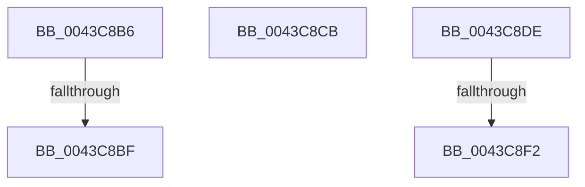

# sub_0043C8B6

- RVA: `0x0043C8B6`–`0x0043C900` (길이 `74` bytes)
- VA: `0x000000014043C8B6`
- 실행 섹션: `.text`
- PDB 이름 있음: `아니요`; PDB Function 태그: `아니요`
- unwind 정보 RVA: `0x000A45E0`
- 디코드: `16`개 명령, `74/74` bytes 표시
- 미해석 바이트: `0` (있으면 어셈블리에 `.byte`로 보존)

> 이 문서는 커널 이미지의 기계어와 PDB 기호를 분석해 생성했습니다. 4번과 5번은 함수 원형과 자료형을 바이너리 사용 방식에서 추정한 C 해석이며 원본 소스 복구 결과는 아닙니다.

## 1. Dependencies

- 직접 호출 지점: **2**; 고유 호출 대상: **2**
- 직접 호출자로 확인된 함수: **0**
- RIP 상대 이미지 참조: **0**

### Outgoing calls
- `0x0043C8E5` → [KiSrcuReportQuiescent](../5C/KiSrcuReportQuiescent_function_005C2C08.md) (function, `0x005C2C08`)
- `0x0043C8F6` → [KiSrcuFlushCompleted](../5C/KiSrcuFlushCompleted_function_005C22B4.md) (function, `0x005C22B4`)

### Direct callers
- 이 함수 시작 RVA로 연결되는 직접 call은 확인되지 않았습니다. 간접 호출은 완전히 역산할 수 없습니다.

### Static image references
- 디코드된 RIP-relative 메모리 참조가 없습니다.

## 2. Other-region calls and transfers

- 다른 실행 섹션으로 향하는 call: **0**
- call이 아닌 외부 분기/꼬리 이동: **5**
  - `0x0043C8B9` → [sub_0043C740 + 0x28](Unknown_function_0043C740.md) (`tail-transfer`)
  - `0x0043C8C6` → [sub_0043C740 + 0x28](Unknown_function_0043C740.md) (`tail-transfer`)
  - `0x0043C8D9` → [sub_0043C740 + 0xF2](Unknown_function_0043C740.md) (`tail-transfer`)
  - `0x0043C8EC` → [sub_0043C740 + 0xF7](Unknown_function_0043C740.md) (`tail-transfer`)
  - `0x0043C8FB` → [sub_0043C740 + 0xF7](Unknown_function_0043C740.md) (`tail-transfer`)

## 3. Assembly (complete function range)

```asm
0043C8B6  48 3B F8                        cmp rdi, rax
0043C8B9  0F 84 A9 FE FF FF               je 0x14043c768
0043C8BF  48 89 83 F8 38 00 00            mov qword ptr [rbx + 0x38f8], rax
0043C8C6  E9 9D FE FF FF                  jmp 0x14043c768
0043C8CB  48 89 7F 08                     mov qword ptr [rdi + 8], rdi
0043C8CF  48 89 3F                        mov qword ptr [rdi], rdi
0043C8D2  48 89 BB F8 38 00 00            mov qword ptr [rbx + 0x38f8], rdi
0043C8D9  E9 54 FF FF FF                  jmp 0x14043c832
0043C8DE  49 8B D0                        mov rdx, r8
0043C8E1  48 8D 4F F8                     lea rcx, [rdi - 8]
0043C8E5  E8 1E 63 18 00                  call 0x1405c2c08
0043C8EA  85 C0                           test eax, eax
0043C8EC  0F 84 45 FF FF FF               je 0x14043c837
0043C8F2  48 8B 4F 30                     mov rcx, qword ptr [rdi + 0x30]
0043C8F6  E8 B9 59 18 00                  call 0x1405c22b4
0043C8FB  E9 37 FF FF FF                  jmp 0x14043c837
```

## 4. C-style interpretation (structured pseudocode)

```c
__int64 __fastcall sub_0043C8B6(__int64 a1, __int64 a2, __int64 a3)
{
    *(unsigned __int64 *)(v_rbx + 14584) = result;
}
```

## 5. (Beta) C Style

```c
int64_t sub_0043C8B6(int64_t Arg1, int64_t Arg2, int64_t Arg3)
{
    *(uint64_t *)(local_rbx + 0x38F8) = result;
}
```

## 6. Execution-region graph

[열기: 2D/3D 그래프와 함수 탐색 컨트롤 패널](../../../control-panel.html?section=text&rva=0x0043C8B6&view=graph)

- 2D 그래프는 위에서 아래로 흐르고, 3D 그래프는 빈 공간을 드래그해 회전합니다. Shift+드래그는 이동, 휠은 확대·축소, 함수 노드 선택은 대상 보고서 이동입니다.

### Static fallback


