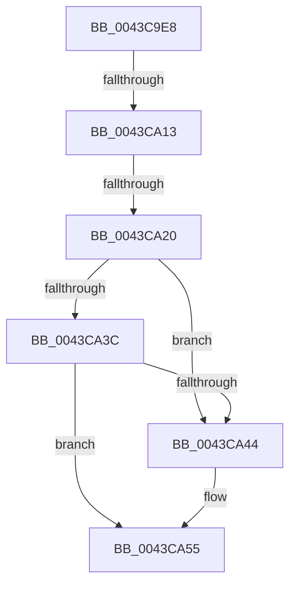

# sub_0043C9E8

- RVA: `0x0043C9E8`–`0x0043CA64` (길이 `124` bytes)
- VA: `0x000000014043C9E8`
- 실행 섹션: `.text`
- PDB 이름 있음: `아니요`; PDB Function 태그: `아니요`
- unwind 정보 RVA: `0x000A461C`
- 디코드: `25`개 명령, `124/124` bytes 표시
- 미해석 바이트: `0` (있으면 어셈블리에 `.byte`로 보존)

> 이 문서는 커널 이미지의 기계어와 PDB 기호를 분석해 생성했습니다. 4번과 5번은 함수 원형과 자료형을 바이너리 사용 방식에서 추정한 C 해석이며 원본 소스 복구 결과는 아닙니다.

## 1. Dependencies

- 직접 호출 지점: **1**; 고유 호출 대상: **1**
- 직접 호출자로 확인된 함수: **0**
- RIP 상대 이미지 참조: **1**

### Outgoing calls
- `0x0043CA4C` → [ObfReferenceObjectWithTag](../21/ObfReferenceObjectWithTag_function_00210710.md) (function, `0x00210710`)

### Direct callers
- 이 함수 시작 RVA로 연결되는 직접 call은 확인되지 않았습니다. 간접 호출은 완전히 역산할 수 없습니다.

### Static image references
- `0x0043CA3C` → RVA `0x00F0EFD0` (`.data`; read)

## 2. Other-region calls and transfers

- 다른 실행 섹션으로 향하는 call: **0**
- call이 아닌 외부 분기/꼬리 이동: **2**
  - `0x0043CA0D` → [sub_0043CA98](Unknown_function_0043CA98.md) (`tail-transfer`)
  - `0x0043CA1A` → [sub_0043CAF8](Unknown_function_0043CAF8.md) (`tail-transfer`)

## 3. Assembly (complete function range)

```asm
0043C9E8  4C 89 64 24 50                  mov qword ptr [rsp + 0x50], r12
0043C9ED  45 33 E4                        xor r12d, r12d
0043C9F0  4C 89 74 24 60                  mov qword ptr [rsp + 0x60], r14
0043C9F5  4C 89 7C 24 20                  mov qword ptr [rsp + 0x20], r15
0043C9FA  65 4C 8B 3C 25 88 01 00 00      mov r15, qword ptr gs:[0x188]
0043CA03  4D 8B B7 50 06 00 00            mov r14, qword ptr [r15 + 0x650]
0043CA0A  4D 85 F6                        test r14, r14
0043CA0D  0F 85 85 00 00 00               jne 0x14043ca98
0043CA13  4C 89 73 38                     mov qword ptr [rbx + 0x38], r14
0043CA17  4D 85 F6                        test r14, r14
0043CA1A  0F 85 D8 00 00 00               jne 0x14043caf8
0043CA20  65 48 8B 04 25 88 01 00 00      mov rax, qword ptr gs:[0x188]
0043CA29  48 8B 88 B8 00 00 00            mov rcx, qword ptr [rax + 0xb8]
0043CA30  48 8B 81 A0 02 00 00            mov rax, qword ptr [rcx + 0x2a0]
0043CA37  48 85 C0                        test rax, rax
0043CA3A  75 08                           jne 0x14043ca44
0043CA3C  38 05 8E 25 AD 00               cmp byte ptr [rip + 0xad258e], al
0043CA42  74 11                           je 0x14043ca55
0043CA44  BA 44 66 6C 74                  mov edx, 0x746c6644
0043CA49  49 8B CF                        mov rcx, r15
0043CA4C  E8 BF 3C DD FF                  call 0x140210710
0043CA51  4C 89 7B 38                     mov qword ptr [rbx + 0x38], r15
0043CA55  4C 8B 74 24 60                  mov r14, qword ptr [rsp + 0x60]
0043CA5A  4C 8B 64 24 50                  mov r12, qword ptr [rsp + 0x50]
0043CA5F  4C 8B 7C 24 20                  mov r15, qword ptr [rsp + 0x20]
```

## 4. C-style interpretation (structured pseudocode)

```c
__int64 __fastcall sub_0043C9E8(__int64 a1, __int64 a2, __int64 a3, __int64 a4, __int64 a5, __int64 a6, __int64 a7, __int64 a8, __int64 a9, __int64 a10, __int64 a11, __int64 a12)
{
    __int64 result;
    __int64 v_r12;
    unsigned __int64 v_stack_p20;
    unsigned __int64 v_stack_p50;
    unsigned __int64 v_stack_p60;

    v_stack_p50 = v_r12;
    v_r12 = 0;
    v_stack_p60 = v_r14;
    v_stack_p20 = v_r15;
    *(unsigned __int64 *)(v_rbx + 56) = *(unsigned __int64 *)(*(unsigned __int64 *)(gs_base + (0 + 392)) + 1616);
    if (*(unsigned __int64 *)(*(unsigned __int64 *)(*(unsigned __int64 *)(gs_base + (0 + 392)) + 184) + 672) != 0) goto loc_0043CA44;
    result = *(unsigned __int64 *)(*(unsigned __int64 *)(*(unsigned __int64 *)(gs_base + (0 + 392)) + 184) + 672);
    if ((*(unsigned __int8 *)(v_rip + 11347342)) != ((unsigned __int8)(*(unsigned __int64 *)(*(unsigned __int64 *)(*(unsigned __int64 *)(gs_base + (0 + 392)) + 184) + 672)))) {
        a2 = 0x746C6644ULL;
        a1 = *(unsigned __int64 *)(gs_base + (0 + 392));
        result = ObfReferenceObjectWithTag(a1, a2, a3, a4);
        *(unsigned __int64 *)(v_rbx + 56) = *(unsigned __int64 *)(gs_base + (0 + 392));
    }
    return result;
}
```

## 5. (Beta) C Style

```c
int64_t sub_0043C9E8(int64_t Arg1, int64_t Arg2, int64_t Arg3, int64_t Arg4, uint64_t Arg5, uint64_t Arg6, uint64_t Arg7, uint64_t Arg8, uint64_t Arg9, int64_t Arg10, uint64_t Arg11, int64_t Arg12)
{
    int64_t result;
    int64_t local_r12;
    uint64_t v_stack_p20;
    uint64_t v_stack_p50;
    uint64_t v_stack_p60;

    v_stack_p50 = local_r12;
    local_r12 = 0;
    v_stack_p60 = local_r14;
    v_stack_p20 = local_r15;
    *(uint64_t *)(local_rbx + 0x38) = *(uint64_t *)(*(uint64_t *)(gs_base + (0 + 0x188)) + 0x650);
    if (*(uint64_t *)(*(uint64_t *)(*(uint64_t *)(gs_base + (0 + 0x188)) + 0xB8) + 0x2A0) != 0) goto loc_0043CA44;
    result = *(uint64_t *)(*(uint64_t *)(*(uint64_t *)(gs_base + (0 + 0x188)) + 0xB8) + 0x2A0);
    if ((*(uint8_t *)(v_rip + 0xAD258E)) != ((uint8_t)(*(uint64_t *)(*(uint64_t *)(*(uint64_t *)(gs_base + (0 + 0x188)) + 0xB8) + 0x2A0)))) {
        Arg2 = 0x746C6644ULL;
        Arg1 = *(uint64_t *)(gs_base + (0 + 0x188));
        result = ObfReferenceObjectWithTag(Arg1, Arg2, Arg3, Arg4);
        *(uint64_t *)(local_rbx + 0x38) = *(uint64_t *)(gs_base + (0 + 0x188));
    }
    return result;
}
```

## 6. Execution-region graph

[열기: 2D/3D 그래프와 함수 탐색 컨트롤 패널](../../../control-panel.html?section=text&rva=0x0043C9E8&view=graph)

- 2D 그래프는 위에서 아래로 흐르고, 3D 그래프는 빈 공간을 드래그해 회전합니다. Shift+드래그는 이동, 휠은 확대·축소, 함수 노드 선택은 대상 보고서 이동입니다.

### Static fallback


