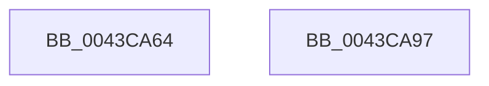

# sub_0043CA64

- RVA: `0x0043CA64`–`0x0043CA98` (길이 `52` bytes)
- VA: `0x000000014043CA64`
- 실행 섹션: `.text`
- PDB 이름 있음: `아니요`; PDB Function 태그: `아니요`
- unwind 정보 RVA: `0x000A4638`
- 디코드: `16`개 명령, `52/52` bytes 표시
- 미해석 바이트: `0` (있으면 어셈블리에 `.byte`로 보존)

> 이 문서는 커널 이미지의 기계어와 PDB 기호를 분석해 생성했습니다. 4번과 5번은 함수 원형과 자료형을 바이너리 사용 방식에서 추정한 C 해석이며 원본 소스 복구 결과는 아닙니다.

## 1. Dependencies

- 직접 호출 지점: **1**; 고유 호출 대상: **1**
- 직접 호출자로 확인된 함수: **0**
- RIP 상대 이미지 참조: **0**

### Outgoing calls
- `0x0043CA6D` → [ObfReferenceObjectWithTag](../21/ObfReferenceObjectWithTag_function_00210710.md) (function, `0x00210710`)

### Direct callers
- 이 함수 시작 RVA로 연결되는 직접 call은 확인되지 않았습니다. 간접 호출은 완전히 역산할 수 없습니다.

### Static image references
- 디코드된 RIP-relative 메모리 참조가 없습니다.

## 2. Other-region calls and transfers

- 다른 실행 섹션으로 향하는 call: **0**
- 별도 외부 분기/꼬리 이동을 확인하지 못했습니다.

## 3. Assembly (complete function range)

```asm
0043CA64  48 8B 4B 28                     mov rcx, qword ptr [rbx + 0x28]
0043CA68  BA 44 66 6C 74                  mov edx, 0x746c6644
0043CA6D  E8 9E 3C DD FF                  call 0x140210710
0043CA72  48 89 73 20                     mov qword ptr [rbx + 0x20], rsi
0043CA76  48 89 7B 30                     mov qword ptr [rbx + 0x30], rdi
0043CA7A  48 A1 08 00 00 00 80 F7 FF FF   movabs rax, qword ptr [0xfffff78000000008]
0043CA84  48 89 43 58                     mov qword ptr [rbx + 0x58], rax
0043CA88  48 8B C3                        mov rax, rbx
0043CA8B  89 6B 54                        mov dword ptr [rbx + 0x54], ebp
0043CA8E  48 83 C4 28                     add rsp, 0x28
0043CA92  5F                              pop rdi
0043CA93  5E                              pop rsi
0043CA94  5D                              pop rbp
0043CA95  5B                              pop rbx
0043CA96  C3                              ret
0043CA97  CC                              int3
```

## 4. C-style interpretation (structured pseudocode)

```c
__int64 __fastcall sub_0043CA64(void)
{
    __int64 result;
    __int64 v_rsp;

    result = ObfReferenceObjectWithTag(*(unsigned __int64 *)(v_rbx + 40), (unsigned int)(0x746C6644ULL), a3, a4);
    *(unsigned __int64 *)(v_rbx + 32) = v_rsi;
    *(unsigned __int64 *)(v_rbx + 48) = v_rdi;
    *(unsigned __int64 *)(v_rbx + 88) = result;
    *(unsigned int *)(v_rbx + 84) = (unsigned int)(v_rbp);
    v_rsp = (v_rsp) + (40);
    return v_rbx;
}
```

## 5. (Beta) C Style

```c
void sub_0043CA64(void)
{
    int64_t result;
    int64_t local_rsp;

    result = ObfReferenceObjectWithTag(*(uint64_t *)(local_rbx + 0x28), (uint32_t)(0x746C6644ULL), a3, a4);
    *(uint64_t *)(local_rbx + 0x20) = local_rsi;
    *(uint64_t *)(local_rbx + 0x30) = local_rdi;
    *(uint64_t *)(local_rbx + 0x58) = result;
    *(uint32_t *)(local_rbx + 0x54) = (uint32_t)(local_rbp);
    local_rsp = (local_rsp) + (40);
    return local_rbx;
}
```

## 6. Execution-region graph

[열기: 2D/3D 그래프와 함수 탐색 컨트롤 패널](../../../control-panel.html?section=text&rva=0x0043CA64&view=graph)

- 2D 그래프는 위에서 아래로 흐르고, 3D 그래프는 빈 공간을 드래그해 회전합니다. Shift+드래그는 이동, 휠은 확대·축소, 함수 노드 선택은 대상 보고서 이동입니다.

### Static fallback


