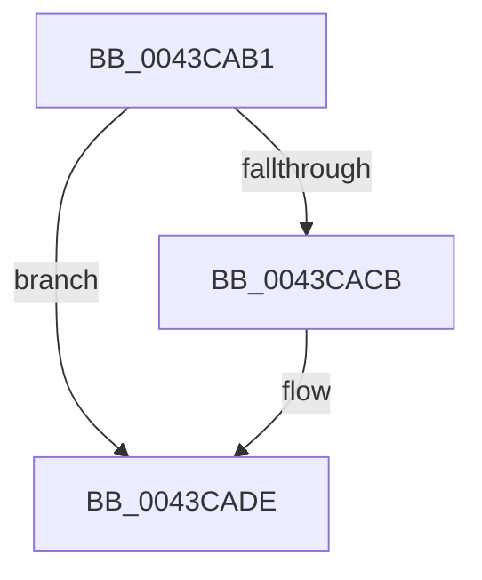

# sub_0043CAB1

- RVA: `0x0043CAB1`–`0x0043CAF8` (길이 `71` bytes)
- VA: `0x000000014043CAB1`
- 실행 섹션: `.text`
- PDB 이름 있음: `아니요`; PDB Function 태그: `아니요`
- unwind 정보 RVA: `0x000A4668`
- 디코드: `15`개 명령, `71/71` bytes 표시
- 미해석 바이트: `0` (있으면 어셈블리에 `.byte`로 보존)

> 이 문서는 커널 이미지의 기계어와 PDB 기호를 분석해 생성했습니다. 4번과 5번은 함수 원형과 자료형을 바이너리 사용 방식에서 추정한 C 해석이며 원본 소스 복구 결과는 아닙니다.

## 1. Dependencies

- 직접 호출 지점: **3**; 고유 호출 대상: **3**
- 직접 호출자로 확인된 함수: **0**
- RIP 상대 이미지 참조: **1**

### Outgoing calls
- `0x0043CAB6` → [ExAcquireSpinLockShared](../24/ExAcquireSpinLockShared_function_0024DCE0.md) (function, `0x0024DCE0`)
- `0x0043CAD3` → [ObfReferenceObjectWithTag](../21/ObfReferenceObjectWithTag_function_00210710.md) (function, `0x00210710`)
- `0x0043CAE9` → [ExReleaseSpinLockShared](../2F/ExReleaseSpinLockShared_function_002F0EF0.md) (function, `0x002F0EF0`)

### Direct callers
- 이 함수 시작 RVA로 연결되는 직접 call은 확인되지 않았습니다. 간접 호출은 완전히 역산할 수 없습니다.

### Static image references
- `0x0043CAE2` → RVA `0x00F06590` (`.data`; read)

## 2. Other-region calls and transfers

- 다른 실행 섹션으로 향하는 call: **0**
- call이 아닌 외부 분기/꼬리 이동: **1**
  - `0x0043CAF3` → [sub_0043C9E8 + 0x2B](Unknown_function_0043C9E8.md) (`tail-transfer`)

## 3. Assembly (complete function range)

```asm
0043CAB1  4C 89 6C 24 58                  mov qword ptr [rsp + 0x58], r13
0043CAB6  E8 25 12 E1 FF                  call 0x14024dce0
0043CABB  4D 8B B7 50 06 00 00            mov r14, qword ptr [r15 + 0x650]
0043CAC2  44 0F B6 E8                     movzx r13d, al
0043CAC6  4D 85 F6                        test r14, r14
0043CAC9  74 13                           je 0x14043cade
0043CACB  BA 44 66 6C 74                  mov edx, 0x746c6644
0043CAD0  49 8B CE                        mov rcx, r14
0043CAD3  E8 38 3C DD FF                  call 0x140210710
0043CAD8  41 BC 01 00 00 00               mov r12d, 1
0043CADE  41 0F B6 D5                     movzx edx, r13b
0043CAE2  48 8D 0D A7 9A AC 00            lea rcx, [rip + 0xac9aa7]
0043CAE9  E8 02 44 EB FF                  call 0x1402f0ef0
0043CAEE  4C 8B 6C 24 58                  mov r13, qword ptr [rsp + 0x58]
0043CAF3  E9 1B FF FF FF                  jmp 0x14043ca13
```

## 4. C-style interpretation (structured pseudocode)

```c
__int64 __fastcall sub_0043CAB1(__int64 a1, __int64 a2, __int64 a3, __int64 a4, __int64 a5, __int64 a6, __int64 a7, __int64 a8, __int64 a9, __int64 a10, __int64 a11)
{
    __int64 result;
    __int64 v_r12;
    unsigned __int64 v_stack_p58;

    v_stack_p58 = v_r13;
    result = ExAcquireSpinLockShared(a1, a2, a3, a4);
    if (*(unsigned __int64 *)(v_r15 + 1616) != 0) {
        a2 = 0x746C6644ULL;
        a1 = *(unsigned __int64 *)(v_r15 + 1616);
        result = ObfReferenceObjectWithTag(a1, a2, a3, a4);
        v_r12 = 1;
    }
    result = ExReleaseSpinLockShared(v_rip + 11311783, (unsigned __int8)((unsigned __int8)(result)), a3, a4);
}
```

## 5. (Beta) C Style

```c
int64_t sub_0043CAB1(int64_t Arg1, int64_t Arg2, int64_t Arg3, int64_t Arg4, uint64_t Arg5, uint64_t Arg6, uint64_t Arg7, uint64_t Arg8, uint64_t Arg9, uint64_t Arg10, int64_t Arg11)
{
    int64_t result;
    int64_t local_r12;
    uint64_t v_stack_p58;

    v_stack_p58 = local_r13;
    result = ExAcquireSpinLockShared(Arg1, Arg2, Arg3, Arg4);
    if (*(uint64_t *)(local_r15 + 0x650) != 0) {
        Arg2 = 0x746C6644ULL;
        Arg1 = *(uint64_t *)(local_r15 + 0x650);
        result = ObfReferenceObjectWithTag(Arg1, Arg2, Arg3, Arg4);
        local_r12 = 1;
    }
    result = ExReleaseSpinLockShared(v_rip + 11311783, (uint8_t)((uint8_t)(result)), Arg3, Arg4);
}
```

## 6. Execution-region graph

[열기: 2D/3D 그래프와 함수 탐색 컨트롤 패널](../../../control-panel.html?section=text&rva=0x0043CAB1&view=graph)

- 2D 그래프는 위에서 아래로 흐르고, 3D 그래프는 빈 공간을 드래그해 회전합니다. Shift+드래그는 이동, 휠은 확대·축소, 함수 노드 선택은 대상 보고서 이동입니다.

### Static fallback


