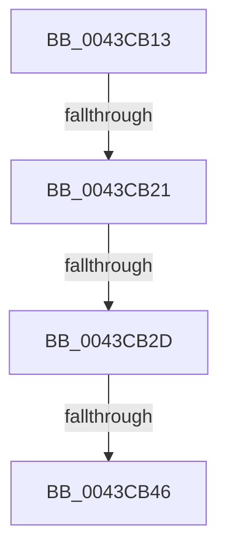

# sub_0043CB13

- RVA: `0x0043CB13`–`0x0043CB52` (길이 `63` bytes)
- VA: `0x000000014043CB13`
- 실행 섹션: `.text`
- PDB 이름 있음: `아니요`; PDB Function 태그: `아니요`
- unwind 정보 RVA: `0x000A468C`
- 디코드: `13`개 명령, `63/63` bytes 표시
- 미해석 바이트: `0` (있으면 어셈블리에 `.byte`로 보존)

> 이 문서는 커널 이미지의 기계어와 PDB 기호를 분석해 생성했습니다. 4번과 5번은 함수 원형과 자료형을 바이너리 사용 방식에서 추정한 C 해석이며 원본 소스 복구 결과는 아닙니다.

## 1. Dependencies

- 직접 호출 지점: **0**; 고유 호출 대상: **0**
- 직접 호출자로 확인된 함수: **0**
- RIP 상대 이미지 참조: **1**

### Outgoing calls
- 직접 디코드된 call 명령이 없습니다.

### Direct callers
- 이 함수 시작 RVA로 연결되는 직접 call은 확인되지 않았습니다. 간접 호출은 완전히 역산할 수 없습니다.

### Static image references
- `0x0043CB13` → RVA `0x00E66108` (`.data`; read)

## 2. Other-region calls and transfers

- 다른 실행 섹션으로 향하는 call: **0**
- call이 아닌 외부 분기/꼬리 이동: **4**
  - `0x0043CB1B` → [IopQueueWorkItemProlog + 0x22](IopQueueWorkItemProlog_function_0043C9B0.md) (`tail-transfer`)
  - `0x0043CB27` → [IopQueueWorkItemProlog + 0x22](IopQueueWorkItemProlog_function_0043C9B0.md) (`tail-transfer`)
  - `0x0043CB40` → [sub_006EF770](../6E/Unknown_function_006EF770.md) (`tail-transfer`)
  - `0x0043CB4D` → [IopQueueWorkItemProlog + 0x29](IopQueueWorkItemProlog_function_0043C9B0.md) (`tail-transfer`)

## 3. Assembly (complete function range)

```asm
0043CB13  8B 05 EF 95 A2 00               mov eax, dword ptr [rip + 0xa295ef]
0043CB19  A8 01                           test al, 1
0043CB1B  0F 84 B1 FE FF FF               je 0x14043c9d2
0043CB21  44 0F 20 C0                     mov rax, cr8
0043CB25  3C 02                           cmp al, 2
0043CB27  0F 83 A5 FE FF FF               jae 0x14043c9d2
0043CB2D  65 48 8B 04 25 88 01 00 00      mov rax, qword ptr gs:[0x188]
0043CB36  48 8B 88 30 06 00 00            mov rcx, qword ptr [rax + 0x630]
0043CB3D  48 85 C9                        test rcx, rcx
0043CB40  0F 84 2A 2C 2B 00               je 0x1406ef770
0043CB46  0F 10 01                        movups xmm0, xmmword ptr [rcx]
0043CB49  0F 11 43 44                     movups xmmword ptr [rbx + 0x44], xmm0
0043CB4D  E9 87 FE FF FF                  jmp 0x14043c9d9
```

## 4. C-style interpretation (structured pseudocode)

```c
__int64 __fastcall sub_0043CB13(void)
{
    *(unsigned __int64 *)(v_rbx + 68) = v_xmm0;
}
```

## 5. (Beta) C Style

```c
void sub_0043CB13(void)
{
    *(uint64_t *)(local_rbx + 0x44) = v_xmm0;
}
```

## 6. Execution-region graph

[열기: 2D/3D 그래프와 함수 탐색 컨트롤 패널](../../../control-panel.html?section=text&rva=0x0043CB13&view=graph)

- 2D 그래프는 위에서 아래로 흐르고, 3D 그래프는 빈 공간을 드래그해 회전합니다. Shift+드래그는 이동, 휠은 확대·축소, 함수 노드 선택은 대상 보고서 이동입니다.

### Static fallback


