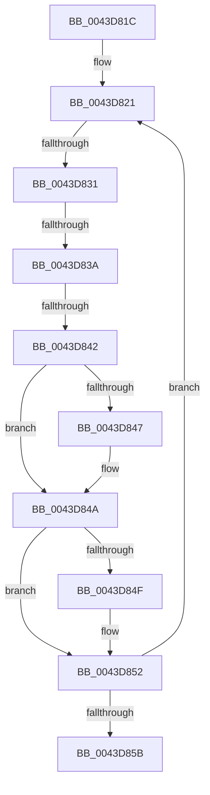

# sub_0043D81C

- RVA: `0x0043D81C`–`0x0043D860` (길이 `68` bytes)
- VA: `0x000000014043D81C`
- 실행 섹션: `.text`
- PDB 이름 있음: `아니요`; PDB Function 태그: `아니요`
- unwind 정보 RVA: `0x000A4890`
- 디코드: `22`개 명령, `68/68` bytes 표시
- 미해석 바이트: `0` (있으면 어셈블리에 `.byte`로 보존)

> 이 문서는 커널 이미지의 기계어와 PDB 기호를 분석해 생성했습니다. 4번과 5번은 함수 원형과 자료형을 바이너리 사용 방식에서 추정한 C 해석이며 원본 소스 복구 결과는 아닙니다.

## 1. Dependencies

- 직접 호출 지점: **0**; 고유 호출 대상: **0**
- 직접 호출자로 확인된 함수: **0**
- RIP 상대 이미지 참조: **0**

### Outgoing calls
- 직접 디코드된 call 명령이 없습니다.

### Direct callers
- 이 함수 시작 RVA로 연결되는 직접 call은 확인되지 않았습니다. 간접 호출은 완전히 역산할 수 없습니다.

### Static image references
- 디코드된 RIP-relative 메모리 참조가 없습니다.

## 2. Other-region calls and transfers

- 다른 실행 섹션으로 향하는 call: **0**
- call이 아닌 외부 분기/꼬리 이동: **3**
  - `0x0043D82F` → [sub_0043D888 + 0x16](Unknown_function_0043D888.md) (`tail-transfer`)
  - `0x0043D838` → [sub_0043D888 + 0x10](Unknown_function_0043D888.md) (`tail-transfer`)
  - `0x0043D840` → [sub_0043D888](Unknown_function_0043D888.md) (`tail-transfer`)

## 3. Assembly (complete function range)

```asm
0043D81C  48 89 7C 24 10                  mov qword ptr [rsp + 0x10], rdi
0043D821  4D 8B 06                        mov r8, qword ptr [r14]
0043D824  4D 8D 5A E8                     lea r11, [r10 - 0x18]
0043D828  49 8B 13                        mov rdx, qword ptr [r11]
0043D82B  4D 39 43 10                     cmp qword ptr [r11 + 0x10], r8
0043D82F  72 6D                           jb 0x14043d89e
0043D831  48 8B 4A 08                     mov rcx, qword ptr [rdx + 8]
0043D835  48 85 C9                        test rcx, rcx
0043D838  74 5E                           je 0x14043d898
0043D83A  48 8B 16                        mov rdx, qword ptr [rsi]
0043D83D  48 3B CA                        cmp rcx, rdx
0043D840  76 46                           jbe 0x14043d888
0043D842  4D 85 C9                        test r9, r9
0043D845  74 03                           je 0x14043d84a
0043D847  4D 89 11                        mov qword ptr [r9], r10
0043D84A  48 85 DB                        test rbx, rbx
0043D84D  74 03                           je 0x14043d852
0043D84F  C6 03 01                        mov byte ptr [rbx], 1
0043D852  4D 8B 52 08                     mov r10, qword ptr [r10 + 8]
0043D856  4D 85 D2                        test r10, r10
0043D859  75 C6                           jne 0x14043d821
0043D85B  48 8B 7C 24 10                  mov rdi, qword ptr [rsp + 0x10]
```

## 4. C-style interpretation (structured pseudocode)

```c
void __fastcall sub_0043D81C(__int64 a1, __int64 a2, __int64 a3, __int64 a4)
{
    unsigned __int64 v_stack_p10;

    v_stack_p10 = v_rdi;
loc_0043D821:
    if (a4 != 0) {
        *(unsigned __int64 *)(a4) = v_r10;
    }
    if (v_rbx != 0) {
        *(unsigned __int8 *)(v_rbx) = 1;
    }
    if (*(unsigned __int64 *)(v_r10 + 8) != 0) goto loc_0043D821;
    return;
}
```

## 5. (Beta) C Style

```c
void sub_0043D81C(int64_t Arg1, int64_t Arg2, int64_t Arg3, int64_t Arg4)
{
    uint64_t v_stack_p10;

    v_stack_p10 = local_rdi;
loc_0043D821:
    if (Arg4 != 0) {
        *(uint64_t *)(Arg4) = local_r10;
    }
    if (local_rbx != 0) {
        *(uint8_t *)(local_rbx) = 1;
    }
    if (*(uint64_t *)(local_r10 + 0x8) != 0) goto loc_0043D821;
    return;
}
```

## 6. Execution-region graph

[열기: 2D/3D 그래프와 함수 탐색 컨트롤 패널](../../../control-panel.html?section=text&rva=0x0043D81C&view=graph)

- 2D 그래프는 위에서 아래로 흐르고, 3D 그래프는 빈 공간을 드래그해 회전합니다. Shift+드래그는 이동, 휠은 확대·축소, 함수 노드 선택은 대상 보고서 이동입니다.

### Static fallback


