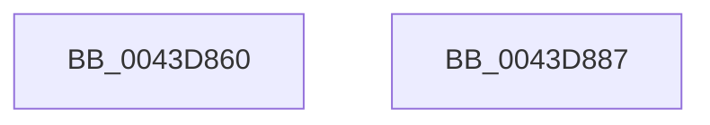

# sub_0043D860

- RVA: `0x0043D860`–`0x0043D888` (길이 `40` bytes)
- VA: `0x000000014043D860`
- 실행 섹션: `.text`
- PDB 이름 있음: `아니요`; PDB Function 태그: `아니요`
- unwind 정보 RVA: `0x000A48A4`
- 디코드: `12`개 명령, `40/40` bytes 표시
- 미해석 바이트: `0` (있으면 어셈블리에 `.byte`로 보존)

> 이 문서는 커널 이미지의 기계어와 PDB 기호를 분석해 생성했습니다. 4번과 5번은 함수 원형과 자료형을 바이너리 사용 방식에서 추정한 C 해석이며 원본 소스 복구 결과는 아닙니다.

## 1. Dependencies

- 직접 호출 지점: **0**; 고유 호출 대상: **0**
- 직접 호출자로 확인된 함수: **0**
- RIP 상대 이미지 참조: **0**

### Outgoing calls
- 직접 디코드된 call 명령이 없습니다.

### Direct callers
- 이 함수 시작 RVA로 연결되는 직접 call은 확인되지 않았습니다. 간접 호출은 완전히 역산할 수 없습니다.

### Static image references
- 디코드된 RIP-relative 메모리 참조가 없습니다.

## 2. Other-region calls and transfers

- 다른 실행 섹션으로 향하는 call: **0**
- 별도 외부 분기/꼬리 이동을 확인하지 못했습니다.

## 3. Assembly (complete function range)

```asm
0043D860  48 8B 5C 24 18                  mov rbx, qword ptr [rsp + 0x18]
0043D865  4D 85 D2                        test r10, r10
0043D868  48 8B 74 24 28                  mov rsi, qword ptr [rsp + 0x28]
0043D86D  49 0F 45 C3                     cmovne rax, r11
0043D871  48 85 C0                        test rax, rax
0043D874  48 8D 48 18                     lea rcx, [rax + 0x18]
0043D878  48 0F 44 CD                     cmove rcx, rbp
0043D87C  48 8B 6C 24 20                  mov rbp, qword ptr [rsp + 0x20]
0043D881  48 8B C1                        mov rax, rcx
0043D884  41 5E                           pop r14
0043D886  C3                              ret
0043D887  CC                              int3
```

## 4. C-style interpretation (structured pseudocode)

```c
__int64 __fastcall sub_0043D860(__int64 a1, __int64 a2, __int64 a3, __int64 a4, __int64 a5)
{
    __int64 result;
    unsigned __int64 v_stack_p18;
    unsigned __int64 v_stack_p20;

    if (v_r10 != 0) { result = v_r11; }
    a1 = result + 24;
    if (result == 0) { a1 = v_rbp; }
    return a1;
}
```

## 5. (Beta) C Style

```c
int64_t sub_0043D860(int64_t Arg1, int64_t Arg2, int64_t Arg3, int64_t Arg4, int64_t Arg5)
{
    int64_t result;
    uint64_t v_stack_p18;
    uint64_t v_stack_p20;

    if (local_r10 != 0) { result = local_r11; }
    Arg1 = result + 24;
    if (result == 0) { Arg1 = local_rbp; }
    return Arg1;
}
```

## 6. Execution-region graph

[열기: 2D/3D 그래프와 함수 탐색 컨트롤 패널](../../../control-panel.html?section=text&rva=0x0043D860&view=graph)

- 2D 그래프는 위에서 아래로 흐르고, 3D 그래프는 빈 공간을 드래그해 회전합니다. Shift+드래그는 이동, 휠은 확대·축소, 함수 노드 선택은 대상 보고서 이동입니다.

### Static fallback


