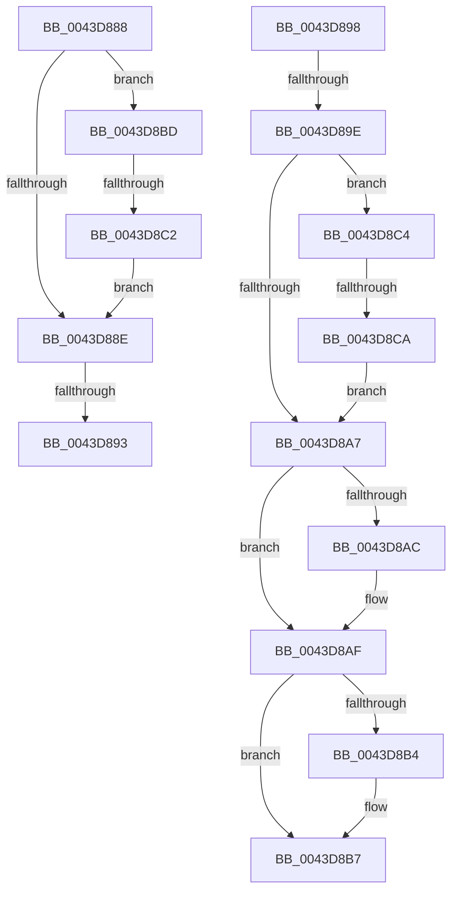

# sub_0043D888

- RVA: `0x0043D888`–`0x0043D8CC` (길이 `68` bytes)
- VA: `0x000000014043D888`
- 실행 섹션: `.text`
- PDB 이름 있음: `아니요`; PDB Function 태그: `아니요`
- unwind 정보 RVA: `0x000A48B8`
- 디코드: `25`개 명령, `68/68` bytes 표시
- 미해석 바이트: `0` (있으면 어셈블리에 `.byte`로 보존)

> 이 문서는 커널 이미지의 기계어와 PDB 기호를 분석해 생성했습니다. 4번과 5번은 함수 원형과 자료형을 바이너리 사용 방식에서 추정한 C 해석이며 원본 소스 복구 결과는 아닙니다.

## 1. Dependencies

- 직접 호출 지점: **0**; 고유 호출 대상: **0**
- 직접 호출자로 확인된 함수: **0**
- RIP 상대 이미지 참조: **0**

### Outgoing calls
- 직접 디코드된 call 명령이 없습니다.

### Direct callers
- 이 함수 시작 RVA로 연결되는 직접 call은 확인되지 않았습니다. 간접 호출은 완전히 역산할 수 없습니다.

### Static image references
- 디코드된 RIP-relative 메모리 참조가 없습니다.

## 2. Other-region calls and transfers

- 다른 실행 섹션으로 향하는 call: **0**
- call이 아닌 외부 분기/꼬리 이동: **6**
  - `0x0043D891` → [sub_0043D81C + 0x3F](Unknown_function_0043D81C.md) (`tail-transfer`)
  - `0x0043D896` → [sub_0043D81C + 0x26](Unknown_function_0043D81C.md) (`tail-transfer`)
  - `0x0043D89C` → [sub_0043D81C + 0x1E](Unknown_function_0043D81C.md) (`tail-transfer`)
  - `0x0043D8BB` → [sub_0043D81C + 0x3A](Unknown_function_0043D81C.md) (`tail-transfer`)
  - `0x0043D8C0` → [sub_0043D81C + 0x26](Unknown_function_0043D81C.md) (`tail-transfer`)
  - `0x0043D8C8` → [sub_0043D81C + 0x3F](Unknown_function_0043D81C.md) (`tail-transfer`)

## 3. Assembly (complete function range)

```asm
0043D888  48 83 FA FF                     cmp rdx, -1
0043D88C  74 2F                           je 0x14043d8bd
0043D88E  49 3B C8                        cmp rcx, r8
0043D891  76 C8                           jbe 0x14043d85b
0043D893  49 8B C3                        mov rax, r11
0043D896  EB AA                           jmp 0x14043d842
0043D898  48 39 6A 10                     cmp qword ptr [rdx + 0x10], rbp
0043D89C  75 9C                           jne 0x14043d83a
0043D89E  48 8B 0E                        mov rcx, qword ptr [rsi]
0043D8A1  48 39 4A 30                     cmp qword ptr [rdx + 0x30], rcx
0043D8A5  74 1D                           je 0x14043d8c4
0043D8A7  4D 85 C9                        test r9, r9
0043D8AA  74 03                           je 0x14043d8af
0043D8AC  4D 89 11                        mov qword ptr [r9], r10
0043D8AF  48 85 DB                        test rbx, rbx
0043D8B2  74 03                           je 0x14043d8b7
0043D8B4  40 88 2B                        mov byte ptr [rbx], bpl
0043D8B7  4D 8B 52 10                     mov r10, qword ptr [r10 + 0x10]
0043D8BB  EB 99                           jmp 0x14043d856
0043D8BD  4D 85 C0                        test r8, r8
0043D8C0  74 80                           je 0x14043d842
0043D8C2  EB CA                           jmp 0x14043d88e
0043D8C4  4C 39 42 08                     cmp qword ptr [rdx + 8], r8
0043D8C8  74 91                           je 0x14043d85b
0043D8CA  EB DB                           jmp 0x14043d8a7
```

## 4. C-style interpretation (structured pseudocode)

```c
__int64 __fastcall sub_0043D888(__int64 a1, __int64 a2, __int64 a3, __int64 a4)
{
    if (a2 == -1) goto loc_0043D8BD;
loc_0043D88E:
loc_0043D8BD:
    goto loc_0043D88E;
}
```

## 5. (Beta) C Style

```c
int64_t sub_0043D888(int64_t Arg1, int64_t Arg2, int64_t Arg3, int64_t Arg4)
{
    if (Arg2 == -1) goto loc_0043D8BD;
loc_0043D88E:
loc_0043D8BD:
    goto loc_0043D88E;
}
```

## 6. Execution-region graph

[열기: 2D/3D 그래프와 함수 탐색 컨트롤 패널](../../../control-panel.html?section=text&rva=0x0043D888&view=graph)

- 2D 그래프는 위에서 아래로 흐르고, 3D 그래프는 빈 공간을 드래그해 회전합니다. Shift+드래그는 이동, 휠은 확대·축소, 함수 노드 선택은 대상 보고서 이동입니다.

### Static fallback


