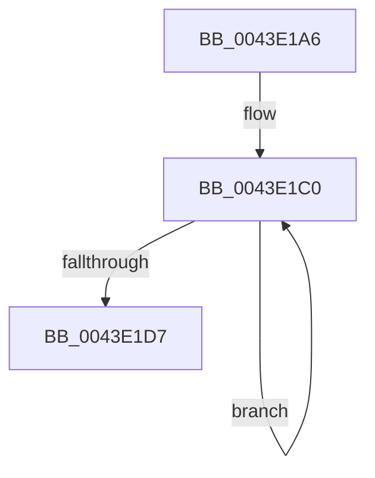

# sub_0043E1A6

- RVA: `0x0043E1A6`–`0x0043E1DF` (길이 `57` bytes)
- VA: `0x000000014043E1A6`
- 실행 섹션: `.text`
- PDB 이름 있음: `아니요`; PDB Function 태그: `아니요`
- unwind 정보 RVA: `0x000A4A8C`
- 디코드: `16`개 명령, `57/57` bytes 표시
- 미해석 바이트: `0` (있으면 어셈블리에 `.byte`로 보존)

> 이 문서는 커널 이미지의 기계어와 PDB 기호를 분석해 생성했습니다. 4번과 5번은 함수 원형과 자료형을 바이너리 사용 방식에서 추정한 C 해석이며 원본 소스 복구 결과는 아닙니다.

## 1. Dependencies

- 직접 호출 지점: **0**; 고유 호출 대상: **0**
- 직접 호출자로 확인된 함수: **0**
- RIP 상대 이미지 참조: **0**

### Outgoing calls
- 직접 디코드된 call 명령이 없습니다.

### Direct callers
- 이 함수 시작 RVA로 연결되는 직접 call은 확인되지 않았습니다. 간접 호출은 완전히 역산할 수 없습니다.

### Static image references
- 디코드된 RIP-relative 메모리 참조가 없습니다.

## 2. Other-region calls and transfers

- 다른 실행 섹션으로 향하는 call: **0**
- call이 아닌 외부 분기/꼬리 이동: **1**
  - `0x0043E1DD` → [sub_0043E1ED + 0x16](Unknown_function_0043E1ED.md) (`tail-transfer`)

## 3. Assembly (complete function range)

```asm
0043E1A6  48 89 3C 24                     mov qword ptr [rsp], rdi
0043E1AA  8D 4B FE                        lea ecx, [rbx - 2]
0043E1AD  D1 E9                           shr ecx, 1
0043E1AF  FF C1                           inc ecx
0043E1B1  44 8B D9                        mov r11d, ecx
0043E1B4  8D 3C 09                        lea edi, [rcx + rcx]
0043E1B7  48 03 C9                        add rcx, rcx
0043E1BA  66 0F 1F 44 00 00               nop word ptr [rax + rax]
0043E1C0  44 03 82 30 FF FF FF            add r8d, dword ptr [rdx - 0xd0]
0043E1C7  44 03 12                        add r10d, dword ptr [rdx]
0043E1CA  48 8D 92 A0 01 00 00            lea rdx, [rdx + 0x1a0]
0043E1D1  49 83 EB 01                     sub r11, 1
0043E1D5  75 E9                           jne 0x14043e1c0
0043E1D7  3B FB                           cmp edi, ebx
0043E1D9  48 8B 3C 24                     mov rdi, qword ptr [rsp]
0043E1DD  73 24                           jae 0x14043e203
```

## 4. C-style interpretation (structured pseudocode)

```c
void __fastcall sub_0043E1A6(__int64 a1, __int64 a2, int a3)
{
    __int64 v_r10;
    __int64 v_r11;
    unsigned __int64 v_stack_p0;

    v_stack_p0 = v_rdi;
    a1 = (unsigned int)((v_rbx - 2) >> (1));
    a1 = (unsigned int)((a1) + 1);
    a1 = (a1) + (a1);
loc_0043E1C0:
    a3 = (unsigned int)((a3) + (*(unsigned int *)(a2 - 208)));
    v_r10 = (unsigned int)((v_r10) + (*(unsigned int *)(a2)));
    v_r11 = ((unsigned int)((unsigned int)(a1))) - (1);
    if (condition_is_not_equal) goto loc_0043E1C0;
}
```

## 5. (Beta) C Style

```c
void sub_0043E1A6(int64_t Arg1, void *Arg2, int32_t Arg3)
{
    uint8_t *arg2 = (uint8_t *)Arg2;

    int64_t local_r10;
    int64_t local_r11;
    uint64_t v_stack_p0;

    v_stack_p0 = local_rdi;
    Arg1 = (uint32_t)((local_rbx - 2) >> (1));
    Arg1 = (uint32_t)((Arg1) + 1);
    Arg1 = (Arg1) + (Arg1);
loc_0043E1C0:
    Arg3 = (uint32_t)((Arg3) + (*(uint32_t *)(arg2 - 0xD0)));
    local_r10 = (uint32_t)((local_r10) + (*(uint32_t *)(arg2)));
    local_r11 = ((uint32_t)((uint32_t)(Arg1))) - (1);
    if (condition_is_not_equal) goto loc_0043E1C0;
}
```

### 관측된 메모리 오프셋

구조체 형식이 확인되지 않은 접근은 인자 기준의 오프셋으로만 기록했습니다.

| 기준 인자 | 오프셋 표현 | 폭 (bit) | 접근 |
|---|---:|---:|---|
| `Arg2` | `- 0xD0` | `32` | `R` |
| `Arg2` | `+ 0x0` | `32` | `R` |
| `Arg2` | `+ 0x1A0` | `64` | `R` |

## 6. Execution-region graph

[열기: 2D/3D 그래프와 함수 탐색 컨트롤 패널](../../../control-panel.html?section=text&rva=0x0043E1A6&view=graph)

- 2D 그래프는 위에서 아래로 흐르고, 3D 그래프는 빈 공간을 드래그해 회전합니다. Shift+드래그는 이동, 휠은 확대·축소, 함수 노드 선택은 대상 보고서 이동입니다.

### Static fallback


