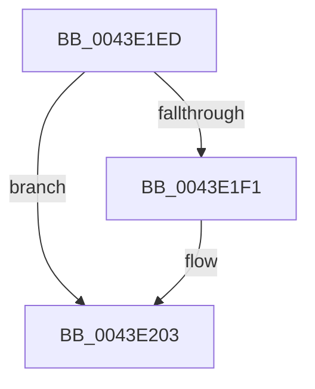

# sub_0043E1ED

- RVA: `0x0043E1ED`–`0x0043E213` (길이 `38` bytes)
- VA: `0x000000014043E1ED`
- 실행 섹션: `.text`
- PDB 이름 있음: `아니요`; PDB Function 태그: `아니요`
- unwind 정보 RVA: `0x000A4AC4`
- 디코드: `9`개 명령, `38/38` bytes 표시
- 미해석 바이트: `0` (있으면 어셈블리에 `.byte`로 보존)

> 이 문서는 커널 이미지의 기계어와 PDB 기호를 분석해 생성했습니다. 4번과 5번은 함수 원형과 자료형을 바이너리 사용 방식에서 추정한 C 해석이며 원본 소스 복구 결과는 아닙니다.

## 1. Dependencies

- 직접 호출 지점: **0**; 고유 호출 대상: **0**
- 직접 호출자로 확인된 함수: **0**
- RIP 상대 이미지 참조: **0**

### Outgoing calls
- 직접 디코드된 call 명령이 없습니다.

### Direct callers
- 이 함수 시작 RVA로 연결되는 직접 call은 확인되지 않았습니다. 간접 호출은 완전히 역산할 수 없습니다.

### Static image references
- 디코드된 RIP-relative 메모리 참조가 없습니다.

## 2. Other-region calls and transfers

- 다른 실행 섹션으로 향하는 call: **0**
- call이 아닌 외부 분기/꼬리 이동: **1**
  - `0x0043E20E` → [PopPepCountReadyActivities + 0x1D](PopPepCountReadyActivities_function_0043E160.md) (`tail-transfer`)

## 3. Assembly (complete function range)

```asm
0043E1ED  85 DB                           test ebx, ebx
0043E1EF  74 12                           je 0x14043e203
0043E1F1  49 8B C8                        mov rcx, r8
0043E1F4  48 69 C9 D0 00 00 00            imul rcx, rcx, 0xd0
0043E1FB  42 03 84 09 28 01 00 00         add eax, dword ptr [rcx + r9 + 0x128]
0043E203  48 8B 5C 24 10                  mov rbx, qword ptr [rsp + 0x10]
0043E208  43 8D 0C 02                     lea ecx, [r10 + r8]
0043E20C  03 C1                           add eax, ecx
0043E20E  E9 6A FF FF FF                  jmp 0x14043e17d
```

## 4. C-style interpretation (structured pseudocode)

```c
__int64 __fastcall sub_0043E1ED(__int64 a1, __int64 a2, __int64 a3, __int64 a4)
{
    __int64 result;
    unsigned __int64 v_stack_p10;

    if ((unsigned int)(v_rbx) != 0) {
        a1 = a3;
        a1 = (a1) * (a1);
        result = (unsigned int)((result) + (*(unsigned int *)(a1 + a4 * 1 + 296)));
    }
    result = (unsigned int)((result) + ((unsigned int)(v_r10 + a3 * 1)));
}
```

## 5. (Beta) C Style

```c
int64_t sub_0043E1ED(int64_t Arg1, int64_t Arg2, void *Arg3, int64_t Arg4)
{
    uint8_t *arg3 = (uint8_t *)Arg3;

    int64_t result;
    uint64_t v_stack_p10;

    if ((uint32_t)(local_rbx) != 0) {
        Arg1 = Arg3;
        Arg1 = (Arg1) * (Arg1);
        result = (uint32_t)((result) + (*(uint32_t *)(Arg1 + Arg4 * 1 + 0x128)));
    }
    result = (uint32_t)((result) + ((uint32_t)(local_r10 + Arg3 * 1)));
}
```

### 관측된 메모리 오프셋

구조체 형식이 확인되지 않은 접근은 인자 기준의 오프셋으로만 기록했습니다.

| 기준 인자 | 오프셋 표현 | 폭 (bit) | 접근 |
|---|---:|---:|---|
| `Arg3` | `+ 0x128 + r9*1` | `32` | `R` |

## 6. Execution-region graph

[열기: 2D/3D 그래프와 함수 탐색 컨트롤 패널](../../../control-panel.html?section=text&rva=0x0043E1ED&view=graph)

- 2D 그래프는 위에서 아래로 흐르고, 3D 그래프는 빈 공간을 드래그해 회전합니다. Shift+드래그는 이동, 휠은 확대·축소, 함수 노드 선택은 대상 보고서 이동입니다.

### Static fallback


