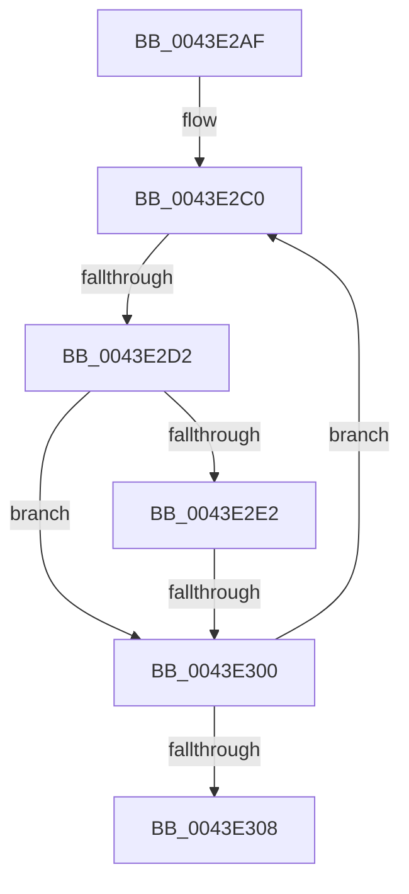

# sub_0043E2AF

- RVA: `0x0043E2AF`–`0x0043E30D` (길이 `94` bytes)
- VA: `0x000000014043E2AF`
- 실행 섹션: `.text`
- PDB 이름 있음: `아니요`; PDB Function 태그: `아니요`
- unwind 정보 RVA: `0x000A4AF0`
- 디코드: `25`개 명령, `94/94` bytes 표시
- 미해석 바이트: `0` (있으면 어셈블리에 `.byte`로 보존)

> 이 문서는 커널 이미지의 기계어와 PDB 기호를 분석해 생성했습니다. 4번과 5번은 함수 원형과 자료형을 바이너리 사용 방식에서 추정한 C 해석이며 원본 소스 복구 결과는 아닙니다.

## 1. Dependencies

- 직접 호출 지점: **0**; 고유 호출 대상: **0**
- 직접 호출자로 확인된 함수: **0**
- RIP 상대 이미지 참조: **0**

### Outgoing calls
- 직접 디코드된 call 명령이 없습니다.

### Direct callers
- 이 함수 시작 RVA로 연결되는 직접 call은 확인되지 않았습니다. 간접 호출은 완전히 역산할 수 없습니다.

### Static image references
- 디코드된 RIP-relative 메모리 참조가 없습니다.

## 2. Other-region calls and transfers

- 다른 실행 섹션으로 향하는 call: **0**
- call이 아닌 외부 분기/꼬리 이동: **2**
  - `0x0043E2CC` → [sub_0043E326 + 0x36](Unknown_function_0043E326.md) (`tail-transfer`)
  - `0x0043E2FE` → [sub_0043E326](Unknown_function_0043E326.md) (`tail-transfer`)

## 3. Assembly (complete function range)

```asm
0043E2AF  4C 89 74 24 70                  mov qword ptr [rsp + 0x70], r14
0043E2B4  4C 8B B4 24 80 00 00 00         mov r14, qword ptr [rsp + 0x80]
0043E2BC  0F 1F 40 00                     nop dword ptr [rax]
0043E2C0  8B 4B 08                        mov ecx, dword ptr [rbx + 8]
0043E2C3  8B C1                           mov eax, ecx
0043E2C5  25 00 F0 FF FF                  and eax, 0xfffff000
0043E2CA  3B C7                           cmp eax, edi
0043E2CC  0F 84 8A 00 00 00               je 0x14043e35c
0043E2D2  44 8B 43 0C                     mov r8d, dword ptr [rbx + 0xc]
0043E2D6  41 8B C0                        mov eax, r8d
0043E2D9  25 00 F0 FF FF                  and eax, 0xfffff000
0043E2DE  3B C7                           cmp eax, edi
0043E2E0  75 1E                           jne 0x14043e300
0043E2E2  81 E1 FF 0F 00 00               and ecx, 0xfff
0043E2E8  41 81 E0 FF 0F 00 00            and r8d, 0xfff
0043E2EF  B8 00 10 00 00                  mov eax, 0x1000
0043E2F4  4C 8B CE                        mov r9, rsi
0043E2F7  2B C1                           sub eax, ecx
0043E2F9  8B C8                           mov ecx, eax
0043E2FB  4D 85 C9                        test r9, r9
0043E2FE  75 26                           jne 0x14043e326
0043E300  48 8B 1B                        mov rbx, qword ptr [rbx]
0043E303  48 85 DB                        test rbx, rbx
0043E306  75 B8                           jne 0x14043e2c0
0043E308  4C 8B 74 24 70                  mov r14, qword ptr [rsp + 0x70]
```

## 4. C-style interpretation (structured pseudocode)

```c
__int64 __fastcall sub_0043E2AF(__int64 a1, __int64 a2, __int64 a3, __int64 a4, __int64 a5, __int64 a6, __int64 a7, __int64 a8, __int64 a9, __int64 a10, __int64 a11, __int64 a12, __int64 a13, __int64 a14, __int64 a15, __int64 a16)
{
    __int64 result;
    unsigned __int64 v_stack_p70;

    v_stack_p70 = v_r14;
loc_0043E2C0:
    result = (unsigned int)(((unsigned int)((unsigned int)((unsigned int)(*(unsigned int *)(v_rbx + 8))))) & (0xFFFFF000ULL));
    result = (unsigned int)(((unsigned int)((unsigned int)((unsigned int)(*(unsigned int *)(v_rbx + 12))))) & (0xFFFFF000ULL));
    if (((unsigned int)(result)) != ((unsigned int)(v_rdi))) goto loc_0043E300;
    a1 = (unsigned int)(((unsigned int)(*(unsigned int *)(v_rbx + 8))) & (0xFFFULL));
    a3 = (unsigned int)(((unsigned int)(*(unsigned int *)(v_rbx + 12))) & (0xFFFULL));
    result = (unsigned int)(((unsigned int)(0x1000ULL)) - ((unsigned int)(a1)));
loc_0043E300:
    if (*(unsigned __int64 *)(v_rbx) != 0) goto loc_0043E2C0;
    return result;
}
```

## 5. (Beta) C Style

```c
int64_t sub_0043E2AF(int64_t Arg1, int64_t Arg2, int64_t Arg3, int64_t Arg4, uint64_t Arg5, uint64_t Arg6, uint64_t Arg7, uint64_t Arg8, uint64_t Arg9, uint64_t Arg10, uint64_t Arg11, uint64_t Arg12, uint64_t Arg13, int64_t Arg14, uint64_t Arg15, int64_t Arg16)
{
    int64_t result;
    uint64_t v_stack_p70;

    v_stack_p70 = local_r14;
loc_0043E2C0:
    result = (uint32_t)(((uint32_t)((uint32_t)((uint32_t)(*(uint32_t *)(local_rbx + 0x8))))) & (0xFFFFF000ULL));
    result = (uint32_t)(((uint32_t)((uint32_t)((uint32_t)(*(uint32_t *)(local_rbx + 0xC))))) & (0xFFFFF000ULL));
    if (((uint32_t)(result)) != ((uint32_t)(local_rdi))) goto loc_0043E300;
    Arg1 = (uint32_t)(((uint32_t)(*(uint32_t *)(local_rbx + 0x8))) & (0xFFFULL));
    Arg3 = (uint32_t)(((uint32_t)(*(uint32_t *)(local_rbx + 0xC))) & (0xFFFULL));
    result = (uint32_t)(((uint32_t)(0x1000ULL)) - ((uint32_t)(Arg1)));
loc_0043E300:
    if (*(uint64_t *)(local_rbx) != 0) goto loc_0043E2C0;
    return result;
}
```

## 6. Execution-region graph

[열기: 2D/3D 그래프와 함수 탐색 컨트롤 패널](../../../control-panel.html?section=text&rva=0x0043E2AF&view=graph)

- 2D 그래프는 위에서 아래로 흐르고, 3D 그래프는 빈 공간을 드래그해 회전합니다. Shift+드래그는 이동, 휠은 확대·축소, 함수 노드 선택은 대상 보고서 이동입니다.

### Static fallback


