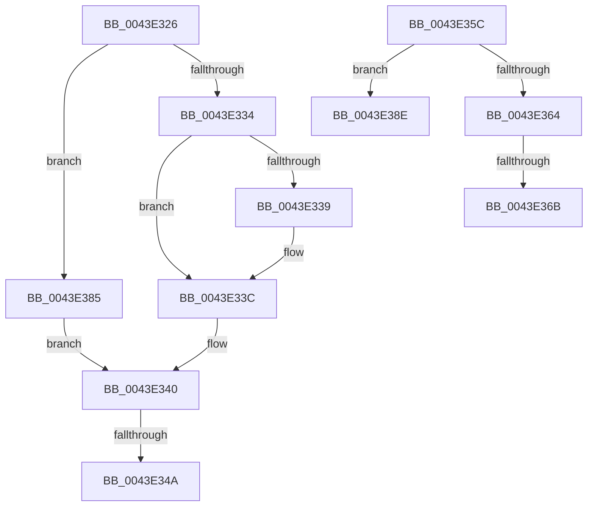

# sub_0043E326

- RVA: `0x0043E326`–`0x0043E3B0` (길이 `138` bytes)
- VA: `0x000000014043E326`
- 실행 섹션: `.text`
- PDB 이름 있음: `아니요`; PDB Function 태그: `아니요`
- unwind 정보 RVA: `0x000A4B18`
- 디코드: `36`개 명령, `138/138` bytes 표시
- 미해석 바이트: `0` (있으면 어셈블리에 `.byte`로 보존)

> 이 문서는 커널 이미지의 기계어와 PDB 기호를 분석해 생성했습니다. 4번과 5번은 함수 원형과 자료형을 바이너리 사용 방식에서 추정한 C 해석이며 원본 소스 복구 결과는 아닙니다.

## 1. Dependencies

- 직접 호출 지점: **1**; 고유 호출 대상: **1**
- 직접 호출자로 확인된 함수: **0**
- RIP 상대 이미지 참조: **0**

### Outgoing calls
- `0x0043E355` → [memcpy](../6C/memcpy_function_006C6840.md) (function, `0x006C6840`)

### Direct callers
- 이 함수 시작 RVA로 연결되는 직접 call은 확인되지 않았습니다. 간접 호출은 완전히 역산할 수 없습니다.

### Static image references
- 디코드된 RIP-relative 메모리 참조가 없습니다.

## 2. Other-region calls and transfers

- 다른 실행 섹션으로 향하는 call: **0**
- call이 아닌 외부 분기/꼬리 이동: **5**
  - `0x0043E348` → [sub_0043E2AF + 0x51](Unknown_function_0043E2AF.md) (`tail-transfer`)
  - `0x0043E35A` → [sub_0043E2AF + 0x51](Unknown_function_0043E2AF.md) (`tail-transfer`)
  - `0x0043E369` → [sub_0043E2AF + 0x51](Unknown_function_0043E2AF.md) (`tail-transfer`)
  - `0x0043E380` → [sub_0043E2AF + 0x51](Unknown_function_0043E2AF.md) (`tail-transfer`)
  - `0x0043E3AB` → [sub_0043E2AF + 0x4C](Unknown_function_0043E2AF.md) (`tail-transfer`)

## 3. Assembly (complete function range)

```asm
0043E326  F6 84 24 88 00 00 00 08         test byte ptr [rsp + 0x88], 8
0043E32E  48 8B 53 18                     mov rdx, qword ptr [rbx + 0x18]
0043E332  75 51                           jne 0x14043e385
0043E334  4D 85 F6                        test r14, r14
0043E337  74 03                           je 0x14043e33c
0043E339  49 03 D6                        add rdx, r14
0043E33C  4A 8D 04 3A                     lea rax, [rdx + r15]
0043E340  48 89 44 24 20                  mov qword ptr [rsp + 0x20], rax
0043E345  45 85 C0                        test r8d, r8d
0043E348  74 B6                           je 0x14043e300
0043E34A  48 8D 54 24 20                  lea rdx, [rsp + 0x20]
0043E34F  48 03 D1                        add rdx, rcx
0043E352  49 8B C9                        mov rcx, r9
0043E355  E8 E6 84 28 00                  call 0x1406c6840
0043E35A  EB A4                           jmp 0x14043e300
0043E35C  F7 C1 FF 0F 00 00               test ecx, 0xfff
0043E362  75 2A                           jne 0x14043e38e
0043E364  66 83 7B 10 03                  cmp word ptr [rbx + 0x10], 3
0043E369  75 95                           jne 0x14043e300
0043E36B  8B 4B 0C                        mov ecx, dword ptr [rbx + 0xc]
0043E36E  49 8B C7                        mov rax, r15
0043E371  81 E1 FF 0F 00 00               and ecx, 0xfff
0043E377  48 C1 E8 10                     shr rax, 0x10
0043E37B  66 01 44 31 FE                  add word ptr [rcx + rsi - 2], ax
0043E380  E9 7B FF FF FF                  jmp 0x14043e300
0043E385  48 8B 45 30                     mov rax, qword ptr [rbp + 0x30]
0043E389  48 03 C2                        add rax, rdx
0043E38C  EB B2                           jmp 0x14043e340
0043E38E  81 E1 FF 0F 00 00               and ecx, 0xfff
0043E394  41 B8 00 10 00 00               mov r8d, 0x1000
0043E39A  4C 8D 0C 31                     lea r9, [rcx + rsi]
0043E39E  41 8B C1                        mov eax, r9d
0043E3A1  25 FF 0F 00 00                  and eax, 0xfff
0043E3A6  44 2B C0                        sub r8d, eax
0043E3A9  33 C9                           xor ecx, ecx
0043E3AB  E9 4B FF FF FF                  jmp 0x14043e2fb
```

## 4. C-style interpretation (structured pseudocode)

```c
__int64 __fastcall sub_0043E326(__int64 a1, __int64 a2, int a3, __int64 a4, __int64 a5, __int64 a6, __int64 a7, __int64 a8, __int64 a9, __int64 a10, __int64 a11, __int64 a12, __int64 a13, __int64 a14, __int64 a15, __int64 a16, unsigned __int8 a17)
{
    __int64 result;
    unsigned __int64 v_stack_p20;

    if (((a17) & (8)) != 0) goto loc_0043E385;
    if (v_r14 != 0) {
        a2 = (*(unsigned __int64 *)(v_rbx + 24)) + (v_r14);
    }
loc_0043E340:
    v_stack_p20 = a2 + v_r15 * 1;
    a2 = (v_stack_p20) + (a1);
    result = memcpy(a4, a2, a3, a4);
loc_0043E385:
    result = (*(unsigned __int64 *)(v_rbp + 48)) + (a2);
    goto loc_0043E340;
}
```

## 5. (Beta) C Style

```c
int64_t sub_0043E326(int64_t Arg1, int64_t Arg2, int32_t Arg3, int64_t Arg4, uint64_t Arg5, uint64_t Arg6, uint64_t Arg7, uint64_t Arg8, uint64_t Arg9, uint64_t Arg10, uint64_t Arg11, uint64_t Arg12, uint64_t Arg13, uint64_t Arg14, uint64_t Arg15, uint64_t Arg16, uint8_t Arg17)
{
    int64_t result;
    uint64_t v_stack_p20;

    if (((Arg17) & (8)) != 0) goto loc_0043E385;
    if (local_r14 != 0) {
        Arg2 = (*(uint64_t *)(local_rbx + 0x18)) + (local_r14);
    }
loc_0043E340:
    v_stack_p20 = Arg2 + local_r15 * 1;
    Arg2 = (v_stack_p20) + (Arg1);
    result = memcpy(Arg4, Arg2, Arg3, Arg4);
loc_0043E385:
    result = (*(uint64_t *)(local_rbp + 0x30)) + (Arg2);
    goto loc_0043E340;
}
```

## 6. Execution-region graph

[열기: 2D/3D 그래프와 함수 탐색 컨트롤 패널](../../../control-panel.html?section=text&rva=0x0043E326&view=graph)

- 2D 그래프는 위에서 아래로 흐르고, 3D 그래프는 빈 공간을 드래그해 회전합니다. Shift+드래그는 이동, 휠은 확대·축소, 함수 노드 선택은 대상 보고서 이동입니다.

### Static fallback


