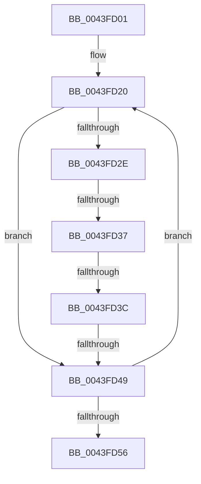

# sub_0043FD01

- RVA: `0x0043FD01`–`0x0043FD64` (길이 `99` bytes)
- VA: `0x000000014043FD01`
- 실행 섹션: `.text`
- PDB 이름 있음: `아니요`; PDB Function 태그: `아니요`
- unwind 정보 RVA: `0x000A4DCC`
- 디코드: `27`개 명령, `99/99` bytes 표시
- 미해석 바이트: `0` (있으면 어셈블리에 `.byte`로 보존)

> 이 문서는 커널 이미지의 기계어와 PDB 기호를 분석해 생성했습니다. 4번과 5번은 함수 원형과 자료형을 바이너리 사용 방식에서 추정한 C 해석이며 원본 소스 복구 결과는 아닙니다.

## 1. Dependencies

- 직접 호출 지점: **0**; 고유 호출 대상: **0**
- 직접 호출자로 확인된 함수: **0**
- RIP 상대 이미지 참조: **0**

### Outgoing calls
- 직접 디코드된 call 명령이 없습니다.

### Direct callers
- 이 함수 시작 RVA로 연결되는 직접 call은 확인되지 않았습니다. 간접 호출은 완전히 역산할 수 없습니다.

### Static image references
- 디코드된 RIP-relative 메모리 참조가 없습니다.

## 2. Other-region calls and transfers

- 다른 실행 섹션으로 향하는 call: **0**
- call이 아닌 외부 분기/꼬리 이동: **4**
  - `0x0043FD35` → [sub_0043FD64 + 0x19](Unknown_function_0043FD64.md) (`tail-transfer`)
  - `0x0043FD3A` → [sub_0043FD64](Unknown_function_0043FD64.md) (`tail-transfer`)
  - `0x0043FD47` → [sub_0043FD64 + 0x13](Unknown_function_0043FD64.md) (`tail-transfer`)
  - `0x0043FD5F` → [SepConstrainByMandatory + 0x1C](SepConstrainByMandatory_function_0043FC70.md) (`tail-transfer`)

## 3. Assembly (complete function range)

```asm
0043FD01  48 89 5C 24 10                  mov qword ptr [rsp + 0x10], rbx
0043FD06  4D 2B C8                        sub r9, r8
0043FD09  48 8B 5C 24 30                  mov rbx, qword ptr [rsp + 0x30]
0043FD0E  48 89 3C 24                     mov qword ptr [rsp], rdi
0043FD12  4C 8B D3                        mov r10, rbx
0043FD15  48 8B F8                        mov rdi, rax
0043FD18  0F 1F 84 00 00 00 00 00         nop dword ptr [rax + rax]
0043FD20  41 8B 00                        mov eax, dword ptr [r8]
0043FD23  44 8B 19                        mov r11d, dword ptr [rcx]
0043FD26  44 23 D8                        and r11d, eax
0043FD29  44 3B D8                        cmp r11d, eax
0043FD2C  74 1B                           je 0x14043fd49
0043FD2E  45 89 18                        mov dword ptr [r8], r11d
0043FD31  0F BA E2 19                     bt edx, 0x19
0043FD35  73 46                           jae 0x14043fd7d
0043FD37  45 85 DB                        test r11d, r11d
0043FD3A  74 28                           je 0x14043fd64
0043FD3C  43 C7 04 01 00 00 00 00         mov dword ptr [r9 + r8], 0
0043FD44  48 85 DB                        test rbx, rbx
0043FD47  75 2E                           jne 0x14043fd77
0043FD49  49 83 C0 04                     add r8, 4
0043FD4D  49 FF C2                        inc r10
0043FD50  48 83 EF 01                     sub rdi, 1
0043FD54  75 CA                           jne 0x14043fd20
0043FD56  48 8B 3C 24                     mov rdi, qword ptr [rsp]
0043FD5A  48 8B 5C 24 10                  mov rbx, qword ptr [rsp + 0x10]
0043FD5F  E9 28 FF FF FF                  jmp 0x14043fc8c
```

## 4. C-style interpretation (structured pseudocode)

```c
__int64 __fastcall sub_0043FD01(__int64 a1, int a2, __int64 a3, __int64 a4, __int64 a5, __int64 a6)
{
    __int64 v_r10;
    __int64 v_r11;
    __int64 v_rdi;
    unsigned __int64 v_stack_p0;
    unsigned __int64 v_stack_p10;

    v_stack_p10 = v_rbx;
    a4 = (a4) - (a3);
    v_stack_p0 = v_rdi;
loc_0043FD20:
    v_r11 = (unsigned int)(((unsigned int)(*(unsigned int *)(a1))) & ((unsigned int)((unsigned int)(*(unsigned int *)(a3)))));
    if (((unsigned int)(v_r11)) == ((unsigned int)((unsigned int)(*(unsigned int *)(a3))))) goto loc_0043FD49;
    *(unsigned int *)(a3) = (unsigned int)(v_r11);
    *(unsigned int *)(a4 + a3 * 1) = 0;
loc_0043FD49:
    a3 = (a3) + (4);
    v_r10 = (a6) + 1;
    v_rdi = (result) - (1);
    if (condition_is_not_equal) goto loc_0043FD20;
}
```

## 5. (Beta) C Style

```c
int64_t sub_0043FD01(void *Arg1, int32_t Arg2, void *Arg3, void *Arg4, uint64_t Arg5, int64_t Arg6)
{
    uint8_t *arg1 = (uint8_t *)Arg1;
    uint8_t *arg3 = (uint8_t *)Arg3;
    uint8_t *arg4 = (uint8_t *)Arg4;

    int64_t local_r10;
    int64_t local_r11;
    int64_t local_rdi;
    uint64_t v_stack_p0;
    uint64_t v_stack_p10;

    v_stack_p10 = local_rbx;
    Arg4 = (Arg4) - (Arg3);
    v_stack_p0 = local_rdi;
loc_0043FD20:
    local_r11 = (uint32_t)(((uint32_t)(*(uint32_t *)(arg1))) & ((uint32_t)((uint32_t)(*(uint32_t *)(arg3)))));
    if (((uint32_t)(local_r11)) == ((uint32_t)((uint32_t)(*(uint32_t *)(arg3))))) goto loc_0043FD49;
    *(uint32_t *)(arg3) = (uint32_t)(local_r11);
    *(uint32_t *)(arg4 + arg3 * 1) = 0;
loc_0043FD49:
    Arg3 = (Arg3) + (4);
    local_r10 = (Arg6) + 1;
    local_rdi = (result) - (1);
    if (condition_is_not_equal) goto loc_0043FD20;
}
```

### 관측된 메모리 오프셋

구조체 형식이 확인되지 않은 접근은 인자 기준의 오프셋으로만 기록했습니다.

| 기준 인자 | 오프셋 표현 | 폭 (bit) | 접근 |
|---|---:|---:|---|
| `Arg1` | `+ 0x0` | `32` | `R` |
| `Arg3` | `+ 0x0` | `32` | `R` |
| `Arg3` | `+ 0x0` | `32` | `W` |
| `Arg4` | `+ 0x0 + r8*1` | `32` | `W` |

## 6. Execution-region graph

[열기: 2D/3D 그래프와 함수 탐색 컨트롤 패널](../../../control-panel.html?section=text&rva=0x0043FD01&view=graph)

- 2D 그래프는 위에서 아래로 흐르고, 3D 그래프는 빈 공간을 드래그해 회전합니다. Shift+드래그는 이동, 휠은 확대·축소, 함수 노드 선택은 대상 보고서 이동입니다.

### Static fallback


