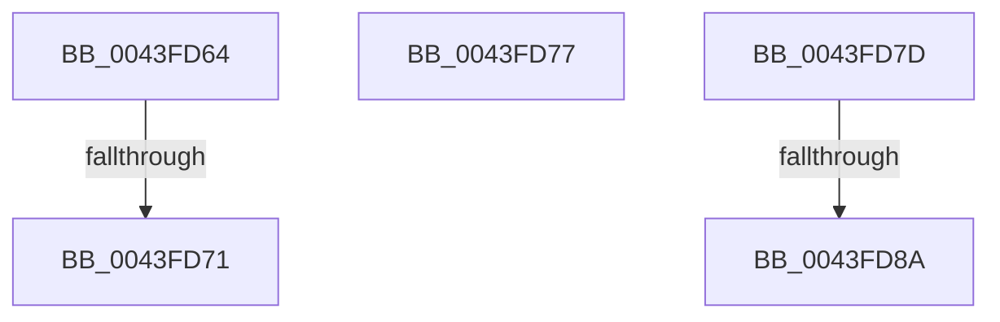

# sub_0043FD64

- RVA: `0x0043FD64`–`0x0043FD96` (길이 `50` bytes)
- VA: `0x000000014043FD64`
- 실행 섹션: `.text`
- PDB 이름 있음: `아니요`; PDB Function 태그: `아니요`
- unwind 정보 RVA: `0x000A4DE4`
- 디코드: `14`개 명령, `50/50` bytes 표시
- 미해석 바이트: `0` (있으면 어셈블리에 `.byte`로 보존)

> 이 문서는 커널 이미지의 기계어와 PDB 기호를 분석해 생성했습니다. 4번과 5번은 함수 원형과 자료형을 바이너리 사용 방식에서 추정한 C 해석이며 원본 소스 복구 결과는 아닙니다.

## 1. Dependencies

- 직접 호출 지점: **0**; 고유 호출 대상: **0**
- 직접 호출자로 확인된 함수: **0**
- RIP 상대 이미지 참조: **0**

### Outgoing calls
- 직접 디코드된 call 명령이 없습니다.

### Direct callers
- 이 함수 시작 RVA로 연결되는 직접 call은 확인되지 않았습니다. 간접 호출은 완전히 역산할 수 없습니다.

### Static image references
- 디코드된 RIP-relative 메모리 참조가 없습니다.

## 2. Other-region calls and transfers

- 다른 실행 섹션으로 향하는 call: **0**
- call이 아닌 외부 분기/꼬리 이동: **5**
  - `0x0043FD6F` → [sub_0043FD01 + 0x48](Unknown_function_0043FD01.md) (`tail-transfer`)
  - `0x0043FD75` → [sub_0043FD01 + 0x48](Unknown_function_0043FD01.md) (`tail-transfer`)
  - `0x0043FD7B` → [sub_0043FD01 + 0x48](Unknown_function_0043FD01.md) (`tail-transfer`)
  - `0x0043FD88` → [sub_0043FD01 + 0x48](Unknown_function_0043FD01.md) (`tail-transfer`)
  - `0x0043FD94` → [sub_0043FD01 + 0x48](Unknown_function_0043FD01.md) (`tail-transfer`)

## 3. Assembly (complete function range)

```asm
0043FD64  43 C7 04 01 22 00 00 C0         mov dword ptr [r9 + r8], 0xc0000022
0043FD6C  48 85 DB                        test rbx, rbx
0043FD6F  74 D8                           je 0x14043fd49
0043FD71  41 C6 02 00                     mov byte ptr [r10], 0
0043FD75  EB D2                           jmp 0x14043fd49
0043FD77  41 C6 02 01                     mov byte ptr [r10], 1
0043FD7B  EB CC                           jmp 0x14043fd49
0043FD7D  43 C7 04 01 22 00 00 C0         mov dword ptr [r9 + r8], 0xc0000022
0043FD85  48 85 DB                        test rbx, rbx
0043FD88  74 BF                           je 0x14043fd49
0043FD8A  41 83 38 00                     cmp dword ptr [r8], 0
0043FD8E  0F 95 C0                        setne al
0043FD91  41 88 02                        mov byte ptr [r10], al
0043FD94  EB B3                           jmp 0x14043fd49
```

## 4. C-style interpretation (structured pseudocode)

```c
__int64 __fastcall sub_0043FD64(__int64 a1, __int64 a2, __int64 a3, __int64 a4)
{
    *(unsigned int *)(a4 + a3 * 1) = 0xC0000022ULL;
    *(unsigned __int8 *)(v_r10) = 0;
}
```

## 5. (Beta) C Style

```c
int64_t sub_0043FD64(int64_t Arg1, int64_t Arg2, int64_t Arg3, void *Arg4)
{
    uint8_t *arg4 = (uint8_t *)Arg4;

    *(uint32_t *)(arg4 + Arg3 * 1) = 0xC0000022ULL;
    *(uint8_t *)(local_r10) = 0;
}
```

### 관측된 메모리 오프셋

구조체 형식이 확인되지 않은 접근은 인자 기준의 오프셋으로만 기록했습니다.

| 기준 인자 | 오프셋 표현 | 폭 (bit) | 접근 |
|---|---:|---:|---|
| `Arg4` | `+ 0x0 + r8*1` | `32` | `W` |

## 6. Execution-region graph

[열기: 2D/3D 그래프와 함수 탐색 컨트롤 패널](../../../control-panel.html?section=text&rva=0x0043FD64&view=graph)

- 2D 그래프는 위에서 아래로 흐르고, 3D 그래프는 빈 공간을 드래그해 회전합니다. Shift+드래그는 이동, 휠은 확대·축소, 함수 노드 선택은 대상 보고서 이동입니다.

### Static fallback


