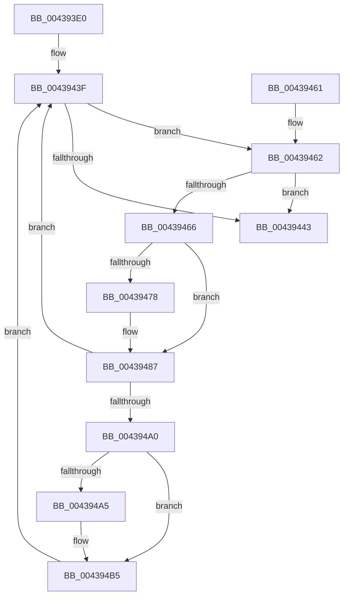

# VslAccessPciDevice

- RVA: `0x004393E0`–`0x004394C5` (길이 `229` bytes)
- VA: `0x00000001404393E0`
- 실행 섹션: `.text`
- PDB 이름 있음: `예`; PDB Function 태그: `아니요`
- unwind 정보 RVA: `0x000A4110`
- 디코드: `76`개 명령, `229/229` bytes 표시
- 미해석 바이트: `0` (있으면 어셈블리에 `.byte`로 보존)

> 이 문서는 커널 이미지의 기계어와 PDB 기호를 분석해 생성했습니다. 4번과 5번은 함수 원형과 자료형을 바이너리 사용 방식에서 추정한 C 해석이며 원본 소스 복구 결과는 아닙니다.

## 1. Dependencies

- 직접 호출 지점: **5**; 고유 호출 대상: **4**
- 직접 호출자로 확인된 함수: **2**
- RIP 상대 이미지 참조: **1**

### Outgoing calls
- `0x0043941C` → [memset](../6C/memset_function_006C6C40.md) (function, `0x006C6C40`)
- `0x0043944C` → [_security_check_cookie](../6A/_security_check_cookie_function_006AC640.md) (function, `0x006AC640`)
- `0x00439482` → [memcpy](../6C/memcpy_function_006C6840.md) (function, `0x006C6840`)
- `0x00439495` → [VslpEnterIumSecureMode](../23/VslpEnterIumSecureMode_function_00235E50.md) (function, `0x00235E50`)
- `0x004394B0` → [memcpy](../6C/memcpy_function_006C6840.md) (function, `0x006C6840`)

### Direct callers
- [HaliPciInterfaceReadConfig](HaliPciInterfaceReadConfig_function_004391A0.md) at `0x00439266`
- [KiOpPciConfigSpaceAccessCommon](../5C/KiOpPciConfigSpaceAccessCommon_function_005C6AAC.md) at `0x005C6B8D`

### Static image references
- `0x004393F5` → RVA `0x00E0A740` (`.data`; read)

## 2. Other-region calls and transfers

- 다른 실행 섹션으로 향하는 call: **0**
- 별도 외부 분기/꼬리 이동을 확인하지 못했습니다.

## 3. Assembly (complete function range)

```asm
004393E0  40 55                           push rbp
004393E2  53                              push rbx
004393E3  56                              push rsi
004393E4  57                              push rdi
004393E5  41 56                           push r14
004393E7  41 57                           push r15
004393E9  48 8D 6C 24 F1                  lea rbp, [rsp - 0xf]
004393EE  48 81 EC A8 00 00 00            sub rsp, 0xa8
004393F5  48 8B 05 44 13 9D 00            mov rax, qword ptr [rip + 0x9d1344]
004393FC  48 33 C4                        xor rax, rsp
004393FF  48 89 45 F7                     mov qword ptr [rbp - 9], rax
00439403  4C 8B 75 7F                     mov r14, qword ptr [rbp + 0x7f]
00439407  8B DA                           mov ebx, edx
00439409  33 D2                           xor edx, edx
0043940B  41 8B F8                        mov edi, r8d
0043940E  44 8A F9                        mov r15b, cl
00439411  41 8B F1                        mov esi, r9d
00439414  48 8D 4D 87                     lea rcx, [rbp - 0x79]
00439418  44 8D 42 68                     lea r8d, [rdx + 0x68]
0043941C  E8 1F D8 28 00                  call 0x1406c6c40
00439421  8B 45 67                        mov eax, dword ptr [rbp + 0x67]
00439424  89 45 9F                        mov dword ptr [rbp - 0x61], eax
00439427  8B 45 6F                        mov eax, dword ptr [rbp + 0x6f]
0043942A  89 5D 93                        mov dword ptr [rbp - 0x6d], ebx
0043942D  8B 5D 77                        mov ebx, dword ptr [rbp + 0x77]
00439430  89 7D 97                        mov dword ptr [rbp - 0x69], edi
00439433  33 FF                           xor edi, edi
00439435  89 45 A3                        mov dword ptr [rbp - 0x5d], eax
00439438  44 88 7D 8F                     mov byte ptr [rbp - 0x71], r15b
0043943C  89 75 9B                        mov dword ptr [rbp - 0x65], esi
0043943F  85 DB                           test ebx, ebx
00439441  75 1F                           jne 0x140439462
00439443  8B C7                           mov eax, edi
00439445  48 8B 4D F7                     mov rcx, qword ptr [rbp - 9]
00439449  48 33 CC                        xor rcx, rsp
0043944C  E8 EF 31 27 00                  call 0x1406ac640
00439451  48 81 C4 A8 00 00 00            add rsp, 0xa8
00439458  41 5F                           pop r15
0043945A  41 5E                           pop r14
0043945C  5F                              pop rdi
0043945D  5E                              pop rsi
0043945E  5B                              pop rbx
0043945F  5D                              pop rbp
00439460  C3                              ret
00439461  CC                              int3
00439462  85 FF                           test edi, edi
00439464  78 DD                           js 0x140439443
00439466  B8 40 00 00 00                  mov eax, 0x40
0043946B  3B D8                           cmp ebx, eax
0043946D  0F 42 C3                        cmovb eax, ebx
00439470  89 45 A7                        mov dword ptr [rbp - 0x59], eax
00439473  45 84 FF                        test r15b, r15b
00439476  74 0F                           je 0x140439487
00439478  44 8B C0                        mov r8d, eax
0043947B  48 8D 4D AF                     lea rcx, [rbp - 0x51]
0043947F  49 8B D6                        mov rdx, r14
00439482  E8 B9 D3 28 00                  call 0x1406c6840
00439487  BA 0D 01 00 00                  mov edx, 0x10d
0043948C  4C 8D 4D 87                     lea r9, [rbp - 0x79]
00439490  45 33 C0                        xor r8d, r8d
00439493  B1 02                           mov cl, 2
00439495  E8 B6 C9 DF FF                  call 0x140235e50
0043949A  8B F8                           mov edi, eax
0043949C  85 C0                           test eax, eax
0043949E  78 9F                           js 0x14043943f
004394A0  45 84 FF                        test r15b, r15b
004394A3  75 10                           jne 0x1404394b5
004394A5  44 8B 45 A7                     mov r8d, dword ptr [rbp - 0x59]
004394A9  48 8D 55 AF                     lea rdx, [rbp - 0x51]
004394AD  49 8B CE                        mov rcx, r14
004394B0  E8 8B D3 28 00                  call 0x1406c6840
004394B5  8B 55 A7                        mov edx, dword ptr [rbp - 0x59]
004394B8  4C 03 F2                        add r14, rdx
004394BB  2B DA                           sub ebx, edx
004394BD  01 55 A3                        add dword ptr [rbp - 0x5d], edx
004394C0  E9 7A FF FF FF                  jmp 0x14043943f
```

## 4. C-style interpretation (structured pseudocode)

```c
__int64 __fastcall VslAccessPciDevice(unsigned __int8 a1, int a2, int a3, int a4, unsigned int a5, unsigned int a6, unsigned int a7, __int64 a8)
{
    __int64 result;
    __int64 v_r14;
    __int64 v_rbx;
    __int64 v_rdi;
    __int64 v_rsp;
    unsigned __int64 v_stack_m3F;
    unsigned __int64 v_stack_m48;
    unsigned __int64 v_stack_m90;
    unsigned int v_stack_m98;
    unsigned int v_stack_m9C;
    unsigned int v_stack_mA0;
    unsigned int v_stack_mA4;
    unsigned int v_stack_mA8;
    unsigned int v_stack_mAC;
    unsigned __int8 v_stack_mB0;
    unsigned __int64 v_stack_mB8;

    v_rsp = (v_rsp) - (168);
    result = (*(unsigned __int64 *)(v_rip + 10294084)) ^ (v_rsp);
    v_stack_m48 = result;
    a2 = 0;
    result = memset(v_stack_mB8, a2, a2 + 104, a4);
    v_stack_mA0 = (unsigned int)((unsigned int)(a5));
    v_stack_mAC = (unsigned int)((unsigned int)(a2));
    v_stack_mA8 = (unsigned int)((unsigned int)(a3));
    v_rdi = 0;
    v_stack_m9C = (unsigned int)((unsigned int)(a6));
    v_stack_mB0 = a1;
    v_stack_mA4 = (unsigned int)((unsigned int)(a4));
loc_0043943F:
    if ((unsigned int)((unsigned int)(a7)) != 0) goto loc_00439462;
loc_00439443:
    a1 = (v_stack_m48) ^ (v_rsp);
    result = _security_check_cookie(a1, a2, a2 + 104, a4);
    v_rsp = (v_rsp) + (168);
    return result;
loc_00439462:
    if (sign_flag) goto loc_00439443;
    result = 64;
    if (((unsigned int)((unsigned int)(a7))) < 64) { result = (unsigned int)((unsigned int)(a7)); }
    v_stack_m98 = (unsigned int)(result);
    if (a1 != 0) {
        a3 = (unsigned int)(result);
        a1 = v_stack_m90;
        a2 = a8;
        result = memcpy(a1, a2, a3, a4);
    }
    a3 = 0;
    result = VslpEnterIumSecureMode(2, 269, a3, v_stack_mB8);
    if (sign_flag) goto loc_0043943F;
    if (a1 == 0) {
        a3 = v_stack_m98;
        a2 = v_stack_m90;
        a1 = a8;
        result = memcpy(a1, a2, a3, v_stack_mB8);
    }
    v_r14 = (a8) + ((unsigned int)(v_stack_m98));
    v_rbx = (unsigned int)(((unsigned int)(a7)) - ((unsigned int)((unsigned int)(v_stack_m98))));
    goto loc_0043943F;
}
```

## 5. (Beta) C Style

```c
int64_t VslAccessPciDevice(uint8_t Arg1, int32_t Arg2, int32_t Arg3, int32_t Arg4, uint32_t Arg5, uint32_t Arg6, uint32_t Arg7, int64_t Arg8)
{
    int64_t result;
    int64_t local_r14;
    int64_t local_rbx;
    int64_t local_rdi;
    int64_t local_rsp;
    uint64_t v_stack_m3F;
    uint64_t v_stack_m48;
    uint64_t v_stack_m90;
    uint32_t v_stack_m98;
    uint32_t v_stack_m9C;
    uint32_t v_stack_mA0;
    uint32_t v_stack_mA4;
    uint32_t v_stack_mA8;
    uint32_t v_stack_mAC;
    uint8_t v_stack_mB0;
    uint64_t v_stack_mB8;

    local_rsp = (local_rsp) - (168);
    result = (*(uint64_t *)(v_rip + 0x9D1344)) ^ (local_rsp);
    v_stack_m48 = result;
    Arg2 = 0;
    result = memset(v_stack_mB8, Arg2, Arg2 + 104, Arg4);
    v_stack_mA0 = (uint32_t)((uint32_t)(Arg5));
    v_stack_mAC = (uint32_t)((uint32_t)(Arg2));
    v_stack_mA8 = (uint32_t)((uint32_t)(Arg3));
    local_rdi = 0;
    v_stack_m9C = (uint32_t)((uint32_t)(Arg6));
    v_stack_mB0 = Arg1;
    v_stack_mA4 = (uint32_t)((uint32_t)(Arg4));
loc_0043943F:
    if ((uint32_t)((uint32_t)(Arg7)) != 0) goto loc_00439462;
loc_00439443:
    Arg1 = (v_stack_m48) ^ (local_rsp);
    result = _security_check_cookie(Arg1, Arg2, Arg2 + 104, Arg4);
    local_rsp = (local_rsp) + (168);
    return result;
loc_00439462:
    if (sign_flag) goto loc_00439443;
    result = 64;
    if (((uint32_t)((uint32_t)(Arg7))) < 64) { result = (uint32_t)((uint32_t)(Arg7)); }
    v_stack_m98 = (uint32_t)(result);
    if (Arg1 != 0) {
        Arg3 = (uint32_t)(result);
        Arg1 = v_stack_m90;
        Arg2 = Arg8;
        result = memcpy(Arg1, Arg2, Arg3, Arg4);
    }
    Arg3 = 0;
    result = VslpEnterIumSecureMode(2, 269, Arg3, v_stack_mB8);
    if (sign_flag) goto loc_0043943F;
    if (Arg1 == 0) {
        Arg3 = v_stack_m98;
        Arg2 = v_stack_m90;
        Arg1 = Arg8;
        result = memcpy(Arg1, Arg2, Arg3, v_stack_mB8);
    }
    local_r14 = (Arg8) + ((uint32_t)(v_stack_m98));
    local_rbx = (uint32_t)(((uint32_t)(Arg7)) - ((uint32_t)((uint32_t)(v_stack_m98))));
    goto loc_0043943F;
}
```

## 6. Execution-region graph

[열기: 2D/3D 그래프와 함수 탐색 컨트롤 패널](../../../control-panel.html?section=text&rva=0x004393E0&view=graph)

- 2D 그래프는 위에서 아래로 흐르고, 3D 그래프는 빈 공간을 드래그해 회전합니다. Shift+드래그는 이동, 휠은 확대·축소, 함수 노드 선택은 대상 보고서 이동입니다.

### Static fallback


