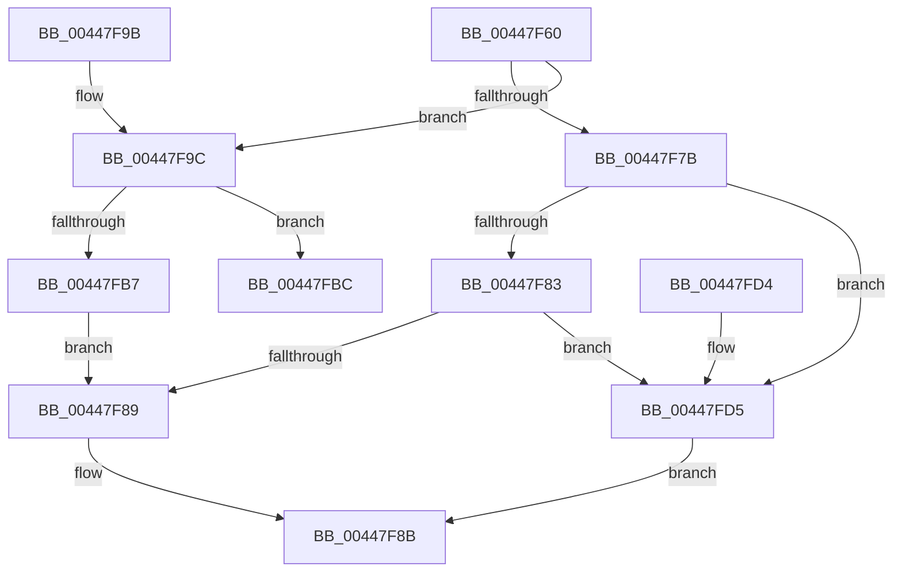

# AllocateOrValidateCharStringBuffer

- RVA: `0x00447F60`–`0x00447FDC` (길이 `124` bytes)
- VA: `0x0000000140447F60`
- 실행 섹션: `.text`
- PDB 이름 있음: `예`; PDB Function 태그: `아니요`
- unwind 정보 RVA: `0x000A5FD4`
- 디코드: `40`개 명령, `124/124` bytes 표시
- 미해석 바이트: `0` (있으면 어셈블리에 `.byte`로 보존)

> 이 문서는 커널 이미지의 기계어와 PDB 기호를 분석해 생성했습니다. 4번과 5번은 함수 원형과 자료형을 바이너리 사용 방식에서 추정한 C 해석이며 원본 소스 복구 결과는 아닙니다.

## 1. Dependencies

- 직접 호출 지점: **1**; 고유 호출 대상: **1**
- 직접 호출자로 확인된 함수: **5**
- RIP 상대 이미지 참조: **0**

### Outgoing calls
- `0x00447FAA` → [ExAllocatePool2](../../poolcode/B8/ExAllocatePool2_function_00B820F0.md) (function, `0x00B820F0`)

### Direct callers
- [RtlUpcaseUnicodeStringToAnsiString](../../page/78/RtlUpcaseUnicodeStringToAnsiString_function_0078A830.md) at `0x0078A8AA`
- [RtlUpcaseUnicodeStringToCountedOemString](../../page/90/RtlUpcaseUnicodeStringToCountedOemString_function_0090E4D0.md) at `0x0090E56B`
- [RtlUnicodeStringToCountedOemString](../../page/90/RtlUnicodeStringToCountedOemString_function_0090F1A0.md) at `0x0090F20E`
- [RtlUpcaseUnicodeStringToOemString](../../page/A8/RtlUpcaseUnicodeStringToOemString_function_00A84220.md) at `0x00A84288`
- [RtlUnicodeStringToOemString](../../page/AC/RtlUnicodeStringToOemString_function_00AC1C10.md) at `0x00AC1C8A`

### Static image references
- 디코드된 RIP-relative 메모리 참조가 없습니다.

## 2. Other-region calls and transfers

- 다른 실행 섹션으로 향하는 call: **1**
  - `0x00447FAA` → [ExAllocatePool2](../../poolcode/B8/ExAllocatePool2_function_00B820F0.md) (`.text` → `POOLCODE`)
- 별도 외부 분기/꼬리 이동을 확인하지 못했습니다.

## 3. Assembly (complete function range)

```asm
00447F60  48 89 5C 24 08                  mov qword ptr [rsp + 8], rbx
00447F65  48 89 74 24 10                  mov qword ptr [rsp + 0x10], rsi
00447F6A  57                              push rdi
00447F6B  48 83 EC 20                     sub rsp, 0x20
00447F6F  8B DA                           mov ebx, edx
00447F71  49 8B F9                        mov rdi, r9
00447F74  49 8B F0                        mov rsi, r8
00447F77  84 C9                           test cl, cl
00447F79  75 21                           jne 0x140447f9c
00447F7B  41 0F B7 01                     movzx eax, word ptr [r9]
00447F7F  3B D8                           cmp ebx, eax
00447F81  77 52                           ja 0x140447fd5
00447F83  49 83 38 00                     cmp qword ptr [r8], 0
00447F87  74 4C                           je 0x140447fd5
00447F89  33 C0                           xor eax, eax
00447F8B  48 8B 5C 24 30                  mov rbx, qword ptr [rsp + 0x30]
00447F90  48 8B 74 24 38                  mov rsi, qword ptr [rsp + 0x38]
00447F95  48 83 C4 20                     add rsp, 0x20
00447F99  5F                              pop rdi
00447F9A  C3                              ret
00447F9B  CC                              int3
00447F9C  48 8B D3                        mov rdx, rbx
00447F9F  B9 00 01 00 00                  mov ecx, 0x100
00447FA4  41 B8 53 74 72 67               mov r8d, 0x67727453
00447FAA  E8 41 A1 73 00                  call 0x140b820f0
00447FAF  48 89 06                        mov qword ptr [rsi], rax
00447FB2  48 85 C0                        test rax, rax
00447FB5  74 05                           je 0x140447fbc
00447FB7  66 89 1F                        mov word ptr [rdi], bx
00447FBA  EB CD                           jmp 0x140447f89
00447FBC  48 8B 5C 24 30                  mov rbx, qword ptr [rsp + 0x30]
00447FC1  48 8B 74 24 38                  mov rsi, qword ptr [rsp + 0x38]
00447FC6  66 89 07                        mov word ptr [rdi], ax
00447FC9  B8 17 00 00 C0                  mov eax, 0xc0000017
00447FCE  48 83 C4 20                     add rsp, 0x20
00447FD2  5F                              pop rdi
00447FD3  C3                              ret
00447FD4  CC                              int3
00447FD5  B8 05 00 00 80                  mov eax, 0x80000005
00447FDA  EB AF                           jmp 0x140447f8b
```

## 4. C-style interpretation (structured pseudocode)

```c
__int64 __fastcall AllocateOrValidateCharStringBuffer(unsigned __int8 a1, int a2, __int64 a3, __int64 a4)
{
    __int64 result;
    __int64 v_rsp;
    unsigned __int64 v_stack_p10;
    unsigned __int64 v_stack_p30;
    unsigned __int64 v_stack_p38;
    unsigned __int64 v_stack_p8;

    v_stack_p8 = v_rbx;
    v_stack_p10 = v_rsi;
    v_rsp = (v_rsp) - (32);
    if (a1 != 0) goto loc_00447F9C;
    if (((unsigned int)((unsigned int)(a2))) > ((unsigned int)(*(unsigned __int16 *)(a4)))) goto loc_00447FD5;
    if ((*(unsigned __int64 *)(a3)) == 0) goto loc_00447FD5;
loc_00447F89:
    result = 0;
loc_00447F8B:
    v_rsp = (v_rsp) + (32);
    return result;
loc_00447F9C:
    result = ExAllocatePool2(256, v_stack_p8, (unsigned int)(0x67727453ULL), a4);
    *(unsigned __int64 *)(v_stack_p10) = result;
    if (result == 0) goto loc_00447FBC;
    *(unsigned __int16 *)(a4) = (unsigned __int16)(v_stack_p8);
    goto loc_00447F89;
loc_00447FBC:
    *(unsigned __int16 *)(a4) = (unsigned __int16)(result);
    v_rsp = (v_rsp) + (32);
    return (unsigned int)(0xC0000017ULL);
loc_00447FD5:
    goto loc_00447F8B;
}
```

## 5. (Beta) C Style

```c
int64_t AllocateOrValidateCharStringBuffer(uint8_t Arg1, int32_t Arg2, void *Arg3, void *Arg4)
{
    uint8_t *arg3 = (uint8_t *)Arg3;
    uint8_t *arg4 = (uint8_t *)Arg4;

    int64_t result;
    int64_t local_rsp;
    uint64_t v_stack_p10;
    uint64_t v_stack_p30;
    uint64_t v_stack_p38;
    uint64_t v_stack_p8;

    v_stack_p8 = local_rbx;
    v_stack_p10 = local_rsi;
    local_rsp = (local_rsp) - (32);
    if (Arg1 != 0) goto loc_00447F9C;
    if (((uint32_t)((uint32_t)(Arg2))) > ((uint32_t)(*(uint16_t *)(arg4)))) goto loc_00447FD5;
    if ((*(uint64_t *)(arg3)) == 0) goto loc_00447FD5;
loc_00447F89:
    result = 0;
loc_00447F8B:
    local_rsp = (local_rsp) + (32);
    return result;
loc_00447F9C:
    result = ExAllocatePool2(256, v_stack_p8, (uint32_t)(0x67727453ULL), Arg4);
    *(uint64_t *)(v_stack_p10) = result;
    if (result == 0) goto loc_00447FBC;
    *(uint16_t *)(arg4) = (uint16_t)(v_stack_p8);
    goto loc_00447F89;
loc_00447FBC:
    *(uint16_t *)(arg4) = (uint16_t)(result);
    local_rsp = (local_rsp) + (32);
    return (uint32_t)(0xC0000017ULL);
loc_00447FD5:
    goto loc_00447F8B;
}
```

### 관측된 메모리 오프셋

구조체 형식이 확인되지 않은 접근은 인자 기준의 오프셋으로만 기록했습니다.

| 기준 인자 | 오프셋 표현 | 폭 (bit) | 접근 |
|---|---:|---:|---|
| `Arg3` | `+ 0x0` | `64` | `R` |
| `Arg3` | `+ 0x0` | `64` | `W` |
| `Arg4` | `+ 0x0` | `16` | `R` |
| `Arg4` | `+ 0x0` | `16` | `W` |

## 6. Execution-region graph

[열기: 2D/3D 그래프와 함수 탐색 컨트롤 패널](../../../control-panel.html?section=text&rva=0x00447F60&view=graph)

- 2D 그래프는 위에서 아래로 흐르고, 3D 그래프는 빈 공간을 드래그해 회전합니다. Shift+드래그는 이동, 휠은 확대·축소, 함수 노드 선택은 대상 보고서 이동입니다.

### Static fallback


