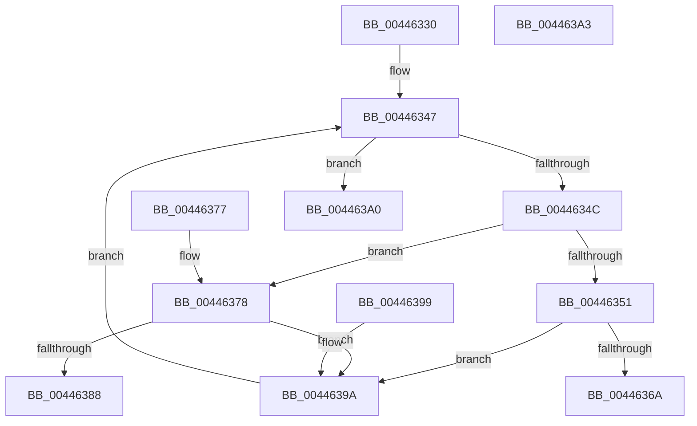

# B_TREE&lt;unsigned long,ST_STORE&lt;SM_TRAITS&gt;::_ST_HASH_ENTRY,4096,NP_CONTEXT,ST_STORE&lt;SM_TRAITS&gt;::ST_HASH_ENTRY_COMPARATOR&gt;::BTreeFindSeperatorIndexEntry

- RVA: `0x00446330`–`0x004463A4` (길이 `116` bytes)
- VA: `0x0000000140446330`
- 실행 섹션: `.text`
- PDB 이름 있음: `예`; PDB Function 태그: `아니요`
- unwind 정보 RVA: `0x000DB714`
- 디코드: `40`개 명령, `116/116` bytes 표시
- 미해석 바이트: `0` (있으면 어셈블리에 `.byte`로 보존)

> 이 문서는 커널 이미지의 기계어와 PDB 기호를 분석해 생성했습니다. 4번과 5번은 함수 원형과 자료형을 바이너리 사용 방식에서 추정한 C 해석이며 원본 소스 복구 결과는 아닙니다.

## 1. Dependencies

- 직접 호출 지점: **0**; 고유 호출 대상: **0**
- 직접 호출자로 확인된 함수: **1**
- RIP 상대 이미지 참조: **0**

### Outgoing calls
- 직접 디코드된 call 명령이 없습니다.

### Direct callers
- [B_TREE&lt;unsigned long,ST_STORE&lt;SM_TRAITS&gt;::_ST_HASH_ENTRY,4096,NP_CONTEXT,ST_STORE&lt;SM_TRAITS&gt;::ST_HASH_ENTRY_COMPARATOR&gt;::BTreeFindLeafSiblingEx](../60/B_TREE_unsigned_long_ST_STORE_SM_TRAITS__ST_HASH_ENTRY_4096_NP_CONTEXT_ST_STORE_SM_TRAITS_ST_HASH_EN_function_0060BB90.md) at `0x0060BBB9`

### Static image references
- 디코드된 RIP-relative 메모리 참조가 없습니다.

## 2. Other-region calls and transfers

- 다른 실행 섹션으로 향하는 call: **0**
- 별도 외부 분기/꼬리 이동을 확인하지 못했습니다.

## 3. Assembly (complete function range)

```asm
00446330  8B 41 18                        mov eax, dword ptr [rcx + 0x18]
00446333  4D 8B D0                        mov r10, r8
00446336  4C 8B 09                        mov r9, qword ptr [rcx]
00446339  48 83 E8 02                     sub rax, 2
0044633D  48 C1 E0 04                     shl rax, 4
00446341  44 8B DA                        mov r11d, edx
00446344  49 03 C1                        add rax, r9
00446347  49 3B C1                        cmp rax, r9
0044634A  72 54                           jb 0x1404463a0
0044634C  45 85 DB                        test r11d, r11d
0044634F  74 27                           je 0x140446378
00446351  4C 8B 00                        mov r8, qword ptr [rax]
00446354  41 8B 08                        mov ecx, dword ptr [r8]
00446357  0F B7 D1                        movzx edx, cx
0044635A  48 FF C2                        inc rdx
0044635D  48 C1 E2 04                     shl rdx, 4
00446361  49 03 D0                        add rdx, r8
00446364  48 39 50 08                     cmp qword ptr [rax + 8], rdx
00446368  73 30                           jae 0x14044639a
0044636A  0F 10 00                        movups xmm0, xmmword ptr [rax]
0044636D  B8 01 00 00 00                  mov eax, 1
00446372  41 0F 11 02                     movups xmmword ptr [r10], xmm0
00446376  C3                              ret
00446377  CC                              int3
00446378  48 8B 10                        mov rdx, qword ptr [rax]
0044637B  4C 8B 40 08                     mov r8, qword ptr [rax + 8]
0044637F  48 8D 4A 10                     lea rcx, [rdx + 0x10]
00446383  4C 3B C1                        cmp r8, rcx
00446386  76 12                           jbe 0x14044639a
00446388  49 8D 40 F0                     lea rax, [r8 - 0x10]
0044638C  49 89 12                        mov qword ptr [r10], rdx
0044638F  49 89 42 08                     mov qword ptr [r10 + 8], rax
00446393  B8 01 00 00 00                  mov eax, 1
00446398  C3                              ret
00446399  CC                              int3
0044639A  48 83 E8 10                     sub rax, 0x10
0044639E  EB A7                           jmp 0x140446347
004463A0  33 C0                           xor eax, eax
004463A2  C3                              ret
004463A3  CC                              int3
```

## 4. C-style interpretation (structured pseudocode)

```c
__int64 __fastcall B_TREE_unsigned_long_ST_STORE_SM_TRAITS____ST_HASH_ENTRY_4096_NP_CONTEXT_ST_STORE_SM_TRAITS___ST_HAS(__int64 a1, int a2, __int64 a3)
{
    __int64 result;

    result = ((unsigned int)(*(unsigned int *)(a1 + 24))) - (2);
    result = (result) << (4);
    result = (result) + (*(unsigned __int64 *)(a1));
loc_00446347:
    if (result < (*(unsigned __int64 *)(a1))) goto loc_004463A0;
    if ((unsigned int)((unsigned int)(a2)) == 0) goto loc_00446378;
    a2 = ((unsigned __int16)((unsigned int)(*(unsigned int *)(*(unsigned __int64 *)(result))))) + 1;
    a2 = (a2) << (4);
    a2 = (a2) + (*(unsigned __int64 *)(result));
    if ((*(unsigned __int64 *)(result + 8)) >= a2) goto loc_0044639A;
    *(unsigned __int64 *)(a3) = v_xmm0;
    return 1;
loc_00446378:
    if ((*(unsigned __int64 *)(1 + 8)) <= (*(unsigned __int64 *)(1) + 16)) goto loc_0044639A;
    *(unsigned __int64 *)(a3) = *(unsigned __int64 *)(1);
    *(unsigned __int64 *)(a3 + 8) = *(unsigned __int64 *)(1 + 8) - 16;
    return 1;
loc_0044639A:
    result = (1) - (16);
    goto loc_00446347;
loc_004463A0:
    result = 0;
    return result;
}
```

## 5. (Beta) C Style

```c
int64_t B_TREE_unsigned_long_ST_STORE_SM_TRAITS____ST_HASH_ENTRY_4096_NP_CONTEXT_ST_STORE_SM_TRAITS___ST_HAS(void *Arg1, int32_t Arg2, void *Arg3)
{
    uint8_t *arg1 = (uint8_t *)Arg1;
    uint8_t *arg3 = (uint8_t *)Arg3;

    int64_t result;

    result = ((uint32_t)(*(uint32_t *)(arg1 + 0x18))) - (2);
    result = (result) << (4);
    result = (result) + (*(uint64_t *)(arg1));
loc_00446347:
    if (result < (*(uint64_t *)(arg1))) goto loc_004463A0;
    if ((uint32_t)((uint32_t)(Arg2)) == 0) goto loc_00446378;
    Arg2 = ((uint16_t)((uint32_t)(*(uint32_t *)(*(uint64_t *)(result))))) + 1;
    Arg2 = (Arg2) << (4);
    Arg2 = (Arg2) + (*(uint64_t *)(result));
    if ((*(uint64_t *)(result + 0x8)) >= Arg2) goto loc_0044639A;
    *(uint64_t *)(arg3) = v_xmm0;
    return 1;
loc_00446378:
    if ((*(uint64_t *)(1 + 0x8)) <= (*(uint64_t *)(1) + 16)) goto loc_0044639A;
    *(uint64_t *)(arg3) = *(uint64_t *)(1);
    *(uint64_t *)(arg3 + 0x8) = *(uint64_t *)(1 + 0x8) - 16;
    return 1;
loc_0044639A:
    result = (1) - (16);
    goto loc_00446347;
loc_004463A0:
    result = 0;
    return result;
}
```

### 관측된 메모리 오프셋

구조체 형식이 확인되지 않은 접근은 인자 기준의 오프셋으로만 기록했습니다.

| 기준 인자 | 오프셋 표현 | 폭 (bit) | 접근 |
|---|---:|---:|---|
| `Arg1` | `+ 0x0` | `64` | `R` |
| `Arg1` | `+ 0x18` | `32` | `R` |
| `Arg3` | `+ 0x0` | `64` | `W` |
| `Arg3` | `+ 0x0` | `128` | `R` |
| `Arg3` | `+ 0x8` | `64` | `W` |

## 6. Execution-region graph

[열기: 2D/3D 그래프와 함수 탐색 컨트롤 패널](../../../control-panel.html?section=text&rva=0x00446330&view=graph)

- 2D 그래프는 위에서 아래로 흐르고, 3D 그래프는 빈 공간을 드래그해 회전합니다. Shift+드래그는 이동, 휠은 확대·축소, 함수 노드 선택은 대상 보고서 이동입니다.

### Static fallback


