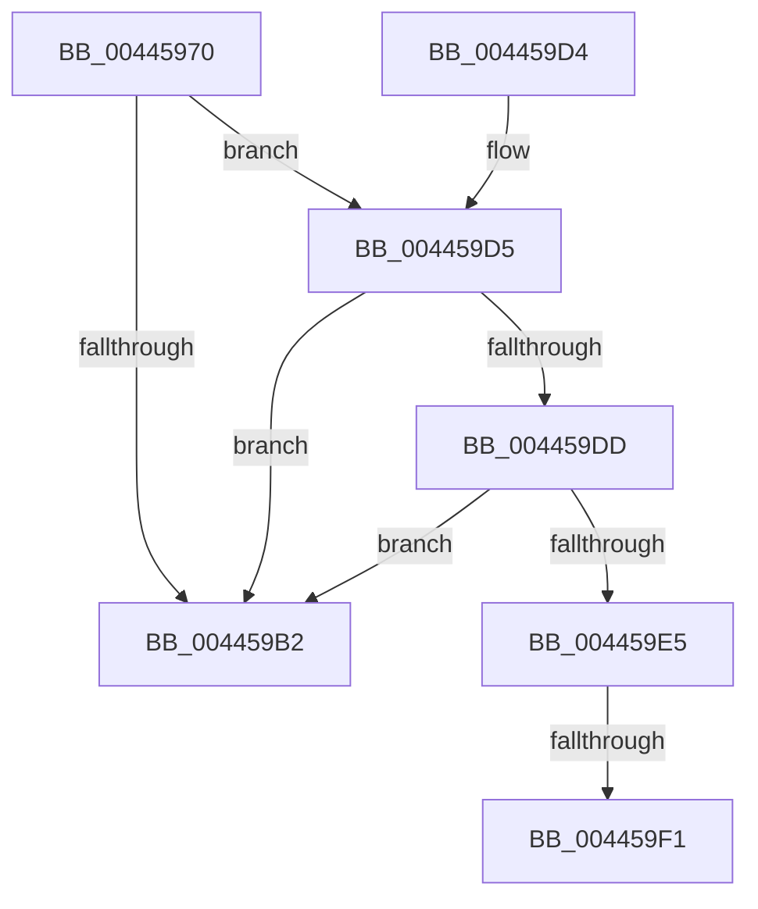

# B_TREE&lt;unsigned long,ST_STORE&lt;SM_TRAITS&gt;::_ST_REGION_ENTRY,4096,NP_CONTEXT,ST_STORE&lt;SM_TRAITS&gt;::ST_REGION_ENTRY_COMPARATOR&gt;::BTreeIteratorCleanup

- RVA: `0x00445970`–`0x004459FA` (길이 `138` bytes)
- VA: `0x0000000140445970`
- 실행 섹션: `.text`
- PDB 이름 있음: `예`; PDB Function 태그: `예`
- unwind 정보 RVA: `0x0009BDAC`
- 디코드: `40`개 명령, `138/138` bytes 표시
- 미해석 바이트: `0` (있으면 어셈블리에 `.byte`로 보존)

> 이 문서는 커널 이미지의 기계어와 PDB 기호를 분석해 생성했습니다. 4번과 5번은 함수 원형과 자료형을 바이너리 사용 방식에서 추정한 C 해석이며 원본 소스 복구 결과는 아닙니다.

## 1. Dependencies

- 직접 호출 지점: **1**; 고유 호출 대상: **1**
- 직접 호출자로 확인된 함수: **2**
- RIP 상대 이미지 참조: **1**

### Outgoing calls
- `0x004459B9` → [_security_check_cookie](../6A/_security_check_cookie_function_006AC640.md) (function, `0x006AC640`)

### Direct callers
- [ST_STORE&lt;SM_TRAITS&gt;::StCompactRegions](../4A/ST_STORE_SM_TRAITS_StCompactRegions_function_004A48E0.md) at `0x004A4A2F`
- [ST_STORE&lt;SM_TRAITS&gt;::StCompactRegions](../4A/ST_STORE_SM_TRAITS_StCompactRegions_function_004A48E0.md) at `0x004A4D41`
- [ST_STORE&lt;SM_TRAITS&gt;::StDmGetStatsBitmap](../60/ST_STORE_SM_TRAITS_StDmGetStatsBitmap_function_0060D838.md) at `0x0060DA4D`

### Static image references
- `0x0044598B` → RVA `0x00E0A740` (`.data`; read)

## 2. Other-region calls and transfers

- 다른 실행 섹션으로 향하는 call: **0**
- call이 아닌 외부 분기/꼬리 이동: **2**
  - `0x004459EB` → [sub_006EFF4C](../6E/Unknown_function_006EFF4C.md) (`tail-transfer`)
  - `0x004459F5` → [sub_006EFF4C](../6E/Unknown_function_006EFF4C.md) (`tail-transfer`)

## 3. Assembly (complete function range)

```asm
00445970  40 55                           push rbp
00445972  48 83 EC 50                     sub rsp, 0x50
00445976  48 8D 6C 24 20                  lea rbp, [rsp + 0x20]
0044597B  48 89 5D 40                     mov qword ptr [rbp + 0x40], rbx
0044597F  48 89 75 48                     mov qword ptr [rbp + 0x48], rsi
00445983  48 89 7D 50                     mov qword ptr [rbp + 0x50], rdi
00445987  4C 89 75 58                     mov qword ptr [rbp + 0x58], r14
0044598B  48 8B 05 AE 4D 9C 00            mov rax, qword ptr [rip + 0x9c4dae]
00445992  48 33 C5                        xor rax, rbp
00445995  48 89 45 28                     mov qword ptr [rbp + 0x28], rax
00445999  45 33 C0                        xor r8d, r8d
0044599C  48 8D 5A 10                     lea rbx, [rdx + 0x10]
004459A0  48 85 D2                        test rdx, rdx
004459A3  4C 8B F2                        mov r14, rdx
004459A6  49 0F 44 D8                     cmove rbx, r8
004459AA  48 8B 03                        mov rax, qword ptr [rbx]
004459AD  83 38 FF                        cmp dword ptr [rax], -1
004459B0  75 23                           jne 0x1404459d5
004459B2  48 8B 4D 28                     mov rcx, qword ptr [rbp + 0x28]
004459B6  48 33 CD                        xor rcx, rbp
004459B9  E8 82 6C 26 00                  call 0x1406ac640
004459BE  48 8B 5D 40                     mov rbx, qword ptr [rbp + 0x40]
004459C2  48 8B 75 48                     mov rsi, qword ptr [rbp + 0x48]
004459C6  48 8B 7D 50                     mov rdi, qword ptr [rbp + 0x50]
004459CA  4C 8B 75 58                     mov r14, qword ptr [rbp + 0x58]
004459CE  48 8D 65 30                     lea rsp, [rbp + 0x30]
004459D2  5D                              pop rbp
004459D3  C3                              ret
004459D4  CC                              int3
004459D5  48 8B 11                        mov rdx, qword ptr [rcx]
004459D8  48 85 D2                        test rdx, rdx
004459DB  74 D5                           je 0x1404459b2
004459DD  49 8B 06                        mov rax, qword ptr [r14]
004459E0  48 3B D0                        cmp rdx, rax
004459E3  74 CD                           je 0x1404459b2
004459E5  41 8B F0                        mov esi, r8d
004459E8  48 85 C0                        test rax, rax
004459EB  0F 84 5B A5 2A 00               je 0x1406eff4c
004459F1  0F B6 70 02                     movzx esi, byte ptr [rax + 2]
004459F5  E9 52 A5 2A 00                  jmp 0x1406eff4c
```

## 4. C-style interpretation (structured pseudocode)

```c
__int64 __fastcall B_TREE_unsigned_long_ST_STORE_SM_TRAITS____ST_REGION_ENTRY_4096_NP_CONTEXT_ST_STORE_SM_TRAITS___ST_R(__int64 a1, __int64 a2, int a3)
{
    __int64 result;
    __int64 v_rbx;
    __int64 v_rsp;
    unsigned __int64 v_stack_m10;
    unsigned __int64 v_stack_m38;
    unsigned __int64 v_stack_m8;
    unsigned __int64 v_stack_p10;
    unsigned __int64 v_stack_p18;
    unsigned __int64 v_stack_p20;
    unsigned __int64 v_stack_p8;

    v_rsp = (v_rsp) - (80);
    v_stack_p8 = v_rbx;
    v_stack_p10 = v_rsi;
    v_stack_p18 = v_rdi;
    v_stack_p20 = v_r14;
    result = (*(unsigned __int64 *)(v_rip + 10243502)) ^ (v_stack_m38);
    v_stack_m10 = result;
    a3 = 0;
    v_rbx = a2 + 16;
    if (a2 == 0) { v_rbx = 0; }
    if ((*(unsigned int *)(*(unsigned __int64 *)(v_rbx))) != -1) goto loc_004459D5;
loc_004459B2:
    a1 = (v_stack_m10) ^ (v_stack_m38);
    result = _security_check_cookie(a1, a2, a3, a4);
    return result;
loc_004459D5:
    if (*(unsigned __int64 *)(a1) == 0) goto loc_004459B2;
    if ((*(unsigned __int64 *)(a1)) == (*(unsigned __int64 *)(v_stack_p20))) goto loc_004459B2;
}
```

## 5. (Beta) C Style

```c
int64_t B_TREE_unsigned_long_ST_STORE_SM_TRAITS____ST_REGION_ENTRY_4096_NP_CONTEXT_ST_STORE_SM_TRAITS___ST_R(void *Arg1, void *Arg2, int32_t Arg3)
{
    uint8_t *arg1 = (uint8_t *)Arg1;
    uint8_t *arg2 = (uint8_t *)Arg2;

    int64_t result;
    int64_t local_rbx;
    int64_t local_rsp;
    uint64_t v_stack_m10;
    uint64_t v_stack_m38;
    uint64_t v_stack_m8;
    uint64_t v_stack_p10;
    uint64_t v_stack_p18;
    uint64_t v_stack_p20;
    uint64_t v_stack_p8;

    local_rsp = (local_rsp) - (80);
    v_stack_p8 = local_rbx;
    v_stack_p10 = local_rsi;
    v_stack_p18 = local_rdi;
    v_stack_p20 = local_r14;
    result = (*(uint64_t *)(v_rip + 0x9C4DAE)) ^ (v_stack_m38);
    v_stack_m10 = result;
    Arg3 = 0;
    local_rbx = Arg2 + 16;
    if (Arg2 == NULL) { local_rbx = 0; }
    if ((*(uint32_t *)(*(uint64_t *)(local_rbx))) != -1) goto loc_004459D5;
loc_004459B2:
    Arg1 = (v_stack_m10) ^ (v_stack_m38);
    result = _security_check_cookie(Arg1, Arg2, Arg3, a4);
    return result;
loc_004459D5:
    if (*(uint64_t *)(arg1) == 0) goto loc_004459B2;
    if ((*(uint64_t *)(arg1)) == (*(uint64_t *)(v_stack_p20))) goto loc_004459B2;
}
```

### 관측된 메모리 오프셋

구조체 형식이 확인되지 않은 접근은 인자 기준의 오프셋으로만 기록했습니다.

| 기준 인자 | 오프셋 표현 | 폭 (bit) | 접근 |
|---|---:|---:|---|
| `Arg1` | `+ 0x0` | `64` | `R` |
| `Arg2` | `+ 0x10` | `64` | `R` |

## 6. Execution-region graph

[열기: 2D/3D 그래프와 함수 탐색 컨트롤 패널](../../../control-panel.html?section=text&rva=0x00445970&view=graph)

- 2D 그래프는 위에서 아래로 흐르고, 3D 그래프는 빈 공간을 드래그해 회전합니다. Shift+드래그는 이동, 휠은 확대·축소, 함수 노드 선택은 대상 보고서 이동입니다.

### Static fallback


