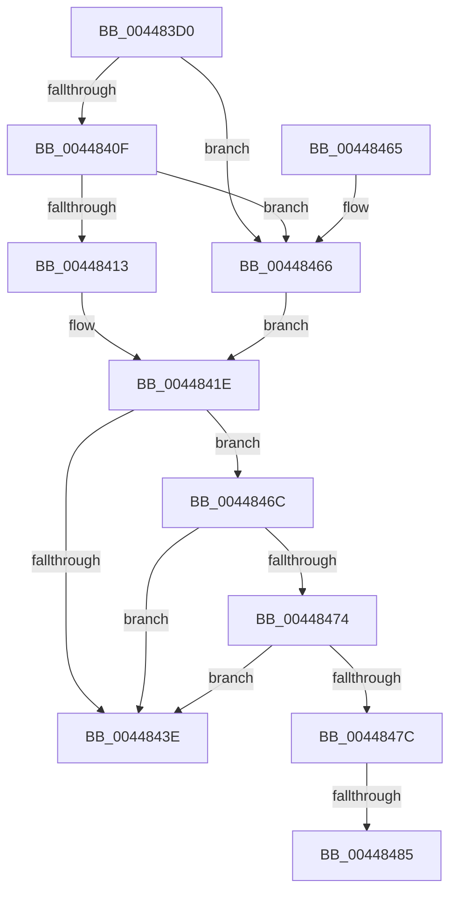

# B_TREE&lt;unsigned long,ST_STORE&lt;SM_TRAITS&gt;::_ST_REGION_ENTRY,4096,NP_CONTEXT,ST_STORE&lt;SM_TRAITS&gt;::ST_REGION_ENTRY_COMPARATOR&gt;::BTreeIteratorFromSearchResult

- RVA: `0x004483D0`–`0x004484A1` (길이 `209` bytes)
- VA: `0x00000001404483D0`
- 실행 섹션: `.text`
- PDB 이름 있음: `예`; PDB Function 태그: `예`
- unwind 정보 RVA: `0x000A60C0`
- 디코드: `63`개 명령, `209/209` bytes 표시
- 미해석 바이트: `0` (있으면 어셈블리에 `.byte`로 보존)

> 이 문서는 커널 이미지의 기계어와 PDB 기호를 분석해 생성했습니다. 4번과 5번은 함수 원형과 자료형을 바이너리 사용 방식에서 추정한 C 해석이며 원본 소스 복구 결과는 아닙니다.

## 1. Dependencies

- 직접 호출 지점: **1**; 고유 호출 대상: **1**
- 직접 호출자로 확인된 함수: **2**
- RIP 상대 이미지 참조: **1**

### Outgoing calls
- `0x0044844A` → [_security_check_cookie](../6A/_security_check_cookie_function_006AC640.md) (function, `0x006AC640`)

### Direct callers
- [ST_STORE&lt;SM_TRAITS&gt;::StCompactRegions](../4A/ST_STORE_SM_TRAITS_StCompactRegions_function_004A48E0.md) at `0x004A49E0`
- [ST_STORE&lt;SM_TRAITS&gt;::StCompactRegions](../4A/ST_STORE_SM_TRAITS_StCompactRegions_function_004A48E0.md) at `0x004A4A3F`
- [ST_STORE&lt;SM_TRAITS&gt;::StDmGetStatsBitmap](../60/ST_STORE_SM_TRAITS_StDmGetStatsBitmap_function_0060D838.md) at `0x0060D8E2`

### Static image references
- `0x004483EB` → RVA `0x00E0A740` (`.data`; read)

## 2. Other-region calls and transfers

- 다른 실행 섹션으로 향하는 call: **0**
- call이 아닌 외부 분기/꼬리 이동: **2**
  - `0x0044847F` → [sub_006F026C](../6F/Unknown_function_006F026C.md) (`tail-transfer`)
  - `0x0044849C` → [sub_006F026C + 0x94](../6F/Unknown_function_006F026C.md) (`tail-transfer`)

## 3. Assembly (complete function range)

```asm
004483D0  40 55                           push rbp
004483D2  41 56                           push r14
004483D4  41 57                           push r15
004483D6  48 83 EC 50                     sub rsp, 0x50
004483DA  48 8D 6C 24 20                  lea rbp, [rsp + 0x20]
004483DF  48 89 5D 50                     mov qword ptr [rbp + 0x50], rbx
004483E3  48 89 75 58                     mov qword ptr [rbp + 0x58], rsi
004483E7  48 89 7D 60                     mov qword ptr [rbp + 0x60], rdi
004483EB  48 8B 05 4E 23 9C 00            mov rax, qword ptr [rip + 0x9c234e]
004483F2  48 33 C5                        xor rax, rbp
004483F5  48 89 45 28                     mov qword ptr [rbp + 0x28], rax
004483F9  48 8B F2                        mov rsi, rdx
004483FC  41 83 CF FF                     or r15d, 0xffffffff
00448400  41 8B 50 18                     mov edx, dword ptr [r8 + 0x18]
00448404  4D 8B C8                        mov r9, r8
00448407  4C 8B F1                        mov r14, rcx
0044840A  41 3B D7                        cmp edx, r15d
0044840D  74 57                           je 0x140448466
0044840F  85 D2                           test edx, edx
00448411  74 53                           je 0x140448466
00448413  44 8D 42 FF                     lea r8d, [rdx - 1]
00448417  49 C1 E0 04                     shl r8, 4
0044841B  4D 03 01                        add r8, qword ptr [r9]
0044841E  41 0F 10 00                     movups xmm0, xmmword ptr [r8]
00448422  48 83 C1 10                     add rcx, 0x10
00448426  49 8B C6                        mov rax, r14
00448429  48 F7 D8                        neg rax
0044842C  F3 0F 7F 06                     movdqu xmmword ptr [rsi], xmm0
00448430  48 1B C0                        sbb rax, rax
00448433  48 23 C1                        and rax, rcx
00448436  48 8B 00                        mov rax, qword ptr [rax]
00448439  44 39 38                        cmp dword ptr [rax], r15d
0044843C  75 2E                           jne 0x14044846c
0044843E  48 83 46 08 FC                  add qword ptr [rsi + 8], -4
00448443  48 8B 4D 28                     mov rcx, qword ptr [rbp + 0x28]
00448447  48 33 CD                        xor rcx, rbp
0044844A  E8 F1 41 26 00                  call 0x1406ac640
0044844F  48 8B 5D 50                     mov rbx, qword ptr [rbp + 0x50]
00448453  48 8B 75 58                     mov rsi, qword ptr [rbp + 0x58]
00448457  48 8B 7D 60                     mov rdi, qword ptr [rbp + 0x60]
0044845B  48 8D 65 30                     lea rsp, [rbp + 0x30]
0044845F  41 5F                           pop r15
00448461  41 5E                           pop r14
00448463  5D                              pop rbp
00448464  C3                              ret
00448465  CC                              int3
00448466  49 83 C0 08                     add r8, 8
0044846A  EB B2                           jmp 0x14044841e
0044846C  48 8B 0E                        mov rcx, qword ptr [rsi]
0044846F  48 85 C9                        test rcx, rcx
00448472  74 CA                           je 0x14044843e
00448474  49 8B 06                        mov rax, qword ptr [r14]
00448477  48 3B C8                        cmp rcx, rax
0044847A  74 C2                           je 0x14044843e
0044847C  41 3B D7                        cmp edx, r15d
0044847F  0F 84 E7 7D 2A 00               je 0x1406f026c
00448485  49 8B 40 F0                     mov rax, qword ptr [r8 - 0x10]
00448489  49 8B 50 F8                     mov rdx, qword ptr [r8 - 8]
0044848D  48 8D 48 10                     lea rcx, [rax + 0x10]
00448491  48 83 C0 08                     add rax, 8
00448495  48 3B D1                        cmp rdx, rcx
00448498  4C 8D 4A F8                     lea r9, [rdx - 8]
0044849C  E9 5F 7E 2A 00                  jmp 0x1406f0300
```

## 4. C-style interpretation (structured pseudocode)

```c
__int64 __fastcall B_TREE_unsigned_long_ST_STORE_SM_TRAITS____ST_REGION_ENTRY_4096_NP_CONTEXT_ST_STORE_SM_TRAITS___ST_R(__int64 a1, __int64 a2, __int64 a3)
{
    __int64 result;
    __int64 v_r15;
    __int64 v_rsp;
    unsigned __int64 v_stack_m18;
    unsigned __int64 v_stack_m20;
    unsigned __int64 v_stack_m48;
    unsigned __int64 v_stack_p10;
    unsigned __int64 v_stack_p18;
    unsigned __int64 v_stack_p8;

    v_rsp = (v_rsp) - (80);
    v_stack_p8 = v_rbx;
    v_stack_p10 = v_rsi;
    v_stack_p18 = v_rdi;
    result = (*(unsigned __int64 *)(v_rip + 10232654)) ^ (v_stack_m48);
    v_stack_m20 = result;
    v_r15 = (unsigned int)((v_r15) | (0xFFFFFFFFULL));
    if (((unsigned int)((unsigned int)(*(unsigned int *)(a3 + 24)))) == ((unsigned int)(v_r15))) goto loc_00448466;
    if ((unsigned int)((unsigned int)(*(unsigned int *)(a3 + 24))) == 0) goto loc_00448466;
    a3 = ((unsigned int)(*(unsigned int *)(a3 + 24)) - 1) << (4);
    a3 = (a3) + (*(unsigned __int64 *)(a3));
loc_0044841E:
    a1 = (a1) + (16);
    result = -(a1);
    *(unsigned __int64 *)(a2) = v_xmm0;
    result = (result) & (a1);
    if ((*(unsigned int *)(*(unsigned __int64 *)(result))) != ((unsigned int)(v_r15))) goto loc_0044846C;
loc_0044843E:
    a1 = (v_stack_m20) ^ (v_stack_m48);
    result = _security_check_cookie(a1, (unsigned int)(*(unsigned int *)(a3 + 24)), a3, a3);
    return result;
loc_00448466:
    a3 = (a3) + (8);
    goto loc_0044841E;
loc_0044846C:
    if (*(unsigned __int64 *)(v_stack_p10) == 0) goto loc_0044843E;
    if ((*(unsigned __int64 *)(v_stack_p10)) == (*(unsigned __int64 *)(a1))) goto loc_0044843E;
    result = (*(unsigned __int64 *)(a3 - 16)) + (8);
}
```

## 5. (Beta) C Style

```c
int64_t B_TREE_unsigned_long_ST_STORE_SM_TRAITS____ST_REGION_ENTRY_4096_NP_CONTEXT_ST_STORE_SM_TRAITS___ST_R(void *Arg1, void *Arg2, void *Arg3)
{
    uint8_t *arg1 = (uint8_t *)Arg1;
    uint8_t *arg2 = (uint8_t *)Arg2;
    uint8_t *arg3 = (uint8_t *)Arg3;

    int64_t result;
    int64_t local_r15;
    int64_t local_rsp;
    uint64_t v_stack_m18;
    uint64_t v_stack_m20;
    uint64_t v_stack_m48;
    uint64_t v_stack_p10;
    uint64_t v_stack_p18;
    uint64_t v_stack_p8;

    local_rsp = (local_rsp) - (80);
    v_stack_p8 = local_rbx;
    v_stack_p10 = local_rsi;
    v_stack_p18 = local_rdi;
    result = (*(uint64_t *)(v_rip + 0x9C234E)) ^ (v_stack_m48);
    v_stack_m20 = result;
    local_r15 = (uint32_t)((local_r15) | (0xFFFFFFFFULL));
    if (((uint32_t)((uint32_t)(*(uint32_t *)(arg3 + 0x18)))) == ((uint32_t)(local_r15))) goto loc_00448466;
    if ((uint32_t)((uint32_t)(*(uint32_t *)(arg3 + 0x18))) == 0) goto loc_00448466;
    Arg3 = ((uint32_t)(*(uint32_t *)(arg3 + 0x18)) - 1) << (4);
    Arg3 = (Arg3) + (*(uint64_t *)(arg3));
loc_0044841E:
    Arg1 = (Arg1) + (16);
    result = -(Arg1);
    *(uint64_t *)(arg2) = v_xmm0;
    result = (result) & (Arg1);
    if ((*(uint32_t *)(*(uint64_t *)(result))) != ((uint32_t)(local_r15))) goto loc_0044846C;
loc_0044843E:
    Arg1 = (v_stack_m20) ^ (v_stack_m48);
    result = _security_check_cookie(Arg1, (uint32_t)(*(uint32_t *)(arg3 + 0x18)), Arg3, Arg3);
    return result;
loc_00448466:
    Arg3 = (Arg3) + (8);
    goto loc_0044841E;
loc_0044846C:
    if (*(uint64_t *)(v_stack_p10) == 0) goto loc_0044843E;
    if ((*(uint64_t *)(v_stack_p10)) == (*(uint64_t *)(arg1))) goto loc_0044843E;
    result = (*(uint64_t *)(arg3 - 0x10)) + (8);
}
```

### 관측된 메모리 오프셋

구조체 형식이 확인되지 않은 접근은 인자 기준의 오프셋으로만 기록했습니다.

| 기준 인자 | 오프셋 표현 | 폭 (bit) | 접근 |
|---|---:|---:|---|
| `Arg1` | `+ 0x0` | `64` | `R` |
| `Arg2` | `+ 0x0` | `64` | `R` |
| `Arg2` | `+ 0x0` | `128` | `W` |
| `Arg2` | `+ 0x8` | `64` | `R/W` |
| `Arg3` | `+ 0x0` | `64` | `R` |
| `Arg3` | `+ 0x18` | `32` | `R` |

## 6. Execution-region graph

[열기: 2D/3D 그래프와 함수 탐색 컨트롤 패널](../../../control-panel.html?section=text&rva=0x004483D0&view=graph)

- 2D 그래프는 위에서 아래로 흐르고, 3D 그래프는 빈 공간을 드래그해 회전합니다. Shift+드래그는 이동, 휠은 확대·축소, 함수 노드 선택은 대상 보고서 이동입니다.

### Static fallback


