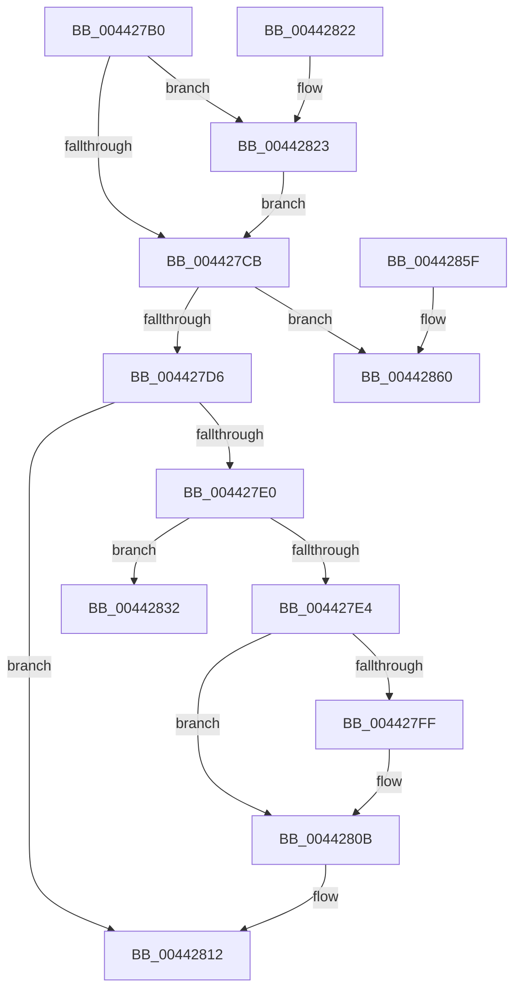

# CcDereferenceVacbArray

- RVA: `0x004427B0`–`0x00442882` (길이 `210` bytes)
- VA: `0x00000001404427B0`
- 실행 섹션: `.text`
- PDB 이름 있음: `예`; PDB Function 태그: `아니요`
- unwind 정보 RVA: `0x000A5270`
- 디코드: `58`개 명령, `210/210` bytes 표시
- 미해석 바이트: `0` (있으면 어셈블리에 `.byte`로 보존)

> 이 문서는 커널 이미지의 기계어와 PDB 기호를 분석해 생성했습니다. 4번과 5번은 함수 원형과 자료형을 바이너리 사용 방식에서 추정한 C 해석이며 원본 소스 복구 결과는 아닙니다.

## 1. Dependencies

- 직접 호출 지점: **7**; 고유 호출 대상: **7**
- 직접 호출자로 확인된 함수: **1**
- RIP 상대 이미지 참조: **1**

### Outgoing calls
- `0x004427F1` → [KeReleaseInStackQueuedSpinLockFromDpcLevel](../21/KeReleaseInStackQueuedSpinLockFromDpcLevel_function_002171B0.md) (function, `0x002171B0`)
- `0x00442806` → [KiLowerIrqlProcessIrqlFlags](../4F/KiLowerIrqlProcessIrqlFlags_function_004F5698.md) (function, `0x004F5698`)
- `0x00442828` → [KeAcquireQueuedSpinLock](../27/KeAcquireQueuedSpinLock_function_00273D80.md) (function, `0x00273D80`)
- `0x00442835` → [CcRemoveVacbArray](../4F/CcRemoveVacbArray_function_004F6FD4.md) (function, `0x004F6FD4`)
- `0x00442842` → [KeReleaseQueuedSpinLock](../27/KeReleaseQueuedSpinLock_function_00272540.md) (function, `0x00272540`)
- `0x0044284A` → [CcFreeVacbArray](../../page/71/CcFreeVacbArray_function_007102DC.md) (function, `0x007102DC`)
- `0x0044287C` → [KeBugCheckEx](../4F/KeBugCheckEx_function_004FD660.md) (function, `0x004FD660`)

### Direct callers
- [CcUnmapInactiveViewsInternal](../27/CcUnmapInactiveViewsInternal_function_0027174C.md) at `0x002718B9`
- [CcUnmapInactiveViewsInternal](../27/CcUnmapInactiveViewsInternal_function_0027174C.md) at `0x00271B90`

### Static image references
- `0x004427F6` → RVA `0x00FC6D20` (`ALMOSTRO`; read)

## 2. Other-region calls and transfers

- 다른 실행 섹션으로 향하는 call: **1**
  - `0x0044284A` → [CcFreeVacbArray](../../page/71/CcFreeVacbArray_function_007102DC.md) (`.text` → `PAGE`)
- 별도 외부 분기/꼬리 이동을 확인하지 못했습니다.

## 3. Assembly (complete function range)

```asm
004427B0  48 89 5C 24 08                  mov qword ptr [rsp + 8], rbx
004427B5  48 89 74 24 10                  mov qword ptr [rsp + 0x10], rsi
004427BA  57                              push rdi
004427BB  48 83 EC 30                     sub rsp, 0x30
004427BF  32 DB                           xor bl, bl
004427C1  0F B6 F2                        movzx esi, dl
004427C4  48 8B F9                        mov rdi, rcx
004427C7  84 D2                           test dl, dl
004427C9  74 58                           je 0x140442823
004427CB  8B 47 04                        mov eax, dword ptr [rdi + 4]
004427CE  85 C0                           test eax, eax
004427D0  0F 84 8A 00 00 00               je 0x140442860
004427D6  FF C8                           dec eax
004427D8  89 47 04                        mov dword ptr [rdi + 4], eax
004427DB  40 84 F6                        test sil, sil
004427DE  75 32                           jne 0x140442812
004427E0  85 C0                           test eax, eax
004427E2  74 4E                           je 0x140442832
004427E4  65 48 8B 0C 25 28 00 00 00      mov rcx, qword ptr gs:[0x28]
004427ED  48 83 C1 40                     add rcx, 0x40
004427F1  E8 BA 49 DD FF                  call 0x1402171b0
004427F6  83 3D 23 45 B8 00 00            cmp dword ptr [rip + 0xb84523], 0
004427FD  74 0C                           je 0x14044280b
004427FF  44 0F 20 C1                     mov rcx, cr8
00442803  0F B6 D3                        movzx edx, bl
00442806  E8 8D 2E 0B 00                  call 0x1404f5698
0044280B  0F B6 C3                        movzx eax, bl
0044280E  44 0F 22 C0                     mov cr8, rax
00442812  48 8B 5C 24 40                  mov rbx, qword ptr [rsp + 0x40]
00442817  48 8B 74 24 48                  mov rsi, qword ptr [rsp + 0x48]
0044281C  48 83 C4 30                     add rsp, 0x30
00442820  5F                              pop rdi
00442821  C3                              ret
00442822  CC                              int3
00442823  B9 04 00 00 00                  mov ecx, 4
00442828  E8 53 15 E3 FF                  call 0x140273d80
0044282D  0F B6 D8                        movzx ebx, al
00442830  EB 99                           jmp 0x1404427cb
00442832  48 8B CF                        mov rcx, rdi
00442835  E8 9A 47 0B 00                  call 0x1404f6fd4
0044283A  0F B6 D3                        movzx edx, bl
0044283D  B9 04 00 00 00                  mov ecx, 4
00442842  E8 F9 FC E2 FF                  call 0x140272540
00442847  48 8B CF                        mov rcx, rdi
0044284A  E8 8D DA 2C 00                  call 0x1407102dc
0044284F  48 8B 5C 24 40                  mov rbx, qword ptr [rsp + 0x40]
00442854  48 8B 74 24 48                  mov rsi, qword ptr [rsp + 0x48]
00442859  48 83 C4 30                     add rsp, 0x30
0044285D  5F                              pop rdi
0044285E  C3                              ret
0044285F  CC                              int3
00442860  45 33 C9                        xor r9d, r9d
00442863  48 C7 44 24 20 00 00 00 00      mov qword ptr [rsp + 0x20], 0
0044286C  BA A5 01 00 00                  mov edx, 0x1a5
00442871  49 C7 C0 20 04 00 C0            mov r8, 0xffffffffc0000420
00442878  41 8D 49 34                     lea ecx, [r9 + 0x34]
0044287C  E8 DF AD 0B 00                  call 0x1404fd660
00442881  CC                              int3
```

## 4. C-style interpretation (structured pseudocode)

```c
__int64 __fastcall CcDereferenceVacbArray(__int64 a1, unsigned __int8 a2, __int64 a3, int a4)
{
    __int64 result;
    __int64 v_rbx;
    __int64 v_rsp;
    unsigned __int64 v_stack_p10;
    unsigned __int64 v_stack_p40;
    unsigned __int64 v_stack_p48;
    unsigned __int64 v_stack_p58;
    unsigned __int64 v_stack_p8;

    v_stack_p8 = v_rbx;
    v_stack_p10 = v_rsi;
    v_rsp = (v_rsp) - (48);
    v_rbx = 0;
    if (a2 == 0) goto loc_00442823;
loc_004427CB:
    if ((unsigned int)((unsigned int)(*(unsigned int *)(a1 + 4))) == 0) goto loc_00442860;
    result = (unsigned int)(((unsigned int)(*(unsigned int *)(a1 + 4))) - 1);
    *(unsigned int *)(a1 + 4) = (unsigned int)(result);
    if (a2 != 0) goto loc_00442812;
    if ((unsigned int)(result) == 0) goto loc_00442832;
    a1 = (*(unsigned __int64 *)(gs_base + (0 + 40))) + (64);
    result = KeReleaseInStackQueuedSpinLockFromDpcLevel(a1, a2, a3, a4);
    if ((*(unsigned int *)(v_rip + 12076323)) != 0) {
        a1 = v_cr8;
        a2 = 0;
        result = KiLowerIrqlProcessIrqlFlags(a1, a2, a3, a4);
    }
loc_00442812:
    v_rsp = (v_rsp) + (48);
    return 0;
loc_00442823:
    result = KeAcquireQueuedSpinLock(4, a2, a3, a4);
    goto loc_004427CB;
loc_00442832:
    result = CcRemoveVacbArray(a1, a2, a3, a4);
    result = KeReleaseQueuedSpinLock(4, (unsigned __int8)((unsigned __int8)(result)), a3, a4);
    result = CcFreeVacbArray(a1, (unsigned __int8)((unsigned __int8)(result)), a3, a4);
    v_rsp = (v_rsp) + (48);
    return result;
loc_00442860:
    a4 = 0;
    v_stack_p58 = 0;
    result = KeBugCheckEx(a4 + 52, 421, 0xFFFFFFFFC0000420ULL, a4);
    return result;
}
```

## 5. (Beta) C Style

```c
int64_t CcDereferenceVacbArray(void *Arg1, uint8_t Arg2, int64_t Arg3, int32_t Arg4)
{
    uint8_t *arg1 = (uint8_t *)Arg1;

    int64_t result;
    int64_t local_rbx;
    int64_t local_rsp;
    uint64_t v_stack_p10;
    uint64_t v_stack_p40;
    uint64_t v_stack_p48;
    uint64_t v_stack_p58;
    uint64_t v_stack_p8;

    v_stack_p8 = local_rbx;
    v_stack_p10 = local_rsi;
    local_rsp = (local_rsp) - (48);
    local_rbx = 0;
    if (Arg2 == 0) goto loc_00442823;
loc_004427CB:
    if ((uint32_t)((uint32_t)(*(uint32_t *)(arg1 + 0x4))) == 0) goto loc_00442860;
    result = (uint32_t)(((uint32_t)(*(uint32_t *)(arg1 + 0x4))) - 1);
    *(uint32_t *)(arg1 + 0x4) = (uint32_t)(result);
    if (Arg2 != 0) goto loc_00442812;
    if ((uint32_t)(result) == 0) goto loc_00442832;
    Arg1 = (*(uint64_t *)(gs_base + (0 + 0x28))) + (64);
    result = KeReleaseInStackQueuedSpinLockFromDpcLevel(Arg1, Arg2, Arg3, Arg4);
    if ((*(uint32_t *)(v_rip + 0xB84523)) != 0) {
        Arg1 = v_cr8;
        Arg2 = 0;
        result = KiLowerIrqlProcessIrqlFlags(Arg1, Arg2, Arg3, Arg4);
    }
loc_00442812:
    local_rsp = (local_rsp) + (48);
    return 0;
loc_00442823:
    result = KeAcquireQueuedSpinLock(4, Arg2, Arg3, Arg4);
    goto loc_004427CB;
loc_00442832:
    result = CcRemoveVacbArray(Arg1, Arg2, Arg3, Arg4);
    result = KeReleaseQueuedSpinLock(4, (uint8_t)((uint8_t)(result)), Arg3, Arg4);
    result = CcFreeVacbArray(Arg1, (uint8_t)((uint8_t)(result)), Arg3, Arg4);
    local_rsp = (local_rsp) + (48);
    return result;
loc_00442860:
    Arg4 = 0;
    v_stack_p58 = 0;
    result = KeBugCheckEx(Arg4 + 52, 421, 0xFFFFFFFFC0000420ULL, Arg4);
    return result;
}
```

### 관측된 메모리 오프셋

구조체 형식이 확인되지 않은 접근은 인자 기준의 오프셋으로만 기록했습니다.

| 기준 인자 | 오프셋 표현 | 폭 (bit) | 접근 |
|---|---:|---:|---|
| `Arg1` | `+ 0x4` | `32` | `R` |
| `Arg1` | `+ 0x4` | `32` | `W` |

## 6. Execution-region graph

[열기: 2D/3D 그래프와 함수 탐색 컨트롤 패널](../../../control-panel.html?section=text&rva=0x004427B0&view=graph)

- 2D 그래프는 위에서 아래로 흐르고, 3D 그래프는 빈 공간을 드래그해 회전합니다. Shift+드래그는 이동, 휠은 확대·축소, 함수 노드 선택은 대상 보고서 이동입니다.

### Static fallback


